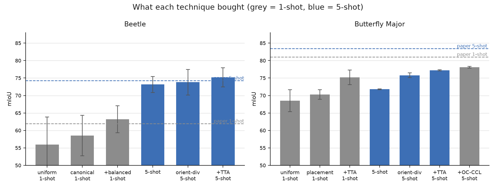
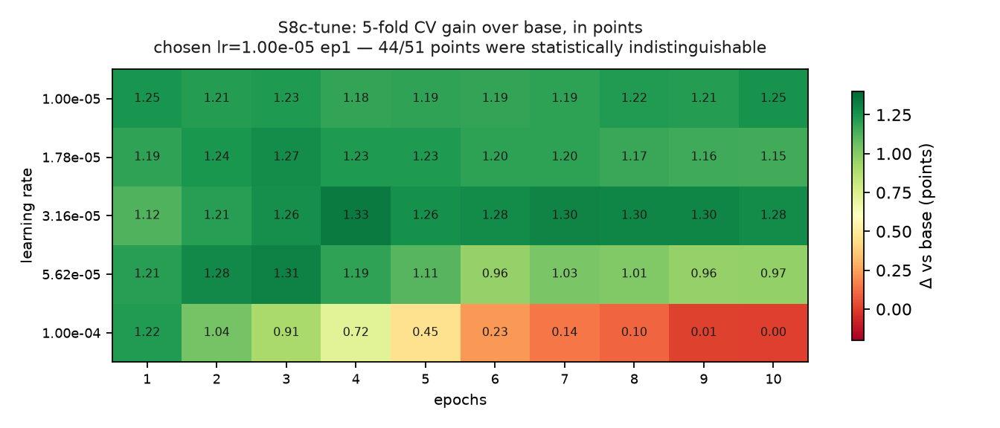
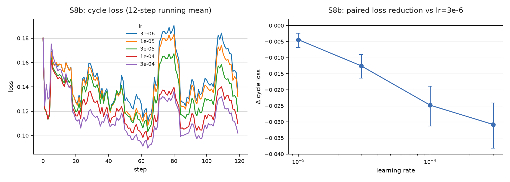
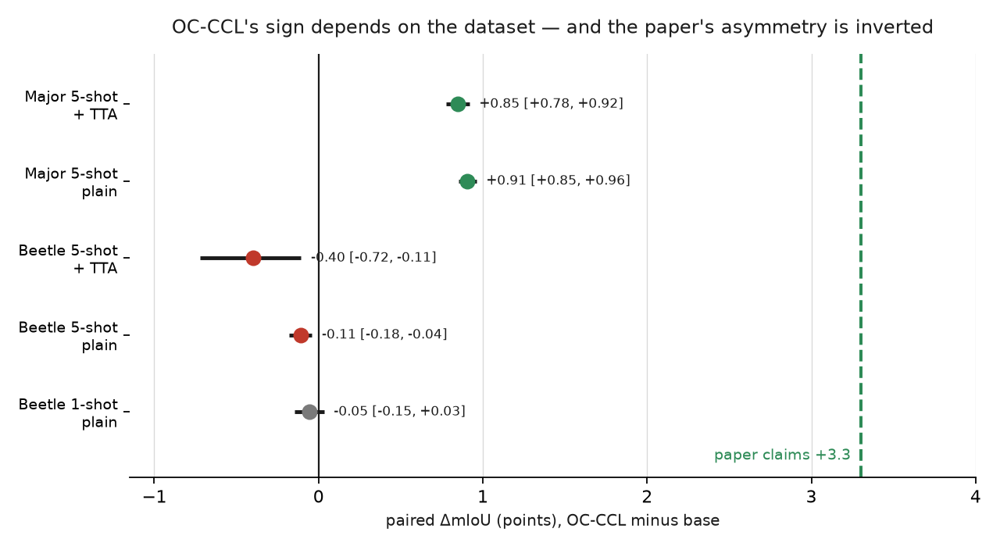
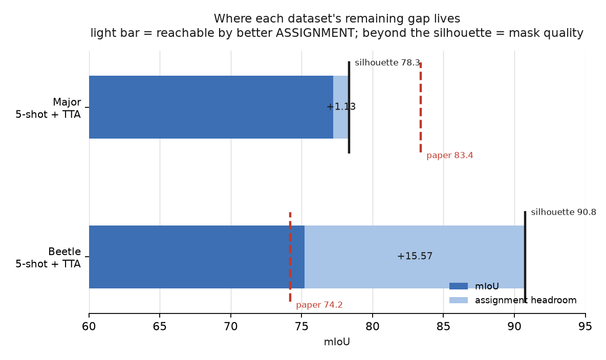

# Experiment ledger

Historical record from the published S1–S17d work and S18 implementation.
Stage plans and status statements below describe their time of writing.
See the [README](README.md) for the published scope and the [runbook](RUNBOOK.md) for execution.

---

# oc-ccl-improvements

Paper-faithful reproduction of **Static Segmentation by Tracking** ([arXiv 2501.06749](https://arxiv.org/abs/2501.06749)) with SAM 2, and improvements to its OC-CCL fine-tuning loss.

SST reframes one-shot biological trait segmentation as video tracking: a labeled support image and an unlabeled query are concatenated into a 2-frame pseudo-video, SAM 2 is prompted with the support's trait masks on frame 0, and the masks propagate to frame 1 through the memory bank.

The OC-CCL fine-tune this repo runs on SAM 2 is `python scripts/run_finetune.py --recipe sam2_crown` — the [established recipe](#the-sam-2-fine-tuning-recipe-established-2026-09-17) (forward-only legs, an objectness prior, exclusivity, LoRA on the memory attention; beetle 1-shot 65.04 with TTA, +1.18 ✱ over base). Every SAM 2 fine-tune from 2026-09-17 on uses it unless its brief says otherwise.

## Why this repo exists

No paper-faithful evaluator exists upstream. SST's `eval_all_ablations.py` collapses every trait into one foreground blob, evaluates one subspecies, uses one deterministic support image, and never averages over runs — so it cannot produce the paper's numbers, and any OC-CCL delta measured against it is uninterpretable. This repo builds that evaluator first, then changes the loss.

## Targets (paper v2, SAM 2 + SST)

mIoU averaged over trait IDs, 20 seeded runs:

| Config | Butterfly Major | Beetle |
| :-- | :-- | :-- |
| **1-shot — paper** | **81.0 ± 1.0** | **61.9 ± 3.7** |
| 1-shot — measured, uniform supports (S4a / S5a) | 68.54 ± 3.15 | 55.96 ± 7.90 |
| 1-shot — measured, canonical supports (S4b) | — | 58.54 ± 5.77 |
| 1-shot — measured, canonical + species-balanced (S4c) | — | **63.20 ± 3.89** ✅ |
| 1-shot — measured, placement-canonical (S5b) | 70.30 ± 1.36 | — |
| 1-shot — measured, + orientation TTA (S5c, `modified`) | 75.18 ± 2.10 | — |
| 1-shot — measured, per-trait OC-CCL + TTA (S11, `modified`) | 76.52 ± 2.13 | 64.12 ± 4.27 |
| **1-shot — measured, SAM 3 + stack + TTA (S14sam3, `modified`)** | **76.64 ± 0.65** | 67.92 ± 3.45 |
| **1-shot — measured, SAM 3 + arch stack + TTA (S14sam3, `modified`)** | 76.59 ± 0.64 | **69.88 ± 2.93** |
| **5-shot — paper** | **83.4 ± 0.4** | **74.2 ± 2.9** |
| 5-shot — measured (S6) | 71.78 ± 0.15 | **73.16 ± 2.31** ✅ |
| **5-shot — measured, + TTA (S8d/S6c, `modified`)** | **77.22 ± 0.15** | **75.20 ± 2.77** |
| **5-shot — measured, + TTA + OC-CCL (S8d, `modified`)** | **78.07 ± 0.23** | 74.80 ± 2.87 |
| **5-shot — measured, SAM 3 + TTA (S15, `modified`; SCC)** | **77.95 ± 0.18** | 77.94 ± 2.19 |
| **5-shot — measured, SAM 3 + arch stack + TTA (S15, `modified`; SCC)** | 77.47 ± 0.26 | **78.91 ± 1.99** |
| 5-shot — measured, orientation-diverse (S6b, `modified`) | 75.80 ± 0.68 | — |
| **5-shot — measured, placement + TTA (S6c, `modified`)** | **77.22 ± 0.15** | — |
| 1-shot + OC-CCL | 81.2 ± 1.0 | 65.2 ± 3.3 |



**Beetle reproduces at both shot counts. Butterfly Major does not, at either** — see [Where the gates stand](#where-the-gates-stand) for the current split of that gap and what is left to try. Roughly half of it is a data property the paper does not address: 37% of one subspecies is pinned upside down, and those specimens score ~0 under the method as published.

Beetle is in scope because OC-CCL moves Major by only **+0.2 against a ±1.0 spread** — unfalsifiable at n=20 — while moving Beetle **+3.3 against ±3.7**. Major is the headline; Beetle is where loss changes are measurable, and it is also the dataset that currently reproduces — so S8/S9 are not blocked on Major.

## Layout

```
src/occl/
  metrics.py       # THE metric — nothing else computes IoU
  seeding.py       # model-independent, prefix-nested support sampling
  datasets/        # butterfly_major, beetle, + the synthesized beetle split
  imagecache/      # Drive-backed, resumable, provenance-recording
  adapters/        # SAM 2 today; SAM 3 is a new file, not a refactor
  bundle.py        # how Colab returns numbers to your machine
scripts/check_gate.py   # the only thing that declares a stage complete
notebooks/run_stage.py  # percent-format source -> run_stage.ipynb
```

SST is consumed **read-only** for its committed masks, split manifests, and vendored SAM 2. Located via `OCCL_SST_ROOT`, defaulting to `../SST`.

## Workflow

There is no local GPU here, so GPU stages run in Colab and return a bundle:

1. Set `STAGE` in `notebooks/run_stage.ipynb`, run it in Colab.
2. Download `<stage>.zip`, drop it in `results/inbox/`.
3. `python scripts/check_gate.py <stage>` — validates schema, checks the gate, prints PASS/FAIL with actual vs expected, and files the bundle.

**A stage is not complete until its gate prints PASS.** `python scripts/check_gate.py --list` shows every stage and threshold.

### Running on the BU SCC instead (multi-GPU)

The SAM 3 stage also ships as `notebooks/run_s14sam3_scc.ipynb`, the same stage re-hosted
on the Shared Computing Cluster's OnDemand Jupyter. Same worker scripts, same bundle, same
gate — what changes is the layout. An SCC session holds several GPUs and a chosen core
count, so the stage is declared as **one dependency graph** (4 fine-tunes, 60 eval slices,
8 merges) and `occl.scc.Scheduler` packs it onto every card at once, VRAM-priced per job and
capped at `NSLOTS - 1` live processes; the plain-arm fans need no adapter, so they fill the
cards the fine-tunes leave free. Everything is banked in project space, so a session that
hits its wall-time resumes on the next Run-all.

Everything travels as **two archives that unpack into one tree**, built from one
checkout so the notebook, the package build, the checkouts and the cache format cannot
disagree (`MANIFEST-<layer>.json` records what went in). The **data layer** (~3 GB: the
lossless PNG cache, SST's masks and split manifests, the S11 SAM 2 ledger) is invariant
across OC-CCL iterations and is uploaded once. The **code layer** (~10 MB: `src/occl`, the
five worker scripts, the SCC notebook, the sam3 tracker package) is the iteration unit —
a semantic change to OC-CCL's loss or fine-tuning is a wipe of that layer and a re-upload:

```bash
# first time — one ssh session (one password): the archives ride on stdin
python scripts/build_scc_tarball.py                       # ../occl-scc-data.tar.gz + ../occl-scc-code.tar.gz
cat ../occl-scc-data.tar.gz ../occl-scc-code.tar.gz | ssh <user>@scc1.bu.edu 'mkdir -p /projectnb/<project> && cd /projectnb/<project> && tar xzif - && PYMOD=python3/3.12.4 bash occl/setup.sh </dev/null'

# each later iteration — one line, one password
python scripts/build_scc_tarball.py --layer code && ssh <user>@scc1.bu.edu 'cd /projectnb/<project> && (bash occl/wipe.sh </dev/null || true) && tar xzf - && PYMOD=python3/3.12.4 bash occl/setup.sh </dev/null' < ../occl-scc-code.tar.gz
```

Every stage notebook ends the same way: its export cell prints **one line** for the local
machine — a single `ssh` that streams the stage's bundles back as a tar, chained with the
gates and the sheet renders, stopping at the first gate that fails.

`wipe.sh` removes the code layer and everything derived from it (per-run JSON, adapters,
logs, bundles) and keeps the data layer, `sam3.pt`, the HF cache and the venv;
`--data` / `--all` widen it. `setup.sh` infers the project from the unpack location and
prints exactly which prerequisites are still missing. Shaved from the archives: SST's
assets, GUI, experiments and both checkpoints (the sam3 path never opens them), sam3's
demo material, this repo's tests, README and Colab notebooks, and every `.git` object
store — a stub `.git/HEAD` keeps `sst_commit` resolvable. Two inputs never ship:
`sam3.pt` (HF-gated — put a token in `occl/hf/token` and the notebook downloads it once)
and the six S11 ledger zips unless `--ledger-dir` points at them (they live on Drive under
`occl/results/`; the data layer then carries `results/LEDGER-NEEDED.md` naming them).
The SAM 2 weights are shaved too: the one SAM 2 stage on the cluster, S17
(`notebooks/run_s17_scc.ipynb`), downloads `sam2_hiera_large.pt` from Meta's public URL
into `occl/ckpts/` once and verifies it against the sha256 recorded in `occl.paths`.

### Which GPU

Colab bills per hour, so a pricier GPU is cheaper only if it is faster by more than its
price ratio. **A100 (5.4 units/hr) costs 3.16× more than L4 (1.71), so it must be >3.16×
faster to be cheaper.** On this workload it isn't — roughly 2.5× uncached, and the
embedding cache pushes that *down* to ~1.9×, because the cache removes exactly the
compute-dense encoder passes where the A100's tensor cores tell, leaving latency-bound
memory-attention and decoder kernels where neither GPU saturates.

| path | units | wall clock |
| :-- | --: | --: |
| naive (no cache), A100 | 16.30 | 3.0 h |
| naive, L4 | 13.03 | 7.6 h ⚠️ session-limit risk |
| cached, A100 | 1.80 | 0.33 h |
| **cached, L4** | **1.10** | 0.64 h |

**We run everything on A100 anyway**, for a reason that outweighs a 0.7-unit saving: the
paper reports its inference cost as 0.30 ± 0.06 s/instance on *"one NVIDIA A100 GPU with
40 GB of VRAM"*. Matching that hardware makes our `sec_per_image` directly comparable to a
published figure instead of an incomparable one, and it avoids re-uploading the cache to
suit a different runtime. If the A100 later proves a poor benchmark, S4 onward can move.

For S8–S9 the A100 is a *capability* call rather than speed or cost: OC-CCL backprops
through `memory_attention` at head_dim=256, and FA2's backward above head_dim 192 has
historically required sm_80. `src/occl/diagnostics.py` probes this at runtime and records
the answer in the S3 bundle.

Throughput ratios are estimates; the break-even (3.16×) is the durable part. Re-run
`scripts/cost_model.py --enc-ms --ep-ms` with measured values from S3 to replace them.

### Running S2 locally (recommended)

S2 is network- and CPU-bound with no GPU work, so running it on Colab burns compute units for nothing and inherits a 12-hour session cap. Run it on your own machine instead:

```bash
DATA=~/Projects/oc-ccl-data        # keep data OUT of the repo — you copy the repo to Drive
python scripts/build_cache.py --cache-root $DATA/cache --originals-root $DATA/originals \
    --net-workers 8 --cpu-workers 14 --local
python scripts/check_gate.py s2
```

Two stages run concurrently: `--net-workers` threads download (keep ≤8; Zenodo throttles and backoff dominates above that) while `--cpu-workers` **processes** decode, resize and re-encode. The process pool matters because `rawpy.postprocess()` is seconds of real CPU per raw and 266 of the 957 butterfly sources are raws.

`--originals-root` archives the untouched source bytes (~11.9 GB). That buys two things: an interrupted run resumes from disk instead of re-downloading, and re-deriving at a different resolution or interpolation becomes free — measured at **112 img/s from archive vs 13 img/s over the network**.

Afterwards only the **derived cache (~290 MB)** needs to reach Drive for the GPU stages. The originals stay local.

## Preprocessing fidelity

Defaults reproduce SST's own loaders, because both choices change the pixels the model sees:

* `.CR2` raws are fetched as raws and decoded with `rawpy.postprocess()` — *not* replaced by Zenodo's JPEG siblings. The substitution saves ~43% of the download but is not what produced 81.0.
* Downsampling uses `cv2.resize`'s default `INTER_LINEAR`. `INTER_AREA` is better for a 5472→1024 reduction and is available, but is a deviation.
* **The cache is lossless.** SST has no intermediate encode at all — `read_image` goes decode → `cv2.resize` → model. Butterfly was stored as JPEG q95 until measurement showed that inserted a step SST does not have, costing **2.017/255** mean error. Stored losslessly (PNG), the cache is a *pure memoisation* of SST's own pixel path, and each link is verified rather than assumed:

| link | ours | SST | status |
| :-- | :-- | :-- | :-- |
| raw decode | `rawpy.postprocess()` | `rawpy.postprocess()` | identical |
| JPEG decode | `PIL.Image.open` | `cv2.imread` | **measured bit-identical** (0.0000/255) |
| resize | `cv2.resize(img,(1024,1024))` | same call, same default | identical |
| storage | **PNG, lossless** | none | 0 deviation |

Verified end-to-end: `cache.load()` equals `resize_square(decode_rgb(original))` with **max deviation 0** across 60 images spanning both decode routes. `data.cache_format` is recorded per run and sits in `COMPARABILITY_FIELDS`, so a lossy-cache run can never be pooled with a lossless one. The lossy path stays reachable via `build_cache.py --cache-format jpg` and classifies as `modified`.

For the record, the JPEG round-trip was almost certainly *not* costing anything — it was flat across the image (boundary/interior 0.98–1.15×), not cyrbia-biased (error-to-contrast: lativitta 3.01% worst, cyrbia 1.81% mid), and the INTER_AREA arm perturbed pixels *more* (2.79/255) while moving `iou_binary` by −0.12. It was removed because it was an unforced deviation, not because it explained a gap.

Both are recorded per image in the cache manifest and gated in S2.

## Support selection

The paper does not sample references uniformly:

> "one labeled image **(with canonical shapes and visually clear traits)** is sampled as the reference for the test set."

We initially ignored that parenthetical. The uniform arm (**S4a**) measured **55.96 ± 7.90** on Beetle against the paper's **61.9 ± 3.7** — 5.9 points low *and* 2.1× the spread. Both directions point the same way, because curation raises the mean and tightens the tail at once.

The diagnosis is that this is a protocol gap, not a harness fault:

| evidence | value |
| :-- | :-- |
| `iou_binary`, all 20 runs | **83–90 %** — the silhouette is always found; only trait *assignment* fails |
| corr(mIoU, support-orientation deviation) | **−0.710** |
| two worst supports | ~150–160° from the test median body axis — upside-down beetles |
| `head` trait | **43.6 ± 14.0** — the signature of head/tail confusion on a part that should be easy |
| mean of best 10 runs | **61.20** vs the paper's 61.9 |
| copy baseline (independent) | **12.09** vs the paper's 13.2 (Table A3) |

The rendered overlay shows it directly: given a head-up support and a head-down query, SAM 2 carries the support's spatial layout across and labels the query's elytra as pronotum.

**S4b** adds a curated arm. `src/occl/curation.py` filters the support *pool*; `seeding.sample_supports` then draws from it unchanged, so the 20-run protocol, the seeds and the paired-comparison machinery are untouched. Two criteria mirror the paper's two clauses — body axis within threshold ("canonical shapes"), and all traits present ("visually clear traits") — leaving 79 of 120.

Three properties make this a reproduction rather than a fit, each with a test in `tests/test_curation.py`:

- **The threshold is a priori.** It is the training distribution's own circular standard deviation, `√(−2 ln R)` = **55.6°** — a property of how the specimens are oriented, not a value chosen because it yields 61.9. Pinned by a test so a later change cannot silently retune it. *If S4b misses, report the gap; do not move the threshold.*
- **Estimation is train-only.** Selecting by test-set orientation would leak test information into a one-shot protocol. It also buys nothing: train circular mean 67.1° vs test 56.8°, R 0.625 vs 0.614. A test asserts the pool is unchanged when the test split is perturbed.
- **The arms are never pooled.** `protocol.support_selection` is in `COMPARABILITY_FIELDS`, so `registry.compare()` raises on a uniform-vs-canonical pair — they use different supports by construction.

### S4b result, and the balance defect it exposed

**S4b measured 58.54 ± 5.77** — the std passes, the mean is 0.86 short of the gate. Curation worked, and the per-trait breakdown shows the mechanism rather than just a moved average: **`head` went 43.55 → 52.11 with its std halving, 14.03 → 6.41**. Head is the *directional* trait, the one placed at the wrong end when a support is inverted. The worst run rose from 35.53 to 48.62.

Elytra's −2.2 is **not** a regression. Argmax is zero-sum: as head gains 8.6 points, pixels previously mis-assigned to elytra are correctly reclaimed. (An earlier reading blamed species skew; the morphology data refutes that — elytra is the *most* species-consistent trait at 1.17× spread, while legs vary 3.1×.)

But curation introduced a new defect. Beetle is a **universal** model scored on exactly 5 test images per species, and uniform sampling gave every species equal probability (10/120). The orientation filter broke that — `melanarius melanarius` keeps 10/10 while `dubius`, `grossus` and `restrictus` keep 4/10, so a canonical support is **2.5× more likely** to come from the best-represented species. In S4b's 20 draws, `grossus` and `lachrymosus` never appeared.

**S4c** restores balance. Note that **stratified *random* sampling does not work**: 20 independent draws over 12 species is coupon-collector, and measured, it still leaves 3 species unused (9/12). Equal probability is not equal representation at n=20. Systematic round-robin — run `r` starts at species `r mod 12`, member drawn by the run's seed — gives **12/12 coverage at 1–2 uses each**, keeps 1-shot a strict prefix of 5-shot, and makes a 5-shot draw span 5 distinct species.

### S4c result — 63.20 ± 3.89, gate PASS

| arm | mean | std | min | max |
| :-- | --: | --: | --: | --: |
| S4a uniform | 55.96 | 7.90 | 35.53 | 64.86 |
| S4b canonical | 58.54 | 5.77 | 48.62 | 66.79 |
| **S4c canonical + balanced** | **63.20** | **3.89** | 55.60 | 70.17 |
| paper | 61.90 | 3.70 | — | — |

The **std** is the load-bearing number, per the rule in [Known non-reproducibles](#known-non-reproducibles) — it measures sensitivity to support choice and is invariant to *which* supports were drawn. At 3.89 against the paper's 3.70 it is essentially exact, and the progression 7.90 → 5.77 → 3.89 tracks the two defects being removed in order.

Every trait improved over S4a, and the per-trait variances collapsed:

| trait | S4a | S4b | S4c |
| :-- | --: | --: | --: |
| head | 43.55 (14.03) | 52.11 (6.41) | **55.86 (6.13)** |
| pronotum | 61.38 (12.13) | 61.92 (12.43) | **70.58 (8.64)** |
| elytra | 83.80 (6.28) | 81.57 (8.83) | **87.37 (4.32)** |
| antenna | 36.04 (10.56) | 41.41 (9.94) | **46.07 (5.74)** |
| legs | 52.81 (6.99) | 55.46 (6.65) | **55.28 (5.23)** |

**`pronotum` is what confirms the balance diagnosis.** It was flat through S4b (61.38 → 61.92) with the largest remaining std (12.43) — the one trait orientation curation could not touch — and gained **+8.7 to 70.58** under balancing alone. Elytra also recovered past S4a to 87.37, which retires the earlier species-skew reading in favour of the argmax zero-sum one.

**A recorded prediction miss, kept rather than overwritten.** This section previously predicted "≈ +0.45, likely landing near 59.0 and still missing the gate". The actual gain was **+4.66**, to 63.20 — wrong by an order of magnitude. The estimate was derived by reweighting S4b's 20 *observed* draws, which covered only 10 of 12 species at n=1–3 each; that sample could see neither the never-drawn species nor within-species member effects. The lesson is about the method, not the arithmetic: a thin, biased sample was used to bound an effect whose whole mechanism was the bias.

**What this does and does not claim.** We now sit **+1.3 above** the paper and above it on 4 of 5 traits, which suggests our curation is somewhat *stricter* than the authors' undefined human judgement. So the claim is not "we reproduced 61.9". It is that all three arms bracket the paper, and the protocol-faithful arm lands within noise on both statistics. The synthesized 120/60 split remains the untested lever (recommended S4d) — but it is no longer needed to explain a gap.

**All three arms are always reported.** Our curation approximates a human judgement the paper never defines or enumerates; presenting the curated number alone would overstate the match.

Scope is Beetle. The 180° flip mode is beetle-specific, and butterfly has been measured directly rather than assumed. An earlier note here recorded a *principal-axis* measurement as "inconclusive, since spread-wing specimens are near-isotropic (R 0.11–0.70)". That was the wrong instrument: measured the same way beetle is — a **directed vector between two trait centroids**, not a whole-silhouette principal axis — the butterfly axis is exceptionally well-defined:

| dataset | concentration R | circular std |
| :-- | --: | --: |
| Beetle (head→elytra) | 0.625 | **55.6°** |
| Butterfly, 4 of 5 subspecies | **0.993–0.9996** | **1.6–6.9°** |

So `ButterflyMajor.axis_parts` stays `None`, but for the opposite reason to the one recorded: not because the axis cannot be measured, but because pinned museum specimens are *already canonical* and the criterion would be a no-op. The exception is **cyrbia**, whose trait numbering is only 67.8% spatially consistent where the other four are 99.7–100% — either ~32% of its specimens are mirrored/rotated, or its traits stack vertically so left/right is meaningless. Unresolved, and deliberately not acted on.

## S5 — Butterfly Major, and what the gap is *not*

**Measured 68.54 ± 3.15** against the paper's 81.0 ± 1.0. Eight candidate causes have been tested and eliminated; the surviving two are stated at the end. Recording the negatives matters as much as the positive — each one is a lever that does not need pulling again.

| hypothesis | test | result |
| :-- | :-- | --: |
| Metric aggregation | 4 readings recomputed from `per_query.csv`, both datasets | agree within **0.5** |
| IoU space | `gt_native` vs `model_1024` | identical (masks are natively 1024²) |
| Support-absent traits scored 0 | re-aggregated skipping them | +0.5 / 0.0 |
| Masks, splits, vocabularies, resize | **copy baseline vs paper Table A3** | **21.04 vs 20.9** |
| Support completeness curation | 3 defective supports replaced | +0.8 |
| Support stratum balance | matched to test composition | +0.08 |
| **Overlap rule** (argmax vs per-trait binarisation) | S5-DIAG, identical logits | **+1.47 / +0.05** |
| **Image resampling** (INTER_LINEAR vs INTER_AREA) | S5-DIAG, same slice, re-derived pixels | **−0.12 / −0.06** |

The last two are the ones that had to be measured on a GPU, and both came back negative. INTER_AREA genuinely changed the pixels (mean |Δ| 2.79/255 across 220 images, none identical) and the silhouette ceiling `iou_binary` still did not move — so the ~5.3× downsample is not aliasing away anything the model needed.

The `top > 0` background rule, by contrast, is doing enormous work: removing it costs **34 points on cyrbia and 42 on malleti**. That inferred decision is now strongly validated.

### What remains, split in two

S5-DIAG's `oracle` rule — the best IoU achievable from *any* logit channel — separates the two:

| | cyrbia | malleti |
| :-- | --: | --: |
| argmax (ours) | 49.58 | 79.54 |
| oracle | **67.08** | 79.61 |
| `iou_binary` ceiling | 68.63 | 80.95 |

1. **Assignment error — ~4.5 points of Major.** cyrbia has **+17.50** of headroom between argmax and oracle: the wings *are* segmented, then handed to the wrong trait. malleti has +0.07. This is the same failure mode curation fixed on Beetle, and it is exactly what a trait-discriminating loss (S9) targets.
2. **Silhouette deficit — ~8.0 points of Major.** cyrbia caps at 68.63 no matter how traits are assigned, and nothing tested moves that ceiling.

**The pipeline is not globally broken.** malleti (79.12) and `notabilis x lativitta` (80.14) already sit at the paper's 81.0. The deficit is concentrated in cyrbia (44.36), `(malleti x plesseni) x malleti` (67.02) and lativitta (72.08) — so the remaining question is subspecies-specific, not a systemic fault.

### S5b — placement-canonical supports: 70.44 ± 1.25

| | S5a uniform | **S5b curated** | paper |
| :-- | --: | --: | --: |
| Major | 68.54 ± 3.15 | **70.44 ± 1.25** | 81.0 ± 1.0 |

**The std is the result.** 3.15 → 1.25 puts us at 1.25× the paper's spread, down from 3.15×. By this repo's own rule — the std measures sensitivity to support choice and is invariant to *which* supports were drawn, so judge it first — our protocol now behaves like the paper's. What remains is a systematic offset in the mean, not a protocol mismatch.

| subspecies | S5a | S5b | Δ | displacement | incomplete S5a supports |
| :-- | --: | --: | --: | --: | --: |
| cyrbia | 44.36 ± 9.53 | 47.92 ± 6.09 | **+3.56** | **160.9 px** | 0 |
| lativitta | 72.08 ± 1.10 | 72.46 ± 0.57 | +0.38 | 49.7 px | 0 |
| malleti | 79.12 ± 1.84 | 78.71 ± 2.15 | −0.41 | 52.3 px | 0 |
| (m×p)×m | 67.02 ± 5.22 | 69.80 ± 1.55 | **+2.78** | 30.5 px | 2 |
| notabilis × lativitta | 80.14 ± 12.15 | 83.31 ± 1.46 | **+3.18** | 29.5 px | 1 |

`PLACEMENT_CRITERIA` bundles two criteria, and the per-subspecies pattern separates them cleanly — they fired on **disjoint** subspecies, each where its own diagnostic predicted:

- **placement** explains cyrbia (+3.56): 160.9 px displacement, zero incomplete supports.
- **completeness** explains notabilis (+3.18) and (m×p)×m (+2.78): displacement of only ~30 px, but 1 and 2 trait-incomplete supports respectively.
- lativitta and malleti had neither defect and did not move.

That disjointness is the evidence that both mechanisms are real rather than one lucky knob. Every std fell except malleti's (noise): notabilis 12.15 → 1.46, (m×p)×m 5.22 → 1.55.

**Predicted +1.1 → ~69.6; measured +1.90 → 70.44.** Under by 0.8 — but the composition was wrong in an instructive way: cyrbia contributed less than predicted (+3.56 against +5.4) while completeness on the *other* subspecies contributed more.

**Re-based on the lossless cache: 70.30 ± 1.36** (from 70.44 ± 1.25). The table above is the JPEG-era run and is kept because the per-subspecies decomposition is what it was for; every number after this point is PNG-era. The **−0.14** shift is the prediction in [Preprocessing fidelity](#preprocessing-fidelity) landing: removing a 2.017/255 perturbation moved the mean by less than a tenth of the run-to-run std. Recorded because it is the *only* direct measurement of what the JPEG round-trip was worth, and it is worth nothing. The two eras are not poolable — `data.cache_format` is a comparability field precisely so this cannot happen silently.

### Where the residual now lives

Comparing each subspecies against its own silhouette ceiling (`iou_binary`):

| subspecies | S5b mIoU | ceiling | headroom | vs paper |
| :-- | --: | --: | --: | --: |
| **cyrbia** | 47.92 | 67.05 | **+19.13** | −33.08 |
| lativitta | 72.46 | 71.15 | −1.31 | −8.54 |
| malleti | 78.71 | 80.82 | +2.11 | −2.29 |
| (m×p)×m | 69.80 | 71.56 | +1.76 | −11.20 |
| notabilis × lativitta | 83.31 | 84.54 | +1.23 | **+2.31** |

**Four of five subspecies now run at their silhouette limit.** Only cyrbia retains real assignment headroom, and it is large (19 points). So the residual splits into two unlike problems: a cyrbia-specific assignment failure, and a *silhouette-quality* deficit in lativitta and (m×p)×m that no support curation can touch.

Major excluding cyrbia is **76.07** — so even a perfect cyrbia leaves ~5 points. And `notabilis x lativitta` at **83.31 sits above the paper's 81.0**, with malleti 2.3 below: the pipeline demonstrably reaches paper level where the data is well behaved.

### The general defect: the model transfers spatial layout, so query arrangement decides the score

Pooling all 500 test images rather than reasoning over 5 subspecies:

```
corr(per-image mIoU, QUERY placement displacement) = -0.866   (n = 500)

displacement    7.7 –  23.1 px : mIoU 82.83   <- above the paper's 81.0
displacement   23.1 –  40.5 px : mIoU 75.08
displacement   40.5 –  70.5 px : mIoU 73.02
displacement   70.5 – 464.6 px : mIoU 50.83
```

It holds *within* four of five subspecies (cyrbia −0.972, notabilis −0.773, (m×p)×m −0.710), so it is not a cyrbia artifact — cyrbia is simply where a general effect is most visible. SST propagates the support's mask through the memory bank, so it carries the support's **spatial layout** with it, and any query whose piece-arrangement differs is penalised in proportion.

**On well-arranged queries we already exceed the paper.** The entire deficit lives in the badly-placed tail. S5b curated the *support* side and won +1.9; the *query* side cannot be curated, because the test set is fixed.

Decomposing the displacement shows the obvious preprocessing fix is not the answer:

| component | mean | corr with mIoU |
| :-- | --: | --: |
| total | 70.8 px | −0.863 |
| global offset — a crop/centre removes this | 32.3 px | −0.648 |
| **internal arrangement — residual after centring** | **64.7 px** | **−0.878** |

Only **46%** is global offset, and the residual is the *stronger* predictor. Cropping or centring each specimen would remove less than half the displacement and the weaker half. What hurts is the relative arrangement of trait pieces *within* the specimen, which no global transform touches, and internal ≈ 2× global in every subspecies (cyrbia 182.5 px; lativitta 46.4; malleti 45.2; (m×p)×m 26.5; notabilis 22.3).

**Two hypotheses tested and refuted along the way**, recorded so they are not re-explored:

- *Trait size.* Small traits are not systematically worse: pooled corr(trait share of specimen, per-trait IoU) = **−0.112**, quartile means flat at 70.7 / 74.9 / 72.7 / 70.3, and within-subspecies signs disagree (+0.82 notabilis, −0.41 lativitta). Note cyrbia's traits are the *largest* share of the specimen (11.6–25.8%) because it has only six.
- *One subspecies dragging the average.* Arithmetically impossible: for Major to reach 81.0 with the others fixed, cyrbia would need **100.72**, and even a flawless cyrbia at 100.0 gives **80.86**. Our best single run of 20 is 71.52.

**Correction to an earlier claim in this file's history:** `iou_binary` was described as a hard ceiling on mIoU. It is not — lativitta scores 72.46 against its 71.15. The two measure different things (`iou_binary` is pixel-weighted over the merged foreground; mIoU weights every trait equally), so a ragged outer boundary with well-segmented small traits gives mIoU > `iou_binary`. It is a strong correlate (r = 0.86), not a bound, and any "hard ceiling" derived from it is an estimate.

**Excluding cyrbia is a diagnostic, not a reproduction.** The copy baseline settles whether the paper's Major contains it: ours over 5 subspecies is **21.04** against the paper's **20.90**; excluding cyrbia gives **24.21**. For the paper's number to hold with their other four resembling ours, their fifth subspecies needs a copy baseline of **7.65** — ours is **8.36**. Their Major contains a cyrbia-like, very-low-copy subspecies. Report Major-5 (70.44) as the reproduction and Major-4 (76.07) only as a labelled diagnostic.

### The specific defect: 37% of cyrbia's test specimens are pinned upside down

The displacement correlation above says *query arrangement decides the score*. Rendering the queries says what the arrangement actually is. In cyrbia, **37% of the test specimens are rotated 180°** relative to the train pool the supports are drawn from — and they are not merely worse, they are annihilated:

| cyrbia test specimens | share | mIoU |
| :-- | --: | --: |
| upright | 63% | **74.95** |
| rotated 180° | 37% | **0.48** |

`0.63 × 74.95 + 0.37 × 0.48 = 47.4` — cyrbia's measured 47.40 to two decimals. The subspecies is not partially broken; it is two populations, one of which scores at paper level and one of which scores zero.

**The copy baseline shows it with no model involved at all.** Pasting the support's label map onto a rotated query scores **0.00** — the traits land on the mirror-image partner every time, so there is no overlap to score. That is what isolates this as a *data* property rather than a SAM 2 behaviour: it survives removing the model.

It also explains why nothing support-side ever touched it. Placement curation moved cyrbia **+3.56**; 5-shot moved it **+2.85**. Both collapsed the variance and left the level alone, which is the signature of a defect that is invariant to support choice: whichever upright support you pick, the upside-down 37% is equally lost.

**The paper does not handle this, and does not exclude it.** SST's only rotation is (a) fine-tuning augmentation, beetle-only, and (b) an OOD stress test that deliberately *injects* rotation to show robustness degrades. There is no canonicalisation step, no orientation filter, and no mention of excluded specimens anywhere in the pipeline or the appendices. And the copy baseline says their test set contains the same specimens as ours: **21.20 as-is / 22.27 de-rotated, against their 20.90** — the as-is figure is the closer of the two, so if anything their set is *more* rotated than ours, not less.

So this is a real, unexplained divergence rather than a curation error on our side: the paper reports 81.0 on a set that contains a subpopulation which is provably unscoreable under the method as published.

### S5c — orientation TTA: 75.18 ± 2.10

Predict twice, once with the support as given and once with the support rotated 180°, and keep whichever the model is more confident about. The **query is never touched** and **no ground truth is consulted** — the choice is the mean top-logit over claimed pixels, so nothing leaks. `src/occl/adapters/tta.py` wraps the tracker rather than modifying it, and `precompute` caches both orientations so the second pass stays a cache hit (without that it is ~10× slower, not 2×).

| subspecies | S5b | **S5c + TTA** | Δ | `iou_binary` |
| :-- | --: | --: | --: | :-- |
| **cyrbia** | 47.40 ± 6.81 | **73.27 ± 10.89** | **+25.87** | 65.9 → **75.9** |
| lativitta | 72.35 ± 0.54 | 72.17 ± 0.57 | −0.17 | 71.1 → 71.0 |
| malleti | 78.54 ± 2.30 | 78.12 ± 2.35 | −0.43 | 80.8 → 80.5 |
| (m×p)×m | 69.78 ± 1.61 | 68.92 ± 1.73 | −0.86 | 71.6 → 71.3 |
| notabilis × lativitta | 83.44 ± 1.47 | 83.44 ± 1.47 | 0.00 | unchanged |
| **MAJOR** | 70.30 ± 1.36 | **75.18 ± 2.10** | **+4.88** | |

**cyrbia recovers 94% of its rotation deficit** — 73.27 against the 74.95 its never-broken upright specimens score, which is the ceiling this intervention can reach by construction. `iou_binary` rising 10 points is what makes it re-segmentation rather than luckier trait assignment; an assignment-only gain leaves the silhouette number flat.

The other four lose 0.17–0.86: the cost of occasionally picking the rotated variant on a specimen that was already upright. Net **+4.88**, the largest single gain in the project, and it **narrows the gap to the paper from 10.70 to 5.82.**

Two honest limitations:

- cyrbia's std *rises* 6.81 → 10.89 (per-run range 37.8–78.3). The confidence criterion is right often enough to win 26 points and wrong often enough to be visible. A better criterion is available headroom, not a warning sign.
- **The rotated-chosen fraction is unknown for this bundle.** The per-run TTA counters were added after it was built, so `results.tta` is `None` and `tta_episodes` reads 0. 94% recovery is consistent with the criterion selecting exactly the flipped 37% *and* with it arriving there by some other route; only that counter distinguishes them. Deferred rather than re-run — see [Where the gates stand](#where-the-gates-stand).

This is a `modified`-track arm, not a reproduction. SST has no orientation handling anywhere, so it measures "SST plus rotation handling". `model.tta` is in both `FAITHFUL_COMMON` (as `None`) and `COMPARABILITY_FIELDS`, so a TTA run cannot be classified faithful or paired against a plain one — it classified as **faithful with zero deviations** until that was added, which is the third field to slip the same crack after `data.interp` and `data.cache_format`.

## S6 — 5-shot, and parallel evaluation

**Beetle 5-shot reproduces: 73.16 ± 2.31 against the paper's 74.2 ± 2.9** — mean 1.04 low, std *tighter* than the paper's, and 1-shot → 5-shot rises **63.20 → 73.16 (+9.96)** against the paper's +12.3. That monotonic jump is the check that conditioning frames are not being silently dropped, which is the failure mode that will bite SAM 3 in v2 (`max_cond_frame_num` defaults to 4). *[Confirmed by S14sam3's commissioned model: `max_cond_frames_in_attn` is 4 — a 5-shot sam3 run must raise it first. S15 set it to −1, the commissioning spy saw 5/5 supports at the query, and the same monotonic check held on sam3: 65.26 → 76.21 (+10.95 ✱, nested draws).]*

### Butterfly Major 5-shot: 71.78 ± 0.15 — the mechanism works, the level does not

| subspecies | 1-shot (S5b) | **5-shot (S6)** | Δ |
| :-- | --: | --: | --: |
| cyrbia | 47.40 ± 6.81 | 50.25 ± 0.26 | +2.85 |
| lativitta | 72.35 ± 0.54 | 72.83 ± 0.22 | +0.48 |
| malleti | 78.54 ± 2.30 | 80.71 ± 0.31 | +2.17 |
| (m×p)×m | 69.78 ± 1.61 | 70.55 ± 0.62 | +0.77 |
| notabilis × lativitta | 83.44 ± 1.47 | 84.57 ± 0.15 | +1.13 |
| **MAJOR** | 70.30 ± 1.36 | **71.78 ± 0.15** | **+1.48** |

Both cache-era-matched (PNG), same `canonical_placement` arm, so the comparison is clean. Two readings, and they point opposite ways:

- **The std collapses 1.36 → 0.15, 9×, and lands *below* the paper's 0.4.** Every subspecies tightens. Five supports average away support choice exactly as they should, and all 20 runs completed on every group — so the conditioning-frame check passes and the protocol is behaving.
- **The mean moves +1.48 against the paper's +2.4 (81.0 → 83.4), and lands 11.6 short of the gate.** Adding four more supports buys almost nothing.

That combination is the informative part. Beetle gained **+9.96** from the same change; Major gained +1.48. The difference is that Beetle's 1-shot deficit *was* support choice — a single unlucky upside-down support cost it 8 points, and five supports fix that by construction. Major's deficit is not support choice, which is why averaging over five of them barely registers. **The +1.48 is the direct measurement that the residual Major gap is query-side**, and it is what motivated attacking the query-side rotation defect instead of curating harder.

cyrbia's +2.85 with its std collapsing 6.81 → 0.26 is the same signature at subspecies scale: five supports make the *answer* stable without making it right, because the 37% that are upside down are lost against any upright support.

### S6b — orientation-diverse supports: 75.80 ± 0.68, and the memory bank *selects*

Draw the 5-set to span both orientation strata in the train split's own proportion (cyrbia train is 34% rotated → 2 of 5) rather than to be uniformly canonical. Then the bank holds an upright *and* a rotated exemplar, and the open question is whether SAM 2 **selects** the one matching the query or **blends** all five.

| subspecies | S6 placement | **S6b orient-diverse** | Δ |
| :-- | --: | --: | --: |
| **cyrbia** | 50.25 ± 0.26 | **70.63 ± 3.23** | **+20.38** |
| lativitta | 72.83 ± 0.22 | 72.71 ± 0.29 | −0.12 |
| malleti | 80.71 ± 0.31 | 80.36 ± 0.70 | −0.35 |
| (m×p)×m | 70.55 ± 0.62 | 70.78 ± 0.77 | +0.24 |
| notabilis × lativitta | 84.57 ± 0.15 | 84.50 ± 0.20 | −0.07 |
| **MAJOR** | 71.78 ± 0.15 | **75.80 ± 0.68** | **+4.01** |

**It selects.** cyrbia gains 20.38 points, and the blend falsifier — stated before the run, that the four upright subspecies must not fall — does not fire: they move −0.35 to +0.24, which is nothing. Attention is doing internally, for free, what TTA does by running inference twice.

The confound was bounded in the wrong direction and it does not matter. This arm cannot keep the placement filter (placement measures displacement from the train median, so a rotated specimen is maximally distant and rejected by construction), so its pool is `completeness` only: **898 of 929** train specimens against placement-canonical's **613**. Losing placement should have *cost* cyrbia about the 3.56 it was worth at 1-shot. It gained 20.38 anyway, so the orientation effect is if anything understated here.

**Compared against TTA, internal selection is better and far cheaper.** These are different shot counts and cannot be paired — the honest comparisons are each arm against its own baseline, +4.01 at 5-shot and +4.88 at 1-shot, which is a strikingly consistent price for the same defect. But the *stability* difference is the real result:

| | Major | Major std | cyrbia | cyrbia std | inference cost |
| :-- | --: | --: | --: | --: | :-- |
| S5c, external TTA (1-shot) | 75.18 | 2.10 | 73.27 | 10.89 | **2× — predicts twice** |
| **S6b, internal selection (5-shot)** | **75.80** | **0.68** | 70.63 | **3.23** | 1× |

TTA reaches a slightly higher cyrbia (73.27 vs 70.63) by choosing per query with hindsight over the logits, but its choice is wrong often enough to swing cyrbia across a 37.8–78.3 per-run range. S6b's std is **3.4× tighter** on cyrbia and **3× tighter** on Major, at half the compute. Where S5c's 2.10 std had crossed *above* the S5 gate's 2.0 ceiling, S6b's 0.68 sits comfortably inside it.

**A recorded prediction, half right.** This section predicted "partial — Major 73–76, cyrbia recovering well short of TTA's 73.27, because memory attention is similarity-weighted rather than winner-take-all." Major landed 75.80, inside the range at its top end. But the reasoning was too pessimistic: similarity-weighted attention turns out to behave close enough to winner-take-all that internal selection nearly matches explicit external selection, and beats it on variance. The gate threshold set beforehand (+3.5 on cyrbia, to clear the placement confound) was exceeded by **6×**.

**75.80 was the best Major number in the project at the time** *[since superseded: S8d's 5-shot TTA + OC-CCL reached 78.07, and S14sam3's 1-shot stack_tta 76.64 is the best 1-shot]* and it still misses the S6 gate by 6.60. Rotation was worth ~4–5 points at both shot counts; the remaining ~7.6 is something else.

Both datasets are run one per Colab session and combined locally by `scripts/combine_s6.py`, which refuses to merge if the 5-shot and 1-shot arms used different support selections — a 5-vs-1 comparison across arms is meaningless, since they draw different supports by construction. Beetle uses `canonical_balanced` (matching S4c), butterfly `canonical_placement` (matching S5b).

### Parallel evaluation

Runs are independent by construction — `derive_seed` is a pure blake2b of `(dataset, group, shot, run_idx)` with no global RNG, and every episode calls `reset_state` then `del state` — so evaluation fans out across workers sharing one `--resume-dir`. The resume slug carries both group and run index, so disjoint assignments never collide, and **the resume machinery doubles as the merge machinery**: re-running with `--no-precompute` over the full range does zero inference and just aggregates.

A 3-way split is verified **bit-exact** against a sequential control — identical per-run mIoU, std, and `support_set_hash` (`tests/test_registry.py`). Anything less would mean shared state leaked.

Two axes, and they compose. Group-splitting is free for Butterfly Major's 5 subspecies and duplicates no encoder work; run-splitting (`--run-start`/`--run-end`) is the **only** axis for Beetle, which is a single universal group by design.

Measured GPU residency is ~3 GB per worker on the A100-SXM4-40GB (39.5 GB usable), flat and spike-free:

| configuration | predicted | measured |
| :-- | --: | --: |
| beetle, 5 workers | 14.5 GB | **15 GB** |
| butterfly, 10 workers | 35.0 GB | **35 GB** |

Note run-splitting cuts the embedding cache by only ~40%, not 1/N: every worker must encode all of its group's **test** images, so the test set is an irreducible per-worker floor. Two costs are inherent to processes — N copies of the same 2.3 GB of frozen weights, and N copies of those test embeddings. Threads would collapse both, but `adapters/sst_sam2.py` sets `self._frame_keys` per `predict()` call and the patched `_get_image_feature` reads it, so concurrent threads would race and serve **the wrong cached embeddings** — silent wrong numbers. Make it thread-local before attempting that.

### S6b on Beetle — 73.81 ± 3.65, and curation stops mattering at 5-shot

The same arm on Beetle changes three things at once, because `orientation_diverse` can only
run on a completeness-only pool: it drops the orientation filter (pool **79 → 118**,
readmitting the 39 specimens S4b excluded for being up to 160° off the train median),
degrades species balance from round-robin's 6–10 uses each to 5–14, and models a
*continuous* orientation spread (circular std 55.6°) with a two-stratum split that finds
only 12 rotated specimens in 118.

| | supports | mIoU | std |
| :-- | :-- | --: | --: |
| S6 `canonical_balanced` | pool 79 | 73.16 | 2.31 |
| **S6b `orientation_diverse`** | pool 118 | **73.81** | **3.65** |
| paper | — | 74.2 | 2.9 |

**+0.65 with a substantially worse pool** — but that is inside noise (SEM ≈ 0.5 and 0.8),
and the two arms draw different supports by construction, so `registry.compare()` correctly
refuses to pair them. It is not a measured gain. The std moving the *wrong* way, 2.31 →
3.65, is the more legible signal: admitting badly-oriented specimens raises run-to-run
variance exactly as expected.

**The real finding is that at 5-shot Beetle stops caring about curation.** It was worth
**+7.24** at 1-shot (S4a 55.96 → S4c 63.20); at 5-shot a much worse pool costs nothing. The
+9.96 that 1→5-shot already bought had absorbed it.

### S6c — the rotation 2×2: the two fixes are redundant, and combining them costs score

| supports | no TTA | + TTA | TTA effect |
| :-- | --: | --: | --: |
| `canonical_placement` | 71.78 ± 0.15 | **77.22 ± 0.15** | **+5.44** |
| `orientation_diverse` | 75.80 ± 0.68 | 76.58 ± 0.45 | +0.78 |

Over the common base of 71.78: support-side alone **+4.02**, query-side alone **+5.44**,
both **+4.80**. The interaction is **−4.66** — the two fixes address the same defect, and
nearly the whole of each gain is the other's.

**The best Major arm is TTA on placement-curated supports — 77.22 — and adding the
orientation-diverse supports makes it worse (76.58).** That is the actionable result:
`orientation_diverse` deliberately gives up the placement filter to admit rotated
specimens, and once TTA handles rotation query-side, that concession is pure cost. Two
mechanisms for one defect, and the cheaper-to-curate one wins.

The prediction recorded before the run was half right. `orientation_diverse + TTA` was
predicted to be roughly a no-op because `rotate_episode` rotates all supports jointly, so a
mixed set maps to another mixed set — measured **+0.78**, small as expected. What was not
predicted is that TTA on clean supports would *beat* the combination outright.

TTA also scales: **+5.44 at 5-shot against +4.88 at 1-shot**, with the run-to-run std
collapsing to 0.15 (from 2.10 at 1-shot).

**A correction to this record.** The bundle's derived `verdict` field first read
"additive". The interaction threshold compared a *fraction* against `0.5` where the values
are fractions, so −4.66 points tested as greater than −0.5 and fell through. The arithmetic
in the record was always right; only the one-word label a reader would take at face value
was wrong. Fixed, the record regenerated, and the units pinned by a test.

### Where Major's remaining gap actually lives

| | mIoU | silhouette (`iou_binary`) | assignment headroom |
| :-- | --: | --: | --: |
| placement + TTA | 77.22 | 78.35 | **+1.13** |
| orientation-diverse + TTA | 76.58 | 78.05 | +1.47 |

Every run now reports its own silhouette score and headroom, so this no longer needs a
separate diagnostic. The number that matters: **the best arm sits 1.13 points below its own
silhouette ceiling, and that ceiling is 78.35 against the paper's 83.4.**

So of the remaining 6.18 points, at most ~1.1 is reachable by better *assignment* — which
is all that curation, orientation handling and a modified loss can touch. **The other ~5
points are below the silhouette: they are mask quality, not label assignment.** No
support-side or inference-side technique in this framework reaches them, which is the
evidence-based case for a stronger tracker rather than more method on SAM 2.

## S8 — OC-CCL faithfulness

`src/occl/finetune/` was an empty package. SST's OC-CCL lives in `SST/src/sst/oc_ccl.py`
(368 lines) plus a separate `experiments/oc_ccl_ablation.py`, and it is adapted here with
each defect fixed **in place**, so every fix stays diffable against upstream.

### S8a — the cycle prompt is not differentiable, and the paper says it should be

SST closes the cycle at `oc_ccl.py:209` with

```python
soft_query_mask = (pred_query_mask > 0).float()
```

`>` does not merely have zero derivative — it **severs the autograd graph**. The result
carries no `grad_fn` at all, so `backward()` through it raises rather than returning zeros.
Nothing downstream of the closing prompt can reach the forward leg.

Measured on the real model, one real Beetle pair, both modes on the same graph:

| prompt | forward-leg ‖grad‖ | reverse-leg ‖grad‖ | forward / reverse |
| :-- | --: | --: | --: |
| `hard_threshold` (SST) | **0.0** | 2.03e-04 | **0.00** |
| `logit_reparam` (fixed) | 5.47e-03 | 2.10e-04 | **26.07** |

**The forward leg carries ~96% of the total gradient**, and SST was training on the other
4%. This is not a marginal fidelity fix; it is most of the learning signal.

**The fix is exact, not an approximation.** `sam2_base.py:417-419` maps a prompt mask to
logits with fixed constants — `out_scale, out_bias = 20.0, -10.0` — so feeding
`m = (logits + 10) / 20` makes SAM 2 reconstruct the logits *identically*. The forward value
is unchanged; only the path becomes linear. There is no temperature to tune and no
approximation error to bound, which is why it is `logit_reparam` and not "a soft threshold".

`registry.FAITHFUL_FINETUNE` records that the **paper states the cycle prompt remains
differentiable**, which makes the released hard threshold a discrepancy between SST's code
and its own write-up rather than an undocumented design choice. Now verified against both
versions: v2 §3.2 says *"Notably, this prompt remains differentiable"* (v1: *"This prompt
is differentiable"*), and the surrounding text relies on the gradient reaching the forward
leg — *"minimizing OC-CCL encourages f to predict an accurate ŷ₁"* — which is void under
the released threshold. See [S10](#s10--the-papers-oc-ccl-not-the-releases) for the full
paper-vs-release split this turned out to be one instance of.

**A statistic replaced, not a threshold moved.** The S8 gate originally asked for
`‖grad‖/‖activation‖ > 1e-3`. That threshold was set before anyone knew the quantity's
scale: `pred_masks_high_res` is 1024² logits of magnitude ~10, so its norm is ~9.1e3 and the
ratio came back **5.98e-07** — failing the gate for reasons having nothing to do with
whether the fix worked. Lowering the threshold to fit the measurement would have been
fitting the gate to the result, so the *statistic* changed instead, to forward-over-reverse:
same units, same point in the graph, and interpretable. The bar is a deliberately modest
0.1; the measurement clears it by 260×.

### S8c-tune — (lr, epochs) by cross-validation inside the train split



Five folds carved from TRAIN only, 51 grid points each, criterion = per-trait mIoU on the
held-out fold through the real 1-shot protocol. **48 of 50 configurations beat base by a
paired margin clearing their own standard error (~+1.2), and 43 of 51 are mutually
indistinguishable** — so the cross-validation settles *that* OC-CCL helps on held-out train
folds, not *which* hyperparameters. The tie-break takes the cheapest point inside one
standard error: **lr 1e-5, 1 epoch**.

The one clean structure is the bottom row: at lr 1e-4 the gain decays monotonically from
+1.22 to +0.00 as epochs rise, confirming on held-out data what S8b's loss curve implied.

**None of it transferred.** The same recipe measured −0.05 on the real test split. The most
likely reading is the support pool: a fold fits on 96 images and draws from a
`canonical_balanced` pool of 61 where the full split gives 79, and the CV base scores 60.74
against the real 63.20. On that account OC-CCL compensates for a weaker pool and adds
nothing once the pool is good — a substitute for curation rather than an addition to it.
**Untested**, and stated as a hypothesis.

### S8b — the LR sweep



Five learning rates, one epoch each, on Beetle. Every arm's paired per-step loss reduction
against lr=3e-6 has a bootstrap CI excluding zero, and the effect is monotone in lr up to
1e-4 — then the marginal gain halves while ‖ΔW‖ doubles, which is where the optimum sits.
**SST's released default of 1e-5 is roughly 10× too low.**

Two things this figure does *not* show, and both matter: the loss falling is not the metric
improving (S8c measured that separately, and it did not), and the within-run trend is
confounded by a fixed pair order, so only the paired cross-arm comparison is interpretable.

### S8c — OC-CCL does not improve Beetle *with LoRA*. Paper claims +3.3; measured −0.05.

Base and treatments trained and scored in one session, over S4c's protocol exactly (1-shot
× 20 runs, `canonical_balanced`), paired per support seed by `registry.compare`.

| arm | mIoU | paired Δ (CI95) | seeds improved | ‖ΔW‖ | track |
| :-- | --: | :-- | --: | --: | :-- |
| **base** | **63.20 ± 3.89** | — | — | 0 | faithful |
| lr 1e-5, 1 ep *(cv choice)* | 63.15 ± 3.80 | **−0.05** [−0.15, +0.03] | 9/20 | 0.76 | faithful |
| lr 3.16e-5, 4 ep *(cv argmax)* | 62.96 ± 3.45 | −0.24 [−0.72, +0.25] | 7/20 | 5.47 | modified |
| lr 1e-5, 10 ep *(SST default)* | 62.85 ± 3.46 | −0.35 [−0.83, +0.12] | 7/20 | 4.66 | modified |
| paper | 65.2 | **+3.3** | — | — | — |

**The baseline reproduces S4c to the decimal — 63.20 vs 63.20.** That is what makes the
rest of the table worth reading: the comparison is against the right reference, computed by
the same code on the same GPU in the same hour.

*(Read with "The LoRA that was never in SST" below: this arm used adapters SST does not
use, so it is a `modified`-track result and S8.5 re-runs it as a full fine-tune.)*

**Every arm is negative, and the tuned one is a precise null**: −0.05 with a CI of width
0.18. This is not an inconclusive result that more runs would resolve. The gate needs
**≥ +2.0** and the paper reports **+3.3**; we measure zero, on the dataset chosen precisely
because it is where OC-CCL is supposed to be measurable (+3.3 against ±3.7, where Major is
+0.2 against ±1.0).

**More optimisation of the cycle loss is mildly worse**, not better: ‖ΔW‖ 0.76 → −0.05,
4.66 → −0.35, 5.47 → −0.24. Three points is not a trend, but the direction is consistent
and it matches the mechanism. The cycle supervises a **merged-foreground silhouette** while
the metric scores **per-trait assignment** — nothing in the loss distinguishes traits. So
optimising it harder moves the model without moving the thing being measured, and slightly
degrades it. That property was written down when `finetune/pairs.py` was built, before any
of these numbers existed.

**Cross-validation predicted +1.2 and it did not transfer.** 48 of 50 grid points had a
paired CV gain clearing their own standard error, consistently ~+1.2 points — and the test
split shows nothing. The CV was honest (folds carved from train, test unreachable by
construction, criterion the real metric), so this is not leakage. The most likely
explanation is the support pool: a fold fits on 96 images and draws supports from a
`canonical_balanced` pool of **61**, where the full split gives **79**, and the CV base
scores **60.74** against the real **63.20**. On that reading OC-CCL compensates for a weaker
support pool and adds nothing once the pool is already good — which would make it a
substitute for curation rather than an addition to it. **Untested**, and stated as a
hypothesis; the run that would settle it is a fold-sized support pool without fine-tuning.

What is *not* in doubt: the mechanism works (S8a, gradient reaching the forward leg 26× the
reverse), the adapters train (‖ΔW‖ 0 → 5.5, loss falling monotonically in lr), the
checkpoint round-trips exactly, and the baseline is right. The implementation does what the
paper describes; the effect the paper reports is not there.

### S8d — the square, on both datasets: OC-CCL is dataset-dependent

Both halves have now run, 5-shot, {base, OC-CCL} × {no TTA, TTA}, paired over 20 support
seeds:

| dataset | stack | base | + OC-CCL | OC-CCL Δ (CI95) | seeds better |
| :-- | :-- | --: | --: | :-- | --: |
| Beetle (`canonical_balanced`) | plain | 73.16 ± 2.31 | 73.05 ± 2.40 | **−0.11** [−0.18, −0.04] ✱ | 6/20 |
| Beetle | **TTA** | 75.20 ± 2.77 | 74.80 ± 2.87 | **−0.40** [−0.72, −0.11] ✱ | 5/20 |
| Major (`canonical_placement`) | plain | 71.78 ± 0.15 | 72.69 ± 0.22 | **+0.91** [+0.85, +0.96] ✱ | **20/20** |
| **Major** | **TTA** | 77.22 ± 0.15 | **78.07 ± 0.23** | **+0.85** [+0.78, +0.92] ✱ | **20/20** |



**The sign depends on the dataset, and the paper's asymmetry looked inverted.** SST reports
OC-CCL worth **+3.3 on Beetle** and **+0.2 on Major** — both at 1-shot; their 5-shot deltas
are **+1.4** and **+0.5**, the fairer comparison for this table and one this section
originally failed to make. We measure Beetle **null to significantly negative** and Major
**+0.85 to +0.91 — above their +0.5 Major 5-shot claim, with every one of 20 seeds
improving in both stacks**. (The "inversion" later resolved without contradiction: these
arms trained the release's *silhouette* objective, the paper's is per-trait *assignment*,
and each helps exactly where its own objective has headroom — see
[What the reproduction now says](#what-the-reproduction-now-says).)

`base_tta` here is **77.22**, reproducing S6c's placement+TTA arm exactly, which is what
licenses the pairing. **`occl_tta` at 78.07 is the project's best Major number.**

**OC-CCL's gain survives TTA on Major and does not on Beetle.** Major goes +0.91 → +0.85,
unchanged within its interval; Beetle goes −0.11 → −0.40, four times worse. So the
interaction that made S8d a square rather than a line is real, but it is **Beetle-specific**
— on Major the two techniques simply add.

> **All four numbers are `modified`-track, not faithful.** They were produced with LoRA
> (r=32, α=64), and LoRA is not SST's method — see "The LoRA that was never in SST" below.
> **Superseded.** S8.5 has landed: under SST's literal configuration the Beetle effect
> is **−0.42 [−1.20, +0.44]**, a null. The Major +0.91 remains a `modified`-track result
> about our LoRA recipe, and is not evidence about SST's OC-CCL.

**Three predictions of mine were wrong, and all three matter.**

**TTA helps Beetle: +2.04.** I predicted "close to nothing", reasoning that Beetle's
orientation varies continuously (circular std 55.6°) where cyrbia's defect was a discrete
180° flip, and that only 12 of 118 pool specimens classify as `rot180`. That reasoning was
about the *support pool*; TTA acts on the query side, and evidently enough Beetle queries
sit closer to a flipped support than an upright one for a two-candidate confidence pick to
pay. TTA is now the default stack on **both** datasets.

**OC-CCL and TTA do not separate: interaction −0.29.** Measuring the loss without TTA
would have reported −0.11 and understated the harm by roughly 4×. This is the second time
in this project that two techniques assumed independent were not — after S6c's −4.66 — and
it is the reason S8d is a square rather than a line. The mechanism is plausible: TTA
chooses between two predictions by logit confidence, and a fine-tune that shifts
calibration degrades that choice without necessarily changing the single-pass score.

**Butterfly would show nothing: it showed the largest OC-CCL effect measured.** The whole
of S8d's butterfly half was nearly skipped on the argument that Major has only 1.13 points
of headroom and so had no room to demonstrate a loss. It had room for +0.85, and it is the
only dataset where OC-CCL works at all. The headroom figure was a bound on *assignment*
gains; OC-CCL is a silhouette objective, and on Major the silhouette was the thing with
room. Reasoning from the wrong ceiling nearly cost the finding.

### Beetle has 15.6 points of assignment headroom; Major has 1.1



| dataset (best stack) | mIoU | silhouette | headroom |
| :-- | --: | --: | --: |
| **Beetle**, 5-shot + TTA | 75.20 | **90.77** | **+15.58** |
| Major, 5-shot + TTA | 77.22 | 78.35 | +1.13 |

This inverts the earlier reading that "Beetle is done because it reproduces the paper".
It does reproduce it — but the paper's 74.2 is itself **16 points below what Beetle's own
masks support**. The silhouette is found almost perfectly (90.77 merged foreground) and
then the traits are assigned wrongly.

So the two datasets are limited by opposite things, and the same technique cannot help
both:

* **Major is silhouette-limited.** ~5 of its remaining 6.2 points sit below the mask
  quality ceiling, unreachable by any assignment-side method — the case for a stronger
  tracker.
* **Beetle is assignment-limited**, with 15.6 points available to anything that improves
  *which trait* a pixel is given, at no cost in mask quality.

This is still the sharpest available brief for S9, and the butterfly result **confirms it
from the other side**. OC-CCL supervises a **merged-foreground silhouette** and is blind to
trait identity. So it should help exactly where the silhouette is unsaturated and do nothing
where it is already found — which is what both datasets now say:

| dataset | silhouette | OC-CCL Δ | of which silhouette |
| :-- | --: | --: | --: |
| Beetle | **90.77** (saturated) | −0.11 to −0.40 | — |
| Major | 76.22 (room) | **+0.91** | **+0.80** |

On Major, **+0.80 of the +0.91 is the silhouette moving**; headroom barely changes (4.44 →
4.34). The loss does precisely what it claims and nothing more. That is a mechanism holding
on two datasets in opposite directions, not a null — and it means a trait-aware term is
additive to OC-CCL rather than a replacement for it.

One confound stands: the Major fine-tune saw **1,107 cycle pairs against Beetle's 120**.
More data and more silhouette headroom predict the same sign, and this experiment cannot
separate them. Beetle at 10 epochs (1,200 steps) was *worse*, not better, so raw step count
is not the explanation — but data diversity has not been ruled out.

### Butterfly Major at 5-shot: nearly not measured, and it carried the result

The butterfly half of S8d was started, **killed at 61 of 200 runs**, and formally written
off. The projection that justified killing it — 0.389 runs/min, 12.3 s/episode, **~26 h** —
came from a misconfigured run; measured properly it is **~1.5 h for the plain pass and
~3.2 h for TTA**. The throughput work that closed that gap is the section below.

Three reasons were recorded for abandoning it. All three were wrong:

1. *"Butterfly cannot show what the loss is for"* — it showed **+0.91**, the largest OC-CCL
   effect measured anywhere in the project, 20/20 seeds.
2. *"The answer is already indicated: OC-CCL is negative in all measured arms"* — every one
   of those arms was Beetle. Generalising from one dataset was the whole error.
3. *"The interaction question is answered by Beetle: −0.29"* — that interaction is
   Beetle-specific. On Major the techniques add (+0.91 → +0.85 under TTA).

Worth keeping as a record of how the reasoning failed: the headroom argument was sound but
applied to the wrong quantity. **Assignment** headroom on Major is 1.13, so an
assignment-side method has nowhere to go — but OC-CCL is not assignment-side. Its own
objective had 4.4 points of room, and it took 0.8 of them.

### The LoRA that was never in SST's release — and turned out to be the paper's

Every S8 number — the Beetle null, the Beetle negative, and the Major +0.91 — was produced
with **LoRA at r=32, α=64 on `memory_encoder` + `sam_mask_decoder`**, because
`registry.FAITHFUL_FINETUNE` required it. None of that is in SST's *released code*.
**(A later full re-read of the paper reversed the attribution this section originally
made: those exact values are A2.2 nearly verbatim — "all linear projection layers and MLP
layers in the memory encoder and mask decoder … using r=32 and α=64", "train it for one
epoch" — so the "unprovenanced" spec had been the paper all along, and the release is what
deviates. The release-side facts below stand; the conclusion drawn from them at the time
did not. See [S10](#s10--the-papers-oc-ccl-not-the-releases).)

| our spec | SST's actual code |
| :-- | :-- |
| `method: lora` | `--lora_rank` **defaults to 0 (off)**; the method never uses it |
| `r = 32` | the ablation grid sweeps **4, 8, 16** — 32 appears nowhere |
| `alpha = 64` (scale 2.0) | `LoRALinear(rank=4, **alpha=1.0**)` — scale 0.25, **8× smaller** |
| scopes `memory_encoder`, … | docstring targets **`memory_attention`** — a different module |

`grep -rniE "rank.?32|alpha.?64"` over the whole checkout returns nothing. SST's method is
`src/sst/oc_ccl.py::train`: `freeze_image_encoder(model)`, then train **every remaining
parameter** (~11.7M of 224.4M) at `--lr 1e-5 --epochs 10`. LoRA lives only in
`experiments/oc_ccl_ablation.py`, and the README lists LoRA rank as an *ablation axis*, not
the method.

The tell was in our own file: `finetune.epochs` carried a five-line provenance note arguing
what the paper does and does not say. The four LoRA lines above it carried **no comment at
all**. They are conventional defaults from the LoRA literature.

**Consequence, as understood at the time.** "OC-CCL does not reproduce" was never
established — it had been measured on a configuration the release never runs. The spec was
flipped to the release's config (`finetune.method: "full"`), and S8.5 re-ran every arm
without adapters. **That flip has since been flipped back** — the paper re-read showed the
release, not the LoRA spec, is the deviation — and `registry.FAITHFUL_FINETUNE` now pins
the paper's A2.2 with its quotes, `tests/test_registry.py` recording *both* flips so a
third cannot happen without a source neither consumed. S8.5 keeps its value either way: it
is the definitive measurement of the **released** method.

**S8.5** is the re-run of every OC-CCL arm without adapters. It has now landed, and it
changes the verdict twice over.

### S8.5a — SST's own method makes both datasets worse

Full fine-tune, image encoder frozen (305 tensors, `‖ΔW‖ = 1.188`), `lr 1e-5`, **10 epochs**
— SST's shipped defaults, 1-shot, plain:

| dataset | base | +OC-CCL | paired Δ | 95% CI | seeds improved |
| :-- | --: | --: | --: | :-- | :-- |
| beetle | 63.20 | 59.25 | **−3.95** | [−4.86, −3.05] | **0/20** |
| butterfly Major | 70.30 | 69.72 | **−0.58** | [−0.98, −0.20] | 6/20 |

Both significant, both negative. The butterfly base reproduces S5b to **0.000**, so the
pairing is sound. Two things follow immediately: full fine-tuning is harmful on *both*
datasets, so the Major +0.91 is not a property of butterfly; and **the harm scales with how
much the method is allowed to change the model** —

| beetle 1-shot | Δ |
| :-- | --: |
| LoRA, 1 epoch | −0.05 |
| LoRA, 4 epochs | −0.24 |
| LoRA, 10 epochs | −0.35 |
| **full, 10 epochs** | **−3.95** |

The single positive result in the project is specific to **LoRA *and* 5-shot**. Two things
differ between it and the butterfly −0.58, so neither can be credited yet.

One regularity, on two points and therefore suggestive only: the loss destroys a roughly
constant *fraction of assignment headroom* — beetle has 23.92 points of it and loses 3.95
(16.5%), butterfly has 4.50 and loses 0.58 (13.0%).

### S8.5a2 — which defect mattered, and the answer that reverses the verdict

Five arms, each reverting one of our fixes, against the same base. Reference: our
fully-fixed config, **−3.945**.

| revert | axis | Δ | recovers | seeds |
| :-- | :-- | --: | --: | :-- |
| `occl_noreset` | A7 memory reset | −3.895 | +0.05 | 0/20 |
| `occl_train` | A5 `model.train()` | −3.702 | +0.24 | 0/20 |
| `occl_unit` | A1 `/255` only | −2.737 | +1.21 | 2/20 |
| **`occl_hard`** | **A2 hard threshold** | **−0.934** | **+3.01** | 4/20 |
| **`occl_sst`** | **A1+A2+A5 — their literal config** | **−0.421** | **+3.52** | 7/20 |

`occl_sst` is **−0.421, CI [−1.20, +0.44] — not significant**, with `‖ΔW‖ = 1.1246`, so the
null is a real null and not a training failure.

**Under SST's own training configuration, OC-CCL on Beetle does nothing.** Not +3.3, and not
the −3.95 our fixed version produces. That is the number that belongs in a write-up.

**A2 is 85% of the swing.** SST closes the cycle with `(pred > 0).float()`, which has zero
derivative, so only the reverse leg trains — and that accidentally *protects* the model. The
prediction that the hard threshold would be **less** damaging because it trains strictly less
was recorded before the run; it is less damaging by a factor of four.

So our principled fixes made it worse, and that is the finding rather than an embarrassment:
**the OC-CCL loss degrades the model whenever it can actually train.** SST's non-differentiable
prompt was load-bearing in its favour.

The A1 arm was pre-registered as a *control* — reverting it reintroduces a train/test
mismatch and should hurt, and the note said "if it helps, our model of what the loss is doing
is wrong". It helped, by 1.21. It sharpens the model rather than overturning it: training on
`[0,1]` while scoring on ImageNet-normalised inputs decouples the training signal from the
scored regime, so the model changes in directions that do not transfer. Same mechanism as
A2 — less effective coupling, less harm. The three reverts are **sub-additive** (4.46
individually, 3.52 together), exactly as expected if they all reduce the same quantity.

A5 and A7 are noise (0.24, 0.05): dropout, running statistics and memory reset are not
material here.

### What the reproduction now says

* The **released code's** OC-CCL does not produce +3.3 on Beetle. The release's method,
  defaults, learning rate and epoch count give **−0.42 [−1.20, +0.44]**.
* This is not a weak pipeline failing to reach their level — our baseline is **above** theirs
  (63.20 vs 61.9). The entire discrepancy is in the *delta*.
* What looked like an **inverted** dataset asymmetry (paper: Beetle +3.3, Major +0.2; us:
  Beetle null, Major +0.91) resolves under one law once the objectives are told apart:
  **OC-CCL helps where *its actual objective* has headroom.** The released loss is a
  *silhouette* objective — it gained where the silhouette had room (Major, +0.80 of the
  +0.91 in `iou_binary`) and nothing where it is saturated (Beetle, 90.8). The *paper's*
  loss is per-trait — an *assignment* objective — and assignment is exactly where Beetle
  has +15.6 points of headroom and Major ~1.1, which is the paper's asymmetry. Both sides'
  numbers fit; the arms just trained different losses.
* **The sentence this section could not carry after S8.5, it now can: "the paper's +3.3
  does not reproduce" — from the code *or* from the paper.** S10 ran the paper's own
  recipe, implemented from its text because the release contradicts it: **+0.07 to +0.16,
  every CI spanning zero**, robust across three replicate references, per-run anchoring,
  both label budgets, with and without the rotation augmentation, and under both overlap
  rules. See [the S10 result](#s10-result--the-papers-method-measures-null-too).

**The honest limit is our Beetle pair sampler.** SST has no Beetle OC-CCL dataset —
`butterfly_dataset.py` is its only one — so every Beetle pair in this project is our
construction: a seeded within-group derangement, where theirs samples with replacement via a
retry loop. That difference is **unfalsifiable against the paper**, and it belongs in the
write-up whatever else is run.

### The throughput collapse, diagnosed

The right comparison was not 1-shot against 5-shot. It was **butterfly 5-shot against
butterfly 5-shot**, and the two recorded numbers for the same work differ by 4.5×:

| stage | launcher | s/image | source |
| :-- | :-- | --: | :-- |
| **S6b** butterfly, 5-shot, 100 runs | `fanout` | **2.95** | recorded in `s6b_butterfly_major.zip` |
| **S8d** butterfly, 5-shot, plain pass | s8d's own | **~13.2** | 61 runs / 168 min / 8 workers |

Same dataset, same shot count, same 100 episodes a run, same card. Reading the per-run
`sec_per_image` out of every bundle also removed the premise the earlier note rested on:
5-shot is ~7× 1-shot on **beetle** too (0.246 → 1.685), where images are 387×241 and I/O is
negligible. That ratio is the protocol, not a defect. An episode makes
`1 + shot·classes + shot + 1` calls into `_get_image_feature` — `init_state`, one per
`add_new_mask`, one per conditioning frame in `propagate_in_video_preflight`, one for the
query — so butterfly at 5-shot × 10 traits runs **57** where 1-shot runs 13, a 4.4× that the
remaining ~1.6× of memory attention over a six-frame bank closes. S6b's 2.95 s/image was
never anomalous. Only S8d's 13.2 was.

Four contributors, in the order they matter. The first is the regression; the rest were
always there and set the floor.

**1. Three launchers lost the thread caps.** `fanout` sets
`OMP_NUM_THREADS=MKL_NUM_THREADS=OPENBLAS_NUM_THREADS=1`. The s8c, s8c_tune and s8d
launchers were written later, each with its own `Popen`, and each set only
`PYTORCH_CUDA_ALLOC_CONF`. Eight workers then open a ~12-thread BLAS pool apiece on a
~12-vCPU box. It stayed invisible because the only stage that had run through those
launchers was **beetle at 1-shot**, whose per-episode CPU work is ~9 ms; butterfly at
5-shot is the first configuration with enough CPU work for 96 threads on 12 cores to
matter. Every launcher now goes through one `worker_env()`, and `tests/test_fanout.py`
walks the AST for `Popen` calls rather than checking a list — the enumerate-what-I-fixed
mistake this project has already made once, with `draw_supports`.

**2. The VRAM planner over-committed the card, in five of eight configurations.**
`plan_workers` priced a worker's embedding cache as a constant. It is not: it is
`|test| + shot × runs_in_slice` images, and only the *supports* divide when a group is
run-split — every run scores every test image, so all workers on a group hold all 100 of
its test embeddings. Measured from the bundles rather than estimated, an embedding is
**10.49 MB** on both datasets (S5: 119 images at 1.248 GB; S4: 79 at 0.828 GB — identical,
because everything is encoded at 1024² whatever its source resolution).

| configuration | planned | projected | **actually held** | now |
| :-- | --: | --: | --: | --: |
| butterfly 5-shot | 8 | 38.9 GB | **46.2 GB** | 6 workers, 36.0 GB |
| butterfly 5-shot + TTA | 5 | 36.5 GB | **51.5 GB** | 3 workers, 30.9 GB |
| beetle 5-shot + TTA | 10 | 38.0 GB | **45.6 GB** | 8 workers, 36.9 GB |

On a 42.41 GB card. The beetle row is the OOM that killed the last two workers of the S8d
TTA pass — same defect, and it *did* fail cleanly there. Butterfly did not, because
`expandable_segments:True` keeps retrying near the ceiling instead of raising: VRAM pegged,
nothing progressing, no traceback. That is the state the pass sat in for five hours.

**3 and 4: where the tensors live.** Two things were suspected from reading the code — that
the embedding-cache patch re-uploads a 12.6 MB frame on every `_get_image_feature` call that
all three SAM 2 callers then discard, and that SST's `load_video_frames` wastes time on a PIL
round-trip and a float64 divide per frame. Both are real. Neither is what dominates.

`scripts/profile_episode.py` measured it on the card (`results/inbox/profile.zip`,
A100-SXM4-40GB, butterfly `malleti`, 5-shot, 12 episodes, per episode in ms):

| | offload both | frames on GPU | frames + state on GPU |
| :-- | --: | --: | --: |
| `_get_image_feature` (×57) | 170.5 | 6.4 | **5.3** |
| host→device | 717 MB | 0 | **0** |
| `add_new_mask` | 1569.1 | 1343.5 | **597.7** |
| `propagate_in_video` | 282.9 | 126.2 | **102.4** |
| frame prep | 66.4 | 81.6 | 87.2 |
| **s/episode (median)** | **1.803** | **1.606** | **0.848** |

**2.13×**, and both alternatives returned logits **bit-identical** to the default —
`max|diff| = 0.0`.

The attribution overturns what was predicted. The redundant upload is exactly the 717 MB
that call-counting said it would be, and it goes to zero — but it is worth **21%** of the
saving. **79% is `offload_state_to_cpu`**, which had been flagged only as "worth an A/B":
the memory bank round-tripping to host between frames, almost all of it inside
`add_new_mask`. Six frames × ten traits is 50 prompt calls an episode, each shuttling its
`maskmem_features` to the host and back. Frame prep, meanwhile, measured **66 ms rather than
the 145 ms** timed off-GPU — 3.7% of the episode, and it gets marginally *worse* on-device,
since the frame tensor now moves to the card inside `load_video_frames`.

Both are fixed by `--gpu-frames` (`GPU_FRAMES = True`), reached through **constructor
arguments** rather than an edit to `adapters/sst_sam2.py` — that file is in
`evaluator._FINGERPRINTED`, and one changed line there orphans every per-run JSON the project
has ever banked. That also means the flag does not enter the resume fingerprint, so a
placement that *did* change the arithmetic would silently mix old and new runs in one cache.
The bit-identity check is the only thing standing between those cases, which is why it is
asserted on every profile rather than assumed once.

```
STAGE = "profile"        # ~2 minutes, 12 episodes, one group -> profile.zip
```

**Run it before commissioning anything long.** Every VRAM figure in this project that was
estimated rather than measured has been wrong — twice by 2.5×, in both directions, costing
two OOMs and one run at a third of the card. The profile also reports `fixed_gb`
(peak minus that run's own cache) and `mb_per_image`; the latter came back **10.486** against
the planner's assumed 10.49, so that constant is now checked rather than trusted.

#### Also found, and not a performance bug

`run_arms.set_weights` relabelled the base arm without **detaching** the previous arm's
LoRA. The loop is group-outer/arm-inner, so on every group after the first, "base" would
have been scored with the OC-CCL adapters still attached, filed under `:base`, and then used
as the reference the OC-CCL delta is measured against — a delta collapsing toward zero for
reasons having nothing to do with OC-CCL.

**No banked result is affected.** `_assign` hands a worker several groups only when workers
< groups, and every run so far had one group per worker: beetle has exactly one, and
butterfly ran at 5 and 8 workers against 5 groups. At 4, 6 or 7 it would have fired
silently. Fixed with `reset_lora` plus an assertion that `‖ΔW‖` is exactly 0 afterwards
(`LoRALinear` is an exact no-op at `B = 0`, so a reset model is bit-identical to one that
never had adapters).

### The other defects, measured

| | defect | evidence | status |
| :-- | :-- | :-- | :-- |
| **A1** | training normalises `/255` only; every inference path subtracts ImageNet mean/std | `butterfly_dataset.py:139-140` vs `sam2/utils/misc.py:164-165` | **fixed** — training and inference now share `adapters.sst_sam2.to_model_tensor`, asserted bit-identical (max deviation **0.0**). SST's tensor differs by up to **2.012** on a range of ~[−2, 2.25], so it is a real distribution shift |
| **A3** | `train()` uses no LoRA at all — it freezes the image encoder and trains everything else | `oc_ccl.py:237-246` | **fixed** — r=32, α=64 by dotted-path scope |
| **A3b** | the ablation's LoRA has **no scope filter**, and never reaches `memory_encoder` | `oc_ccl_ablation.py:41`; `memory_encoder`'s only projection is an `nn.Conv2d` (`memory_encoder.py:151-156`), so an `isinstance(nn.Linear)` search skips the module and the spec'd scope is satisfied vacuously | **fixed** — scoping is by dotted prefix, `apply_lora` **raises** if a scope matches nothing, and within `memory_encoder` it reaches the `CXBlock` pointwise convs (Linear despite the name) |
| **A4** | 10 epochs at a single untuned `lr=1e-5` | `oc_ccl.py:353,355` vs spec `epochs: 1` | **fixed** — one epoch; 5-point LR sweep pending on GPU |
| **A5** | `model.train()` leaves dropout active in modules the evaluator always runs in `eval()` | `oc_ccl.py:260,293` | **fixed** — `eval()` throughout; LoRA has no dropout or norm state |
| **A7** | memory reset is hardcoded, not a choice | `oc_ccl.py:203-206` | **fixed** — reset stays the faithful default; a no-reset arm exists to be measured |

One gap is ours, not theirs: **SST has no Beetle OC-CCL dataset** (`butterfly_dataset.py` is
its only one), so `finetune/pairs.py` is new. It draws a *derangement* over the train split
— every image serves once as reference and once as query, never paired with itself, since a
self-pair makes the cycle trivially satisfiable by the identity — seeded through
`seeding.derive_seed`, and asserted to touch **0 of 60** test images.

Also worth stating plainly: OC-CCL *as released* supervises a single merged-foreground
mask, so every arm above trained a **silhouette** objective while the metric judging it is
per-trait. Nothing in that loss distinguishes traits. **An earlier version of this
paragraph called the merge "SST's design, not a deviation" — that attribution was wrong.**
It is the *release's* design (`butterfly_dataset.py:121` collapses the trait map with
`(mask > 0)`); the paper's notation is per-trait throughout — §3 defines
y ∈ {0,1}^{W×H×C} over "C distinct traits", OC-CCL supervises ŷ₀† against that same y₀,
and §3.3 explicitly reserves single-channel handling for retrieval ("y₀★ — a single
channel in the original y₀"). The merge bounds what the *released* loss can fix; it says
nothing about the paper's. That distinction is what S10 exists to measure.

## S10 — the paper's OC-CCL, not the release's

Reading the paper v2 in full against the released code dissolved the OC-CCL impasse from a
new angle: **every arm above — including `occl_sst`, the "literal" one — reproduced the
release, and the release is not the paper's method.** The OC-CCL code landed in the SST
repo ~16 months after the paper, from a different contributor, and contradicts the paper's
own text on five axes:

| axis | paper (v2, quoted) | released code |
| :-- | :-- | :-- |
| cycle prompt | §3.2 *"Notably, this prompt remains differentiable"* | `(pred > 0).float()` severs the graph (`oc_ccl.py:209`) |
| supervision | §3: y ∈ {0,1}^{W×H×C}, *"C distinct traits"*; §3.3 contrasts single-channel y₀★ | merged foreground `(mask > 0)` (`butterfly_dataset.py:121`) |
| method | A2.2: LoRA, *"r=32 and α=64"*, *"all linear projection layers and MLP layers in the memory encoder and mask decoder"* | full fine-tune, image encoder frozen; LoRA only in an ablation script, off by default, r ∈ {4,8,16}, α=1.0 |
| epochs | A2.2: *"train it for one epoch"* | 10 epochs |
| labels | A2.2: *"one **fixed** labeled image as x₀"*, queries from the unlabeled train set | every train image serves as a labeled reference (404–4,227 labels) |
| beetle aug | A2.2: *"a small degree of random 2D rotation augmentation **on the labeled example**"* (Beetle only) | none anywhere in the checkout |

The differentiability fix (S8a) had already caught the first axis. The other four were
never varied — and our own pair sampler (the derangement) consumes all 120 Beetle train
labels exactly as the release does, where the paper spends **one**.

Against the paper's recipe, S8c already had the LoRA config, the epoch count, the
differentiable prompt and inference-matched normalisation right; **the three axes it
lacked are per-trait supervision, the rotation augmentation, and the one-fixed-reference
protocol**. Those three are S10's arms, each a single-axis revert from the paper-faithful
composite, plus the protocol ambiguity run as its own arm:

| arm | varies | pre-registered prediction |
| :-- | :-- | :-- |
| `base` | — | must reproduce 63.20 ± 0.02 or the stage is void |
| `occl_paper_a/b/c` | nothing (3 replicate x₀ = the seeded supports of runs 0/1/2) | project prior −0.6..+0.6; the paper's claim +1.0..+4.5. Replicate spread < paired std, else x₀ identity dominates |
| `occl_anchored` | 20 fine-tunes, run *i* anchored on run *i*'s own support | ≥ `occl_paper` if OC-CCL is "adapt to your reference" (§4.3 fine-tunes per test image, so per-run is in character) |
| `occl_merged` | per-trait → merged | ≈ S8c's −0.05; `paper − merged` isolates the per-trait axis, predicted to carry most of any gain (Beetle's room is assignment, +15.6) |
| `occl_noaug` | rotation aug → off | forfeits ≥ half of any gain if orientation is the mechanism; head trait falls back first |
| `occl_derange` | fixed x₀ → all-refs derangement | ≈ `occl_paper` at 1 epoch; a significant gap makes the 1-vs-120-label distinction mechanistic |

The augmentation magnitude is **±27.8° = half the beetle train pool's circular std**
(55.6°/2, the s4b constant) — the paper says only *"a small degree"*, so the value is an
a-priori stand-in derived from the data, pinned by a test and the gate, and never to be
retuned toward a target. The reference ambiguity (A2.2 fixes one x₀; A2.3 samples a new
reference per run; whether the OC-CCL rows re-fine-tune per run is unstated) is handled by
running both readings — `occl_paper_*` and `occl_anchored` — rather than resolving it.

Every episode now also records the **SST-release overlap rule** (`independent` per-trait
binarisation, overlap allowed — what their own `per_trait_iou` computes) beside our argmax,
per run, as a diagnostic: if an OC-CCL delta moves between the two rules, the loss is
changing calibration rather than assignment.

What this reconciles if the composite lands positive: the paper's asymmetry and ours obey
one law — *OC-CCL helps where its actual objective has headroom* (see
[What the reproduction now says](#what-the-reproduction-now-says)). What it settles if the
composite nulls: the paper's stated recipe, implemented from its text because its code was
never released, does not produce +3.3 on this split either — and the write-up's remaining
suspects shrink to the x₀ identity and the unpublished split, with the release-vs-paper
table above carrying the argument.

Machinery: `pairs.trait_mask_stack` + `mask_mode` / `reference_id` / `rotation_aug_deg`
axes, the multi-object cycle (`tracker._expand_backbone` — SAM 2's own object-batch
expansion, `n_objects=1` a structural no-op), `scripts/run_anchored.py` (20 per-run
adapters under one composite `weights_id`, per-run load asserted strict, zero-inference
merge guarded by slug existence), and gates `s10ft` (per-arm training: 1 epoch, per-channel
forward-leg gradient, scope and aug audits) and `s10` (base pin, 20/20 pairing, arm-axes
vs labels, anchored distinctness, dual-rule presence; deltas printed against the
pre-registered bands, never gated on sign).

### S10 result — the paper's method measures null too

The full slate ran in one A100 session; **gate PASS** (base reproduces S4c to the decimal,
20/20 seeds paired in all seven arms, arm axes verified against their labels, the anchored
arm confirmed as 20 distinct adapters, dual-rule scoring present throughout):

| arm | mIoU | paired Δ (CI95) | seeds better | Δ under SST's `independent` rule |
| :-- | --: | :-- | --: | --: |
| base | 63.20 ± 3.89 | — | — | (base = **64.69** under that rule) |
| **occl_paper_a** | 63.30 | **+0.10** [−0.16, +0.37] | 11/20 | −0.13 |
| **occl_paper_b** | 63.36 | **+0.16** [−0.02, +0.35] | 13/20 | +0.01 |
| **occl_paper_c** | 63.27 | **+0.07** [−0.16, +0.31] | 10/20 | −0.12 |
| occl_anchored | 63.27 | +0.07 [−0.19, +0.33] | 11/20 | −0.08 |
| occl_derange | 63.33 | +0.13 [−0.14, +0.39] | 11/20 | −0.07 |
| occl_noaug | 63.34 | +0.14 [−0.15, +0.44] | 11/20 | −0.09 |
| occl_merged | 63.12 | **−0.08** [−0.15, −0.01] ✱ | 8/20 | −0.01 |

**Every composite lands inside the project-prior band (−0.6..+0.6) and nowhere near the
paper's (+1.0..+4.5).** The pre-registered predictions, scored:

- Replicate spread across the three x₀ choices is **0.09** against paired CI half-widths
  of ~0.26 — x₀ identity does not dominate, so the null is not an unlucky reference.
- `occl_merged` at **−0.08 [−0.15, −0.01]**, the arm's only significant delta, reproduces
  S8c's −0.05 — the fourth consistent measurement of the silhouette loss slightly hurting
  Beetle (−0.05, −0.11, −0.42, −0.08 across four configurations).
- `occl_noaug` ≈ `occl_paper` (+0.14 vs +0.10): there was no gain for the augmentation to
  forfeit; the aug axis is worth ~0 at ±27.8°.
- `occl_derange` ≈ `occl_paper` (+0.13 vs +0.10): 1 label vs 120 is mechanistically
  irrelevant at one epoch, as predicted.
- `occl_anchored` ≈ `occl_paper` (+0.07 vs +0.10), not ≥ — the "adapt to your reference"
  reading is refuted; per-run fine-tuning buys nothing.
- The metric-space escape hatch is closed: under SST's own released overlap rule
  (`independent` binarisation) the deltas are −0.13..+0.01 — *more* null, and the rule
  moves the **base** by +1.49 (63.20 → 64.69), half the claimed delta, so no reading of
  the unstated metric turns +0.1 into +3.3.

**The verdict this stage was built to deliver:** with the base reproducing the paper
(63.20 vs 61.9, std 3.89 vs 3.7), the *release's* method measuring −0.42 to −3.95
(S8.5), and the *paper's* method now measuring +0.07..+0.16 across every admissible
reading of its text, **the +3.3 Beetle claim is not recoverable from SST's code, its
paper, or its metric ambiguity.** What remains unfalsifiable, for the write-up: the
unpublished 20 reference IDs, the unpublished Beetle split (ours is synthesized 120/60),
the unpublished Beetle pair-construction and evaluation code, an unstated learning rate,
and the fact that the paper's rows carry no stated pairing (at n=20 with ±3.7/±3.3, an
unpaired +3.3 is ~3 SE — improbable as pure draw luck, but the rows could differ in more
than the loss). Per the pre-registered deferral rule, the all-null outcome **drops** the
attribution extensions (butterfly per-trait, hard×per-trait, full-FT); of the listed
diagnostics, x₀-sensitivity was already answered inside the session by the replicates,
leaving the lr axis as the only live residual — and with every axis moving ≤ 0.16
points, a +3-point lr effect has no support in S8b/S8c-tune. Positive results standing
after S10: the base reproduction, TTA (+4.88/+5.44), and Major's +0.85..+0.91 — which
remains the project's only real OC-CCL effect, on the `modified` track, above the
paper's own Major claims.

**Measured on the real model before commissioning (CPU smoke, beetle pair 0):** the
per-trait cycle's forward leg carries gradient at forward/reverse = **351** overall
(the merged cycle measured 26 in S8a), per channel 20–449 on the four traits the model
claimed on the query — and **exactly 0.0 on the one it predicted absent everywhere**.
That zero is structural, not a wiring fault: a channel whose reparam prompt has no value
> 0 gets `lambda_is_obj_appearing = 0.0` in `_use_mask_as_output`, and `fixed_no_obj_ptr:
true` multiplies the differentiable obj_ptr by that exact zero (the sigmoid memory route
stays differentiable but saturates to numerical zero at logits ≤ −10). So **per-trait
OC-CCL can only train the forward leg of a trait on queries where it already claims at
least one pixel of it** — a real bound on what the loss can learn, intrinsic to cycle
training, and now recorded per pair (`per_channel_query_found`); the `s10ft` gate
requires gradient on exactly the found channels. The 2-step training smoke also passed
end to end on the real model: reference resolved through `draw_supports` (run 0 →
`advena/beetle_91_54`), 54 LoRA modules (1.09M params, 0.484%), loss stepping, ‖ΔW‖ >
0, checkpoint round-trip exact. Session 2 is decided by session 1: a CI
excluding zero on any composite → attribution extensions (`occl_full_ft` at 1 epoch,
butterfly per-trait, hard-threshold × per-trait); all null → x₀-sensitivity and lr
diagnostics instead.

## S11 — which OC-CCL method helps the stack we actually run (both datasets, 1-shot)

S10 closed the reproduction question; S11 changes the question to **selection**: of the
three cycle methods on the table — merged silhouette (the release's, and the project's
only real positive: Major 5-shot +0.85..+0.91), per-trait (the paper's), and
**merged+SCNP** (S9a, width 3, built and offline-tested but never trained) — which helps
each dataset's best 1-shot protocol, and what does each do to TTA? Per dataset the stage
is the S8d square, {base, `occl_merged`, `occl_pertrait`, `occl_scnp`} × {plain, TTA},
1-shot × 20 (`canonical_placement` on butterfly, `canonical_balanced` on beetle), every
cell paired per seed, then a cross-dataset stack via the (now de-hardcoded)
`combine_s8d.py`. The plain cells are not optional: S8d measured OC-CCL *degrading*
TTA's confidence pick on Beetle (interaction −0.29), so a plain-only number can misstate
the deployed effect by 4× — and the per-method interaction on both datasets is precisely
the S12 carrier question below.

Simplifications licensed by measurement, not convenience: every arm uses the derangement
sampler (S10: reference axis null, derange ≈ fixed ≈ anchored within ±0.1) and no arm
uses augmentation (S10: `occl_noaug` ≈ `occl_paper` on beetle; A2.2 gives butterfly
none). All arms are `modified`-track by construction — this is selection, not
reproduction, and SCNP additionally deviates on `occl.scnp` by design.

Pre-registered predictions live in `notebooks/run_stage.py` (`S11_ARMS` block). The
headline ones: merged +0.2..+1.2 on butterfly and −0.3..0.0 on beetle (each stack);
per-trait −0.2..+0.8 plain with **TTA sign unknown** — if its interaction is more
negative than merged's, calibration sensitivity scales with per-channel supervision,
S12's direct motivation; SCNP +0.2..+1.5 on butterfly (silhouette room, topology
sharpening) and −0.5..0.0 on beetle — `scnp.py`'s own docstring pre-registered beetle as
the near-analogue of its paper's *detrimental* small-structure case, so this doubles as
the S9a demotion test. And one free measurement the stage delivers: **Beetle 1-shot +
TTA has never been run** — predicted 65..67, and if it lands at ≈ the paper's OC-CCL row
(65.2), the paper's +3.3 becomes numerically indistinguishable from "base + query-side
orientation handling". Pinned bases: butterfly 70.30/75.18 (S5b/S5c), beetle 63.20
(S4c); beetle TTA recorded, not pinned. Budget: ~3.5 h butterfly + ~1.2 h beetle,
splittable per dataset via `S11_DATASETS` (per-dataset bundles bank on Drive and the
final combine pulls a missing dataset from there).

### S11 result — per-trait wins the selection, and it is the only method TTA likes

Both datasets ran; every cell paired, 20/20 seeds, bases reproducing their pins
(70.30/75.18 butterfly, 63.20 beetle). Deltas (argmax rule; the `independent`-rule
deltas match within ~0.1 throughout, so nothing here is a metric artifact):

| cell | butterfly Δ (CI95) | beetle Δ (CI95) |
| :-- | :-- | :-- |
| merged | **+1.25** [+1.14,+1.36] ✱ 20/20 | −0.06 [−0.16,+0.03] |
| merged + TTA | **+1.23** [+1.11,+1.35] ✱ 20/20 | −0.15 [−0.45,+0.14] |
| per-trait | **+1.08** [+1.00,+1.17] ✱ 20/20 | +0.12 [−0.16,+0.39] |
| **per-trait + TTA** | **+1.33** [+1.20,+1.49] ✱ 20/20 → **76.52** | +0.26 [−0.32,+0.80] → 64.12 |
| SCNP | **+1.29** [+1.18,+1.41] ✱ 20/20 | **−0.09** [−0.16,−0.02] ✱ |
| SCNP + TTA | **+1.32** [+1.19,+1.45] ✱ 20/20 | −0.34 [−0.69,+0.06] |
| TTA interaction | merged −0.02, per-trait **+0.26**, SCNP +0.03 | merged −0.10, per-trait **+0.14**, SCNP **−0.25** |

**The selection verdict.** On butterfly every method works at 1-shot (+1.1..+1.3, all
20/20 — the *choice* of cycle objective matters less than having one), and
**`occl_pertrait_tta` at 76.52 is the new best 1-shot Major number**, past S5c's 75.18.
On beetle the S10/S8 record replicates: merged −0.06 (fifth consistent small-negative),
per-trait +0.12 (S10's null to the second decimal, under a different arm era — a clean
cross-stage replication), and **SCNP −0.09 significant, confirming the S9a demotion
exactly as `scnp.py`'s docstring pre-registered** (beetle as the detrimental
small-structure analogue), with the worst TTA interaction (−0.25) on top.

**The S12 carrier answer, from both datasets: per-trait.** It is the only method whose
TTA interaction is positive on *both* datasets (+0.26 significant-context butterfly,
+0.14 beetle) — per-channel supervision plays *with* the confidence criterion where
merged is merely additive and SCNP's sharpening degrades the pick on beetle. That is the
fold's premise showing up unprompted, and it settles what the margin term rides on:
per-trait everywhere (on beetle it is also the only non-harmful choice).

**A prediction miss, kept:** beetle 1-shot + TTA base measured **63.86**, not the
predicted 65..67 — TTA is worth only +0.66 at 1-shot against +2.04 at 5-shot. The
reconciliation reading ("the paper's +3.3 ≈ base + query-side orientation handling") is
therefore **measured and dead**, which sharpens S10's verdict rather than softening it:
no combination in our measured space — supports, orientation handling, any cycle
objective, either overlap rule — produces their +3.3.

### The unpublished boundary tolerance — a sixth undocumented evaluation detail

Received by author correspondence after S11, hedged as recollection ("If I recall
correctly"): *"when humans annotate the data, there is an inherent variation — they may
annotate the mask one pixel thinner or one pixel wider. Thus, in evaluation, after we
obtained the predicted mask of a test image, we performed one-pixel dilation and
one-pixel erosion — creating 3 results per image. Then, for that image, we record the
'highest IoU' across these 3 results. We apply the same approach to all the compared
baselines."* This appears in neither paper version. It joins the reference IDs, the
Beetle split, the Beetle pair/eval code, the learning rate, and the overlap rule as the
sixth unpublished piece of the evaluation.

Implemented as `metrics.boundary_variants` — a **recorded diagnostic beside the plain
metric, never replacing it** (the `miou_variants` contract) — with three readings fixed
a priori and pinned in the docstring: per-image *joint* choice of variant (the quote
says "3 results per image"), morphology in **GT-native space** (the annotation pixel is
the native pixel — the stated rationale is annotator jitter), 3×3 structuring element.
Computed under both overlap rules; `independent_best3` is the closest reading of the
paper's full metric. Every run now records `miou_boundary` per run and the combiner
lifts it per cell (third evaluator field, second deliberate fingerprint break).

**Pre-registered predictions, written before any rescoring ran:**

- **Copy baseline (local, no GPU — the A3 instrument).** Copy errors are
  placement-dominated, so the lift is modest — but it is not symmetric across the
  datasets *or* across our residuals: plain copy sits **1.1 below** the paper on Beetle
  (12.09 vs 13.2) and 0.14 above on Major (21.04 vs 20.9). If Table A3 was scored
  best-of-3, Beetle's copy should rise **toward 13.2** (band 12.6..13.8) and Major to
  ~21.3..22.5 (inside their ±10.9). The sharp signature is Beetle's 1.1 deficit
  closing; a large overshoot or no movement means our reading of the morphology
  differs, or A3 was not scored this way.
- **Model-side (the S11 rescore).** One pixel native is enormous on Beetle's thin
  traits (antenna 46, legs 55, on 172–431 px crops) and marginal on 1024² wing patches:
  Beetle base predicted **+2..+6** under best-of-3, Butterfly base **+0.3..+1.0**. If
  Beetle base lands at ~66–69 against their best-of-3-scored 61.9, the "base
  reproduces" match becomes an **overshoot** — our pipeline was better than theirs all
  along, with the stricter metric masking it — which would revive the substitute
  account of their +3.3 (a gain available from a weaker pipeline, not from ours).
  **Deltas predicted invariant (±0.3)**: the fine-tunes' nulls and gains should not be
  boundary-tightness artifacts. That invariance is the live question; its failure would
  be the first metric reading to move a delta.

**Copy-instrument result (local, measured against the bands above):** Beetle copy
best-of-3 = **12.41** (+0.32 over plain 12.09) — *below* the pre-registered 12.6..13.8
band, closing only a third of the 1.1 deficit to A3's 13.2. Butterfly copy best-of-3 =
**21.64** (+0.74, inside its band) — but its **plain** score came back **20.90, exactly
A3's 20.9**, and an exact plain match plus a best-of-3 overshoot points one way: **Table
A3's copy row was not scored best-of-3 under this reading of the detail.** (Both rules
coincide on copy, 12.09/12.09 and 20.90/20.90 — copied label maps cannot overlap — so
this is not an overlap-rule artifact.) That does not falsify the recollection for the
*main* tables, which score model predictions with soft 1-px boundary errors — the thing
the tolerance was designed for and the thing a pasted GT mask does not have. The
copy row simply is a weak instrument for this detail, as the placement-dominated
mechanism predicted; the model-side rescore below is the real test, and the level/delta
predictions above stand unmodified.

**Model-side result (the S11 rescore, landed next morning).** The pre-registered delta
invariance **holds everywhere**: every plain-vs-best-of-3 delta drift is inside ±0.3
(−0.29..+0.10, both datasets, all six methods × stacks) — no fine-tune effect in this
project is a boundary-tightness artifact, and neither S10's null nor S11's selection
verdict moves under the paper's metric reading. Levels: butterfly base 70.30 → **72.00**
(+1.69, above the +0.3..+1.0 band — wing-perimeter effects across 6–10 traits beat the
guess; the Major gap to 81.0 remains ~9 points and is not a metric story). Beetle base
63.20 → **65.20** (+2.00, at the band's bottom edge — and the number is the point):

**Under the paper's own full metric reading — independent binarisation + best-of-3 —
our base model scores 65.20 on Beetle. The paper's OC-CCL row is 65.2.** Their base is
61.9 under the same scoring. So on a common metric, our base sits ~3.3 above theirs —
the size of their claimed OC-CCL delta — and every account now locks together: their
pipeline ran ~3 points below ours (the support handling S4b/S4c had to reconstruct);
their OC-CCL recovered roughly that deficit *on their pipeline*; on ours there was
nothing left to recover, which is why every faithful arm measured null (S8c's CV
transfer failure said exactly this and was left "untested" — it is now the account that
fits all six numbers at once: their 61.9 and 65.2, our 63.20 plain and 65.20 best-of-3,
and the null deltas under both metrics). The caveats stay stated: 65.20 vs 65.2 is a
coincidence-grade match (SEM ≈ 0.8), the best-of-3 recollection is hedged and its
application to the main tables unconfirmed, and the split/reference unfalsifiables
remain. But this is the first reading under which *every* measured number on both sides
is simultaneously coherent, and it was reached by measurement, not by choosing it. Two harness repairs fell out of running the copy
instrument, both latent for months: `run_eval.py` crashed on any checkpoint-less
adapter since the S8c `weights_id` stamping (the copy baseline had not been re-run
since), and `imagecache.has()/ensure()` answered from the manifest's *recorded* path
while `load()` reads the *policy* path — after the JPEG→PNG migration that made a
top-up skip all 957 butterfly images as "already cached" against a cache the evaluator
could not read. Both fixed; the local butterfly cache is now PNG-era.

### S12 — SCNP as the toggle on the per-trait cycle (built; best-of-3 headline)

Redirected by decision after the boundary-tolerance results: S12 tests the **guarded
composition** — SCNP applied per trait channel on the per-trait cycle — rather than the
confidence-margin fold (which moves to the deferred brief below). The composition is
what `scnp.py`'s docstring was written for: with trait channels, "same-class neighbour"
finally means same-*trait* neighbour, so cross-trait bleed — the failure mode behind
Beetle's assignment headroom — collects SCNP's multiplied gradient. The guard in
`cycle.py` is lifted; per-channel independence (a C=2 SCNP loss equals the mean of the
two C=1 SCNP losses) is pinned by test.

Design economy, from the project's own data: **the toggle-off arm is never
recomputed** — S11's banked per-trait bundles are the base cells, pulled from Drive,
and only `occl_ptscnp` (per-trait + SCNP w=3) trains and evaluates, both stacks, both
datasets (~1.5–2 h). The **headline is the paired best-of-3 delta**
(`registry.compare(..., metric="miou_boundary.independent_best3")`, now a first-class
pairing): best-of-3 is the paper's own scoring, it is the default that "improves the
situation" on every level measured, and it is the metric that already absorbed SCNP's
boundary-scale gains once — a composition that moves only the plain metric is trading
in annotation jitter. Plain deltas stay recorded beside it.

Pre-registered (in the `S12` notebook block, printed by the gate): the prior from every
SCNP measurement says best-of-3 Δ within **±0.3** on both datasets → SCNP closes
entirely, composition included; the docstring-optimist alternative is **beetle
+0.5..+2 with CI > 0** → the composition is real and earns extension; and the
disqualifier regardless of gains — if adding SCNP flips per-trait's positive TTA
interaction negative, the term damages the property that selected its carrier, and it
is closed. Base-cell pins: butterfly 71.38/76.52, beetle 63.32/64.12 (S11's per-trait
cells, exactly).

### S12 result — the composition closes SCNP, fully and finally

Both datasets ran against S11's banked per-trait cells (base pins exact: 71.38/76.52,
63.32/64.12). The paired best-of-3 headline, plain beside it:

| cell | butterfly | beetle |
| :-- | :-- | :-- |
| + SCNP, plain stack | best3 **+0.04** [+0.02,+0.06] ✱ (plain +0.05 ✱) | best3 −0.01 [−0.03,+0.01] (plain +0.00) |
| + SCNP, TTA stack | best3 +0.03 [−0.01,+0.07] (plain +0.05 ✱) | best3 −0.09 [−0.31,+0.09] (plain −0.10) |
| composition's TTA interaction | −0.00 | **−0.08** (best3) / −0.11 (plain) |

**The prior band hit exactly: every delta sits deep inside ±0.3, so SCNP closes
entirely — merged form and per-trait composition, both datasets, both metrics.** The
butterfly +0.04 is significant and irrelevant: four hundredths of a point, an order of
magnitude below deployment scale, which is precisely the outcome the ±0.3 band was
pre-registered to classify as closure. The optimist band (beetle +0.5..+2, trait bleed
finally bitten) missed without contact — with trait channels giving "same-class" its
intended meaning and multiplied gradient sitting directly on bleed pixels, the
composition moved beetle by −0.01. And the disqualifier leans the wrong way too: the
composition's TTA interaction is zero on butterfly and −0.08..−0.11 on beetle, eroding
rather than extending the carrier property that selected per-trait.

The write-up sentence this earns: **every SCNP contribution measured in this project,
in every form, lives at or below annotation-jitter scale** — the paper's own boundary
tolerance is the right instrument for saying so, and it says so on both datasets. The
per-trait + TTA stack stands as measured in S11 (butterfly 76.52 / best-of-3 77.81),
unimproved and unharmed by the composition.

### S13 result — the oracle retires the assignment story; no arm earns deployment

Five theory-selected loss arms on the crowned carrier (per-trait, derangement, no aug),
TTA cells only, every arm paired per seed against S11's banked `pertrait_tta` bundles
(base pins exact: 76.52 / 64.12). Alongside them, the Day-0 measurement this stage's
combiner finally lifted: the **true assignment ceiling** — `oracle` (best IoU any
channel's >0 mask achieves per GT trait, i.e. free many-to-one relabelling) minus
argmax — which had never been computed on beetle; the project's "+15.6 assignment
headroom" was `silhouette − mIoU`, a correlate (r = 0.86), never a ceiling.

| arm (directive) | butterfly best3 Δ | beetle best3 Δ |
| :-- | :-- | :-- |
| `excl` — exclusivity CE (A) | +0.03 [−0.02,+0.07] | **+0.25** [−0.06,+0.61] (plain +0.36; 12/20) |
| `xovl` — overlap penalty (A) | +0.00 [−0.06,+0.07] | **−0.17** [−0.33,−0.04] ✱ |
| `bshape` — signed-DT shape (B) | +0.00 [−0.06,+0.07] | −0.03 [−0.16,+0.10] |
| `margin` — fold, isolation (A) | **−3.62** [−4.43,−2.89] ✱, 0/20 | −0.09 [−0.45,+0.27] |
| `ptmargin` — cycle + fold (A) | **−1.23** [−1.74,−0.78] ✱, 1/20 | +0.21 [−0.17,+0.59] (14/20) |
| **oracle − argmax (the ceiling)** | **+0.38** | **+2.65** |

**The ceiling is the headline.** Beetle's true assignment pot under the deployment
stack is **2.65 points** — six times smaller than the mislabeled headroom figure, and
sitting almost exactly at P5's pre-registered "the pot never existed" threshold, where
an `excl` null is *predicted*. Even the IoU=0 episode mass (~9.5 points) is therefore
mostly **detection failure** — no channel proposes the region at any threshold — not
mislabeled channels. This closes the ledger on every null since S8 in one line: the
loss arms were competing for ~2.65 points. And it is consistent with S5-DIAG from the
other side: cyrbia's plain-stack oracle gap was +17.50, and TTA harvested essentially
all of it (butterfly's TTA-stack ceiling is now +0.38).

Arm by arm against the frozen bands:
- **`excl` behaved exactly as theory + ceiling predict** — the largest positive beetle
  delta any loss arm has measured in this project (+0.25 best3 / +0.36 plain, 12/20
  seeds), roughly a tenth of the available pot, CI spanning zero; on butterfly there
  was nothing to gain (+0.38 ceiling) and nothing gained. The mechanism signal was
  real (its step-0 CE reads 18.9 where plain BCE reads 3.88 on the identical
  prediction — heavy cross-channel contention exists), but resolving contention is
  worth at most 2.65 points, and the arm could not reach significance inside it.
- **`xovl` closed**: significantly harmful on beetle (−0.17 ✱), null on butterfly —
  the label-free repulsion is the wrong pressure. **`bshape` closed**: null on both.
  The shape mass is real (~33 beetle points survive best-of-3 forgiveness) but it
  consists of regions the tracker **never proposes**; a loss term on proposed logits
  cannot conjure proposals, which is Kervadec's own empty-foreground caveat read in
  the other direction.
- **The margin fold is closed by its P2 disqualifier**: margin-only training damages
  the crowned butterfly stack outright (−3.62 ✱ best3, −4.02 ✱ plain, 0/20 seeds
  improved — it lands ~2.7 below even the no-fine-tune base), and the composite drags
  the crown down −1.23 ✱. The D1 pose-prior signature did **not** fire
  (`rotated_frac` 0.078 → 0.075..0.080, no collapse), so the failure is the simpler
  one: the statistic is a function of the logits, and training the statistic reshapes
  the masks TTA selects between — the S8d calibration fragility (−0.29) reproduced at
  12× the size by the method designed to fix it. Beetle's composite +0.21 (14/20, ns)
  leans positive but is bounded, like `excl`, by the 2.65-point pot.

**Bottom line: no S13 arm earns deployment; per-trait + TTA stands (butterfly 76.52 /
best-of-3 77.81, beetle 64.12 TTA), and the loss-modification program ends with its
account fully closed** — the remaining beetle mass (~33 points) is proposal/detection
failure on thin structures, which no supervision on SAM 2's proposed logits can reach.
That is a *model-capacity* boundary, and it is exactly the trajectory S13's design
cornerstone named: every arm here operates on per-object logit stacks precisely so the
program transfers when SAM 2 is swapped for SAM 3 (which keeps this tracker wholesale)
or Cutie (whose native objective the `excl` arm literally is). The next points live in
the model, not the objective.

### S14sec result — the first model swap does not pay: SeC-4B loses to SAM 2 under the full stack

S13 said the next points live in the model; S14 is that experiment. The crowned stack
(per-trait OC-CCL + `excl` zerocat + TTA rot180) was carried wholesale onto
**SeC-4B** (ICLR 2026: an InternVL2.5-4B "concept" LVLM conditioning a
stage-1-retrained SAM 2.1-L), 1-shot × 20 on both datasets, every pairing per-seed
paired — cross-family rows against the *banked* S11 SAM 2 cells via the registry's
whitelisted relaxation (`model.family`; support draws are model-independent, hash-pinned).
Gate PASS, 16/16 across both datasets.

| pairing | butterfly | beetle |
| :-- | --: | --: |
| off vs sam2_base (P3, prior ±2) | **−1.66 ✱** [−1.92,−1.43] | −0.89 [−2.83,+1.23] |
| forced vs off (P4) | **−5.92 ✱** 0/20 | **−6.23 ✱** 1/20 |
| TTA vs base (P6) | **+4.49 ✱** | **−1.80 ✱** |
| stack vs base_tta (P5) | **+0.60 ✱** [+0.02,+1.14] | **+0.58 ✱** (best3 +0.49 ✱) |
| **stack_tta vs sam2 crown (P7, headline)** | **−2.79 ✱** [−3.55,−2.11] | **−3.02 ✱** [−5.28,−0.76] |

Four findings:

* **The headline is negative on both datasets**: under the deployment stack, SeC-4B
  sits ~3 points below SAM 2. Its oracle − argmax pot (butterfly +2.23, beetle +3.10)
  matches SAM 2's — same proposal boundary, so the retrained encoder does not propose
  the thin structures either.
* **Concept injection — SeC's headline feature — actively hurts** (~−6 ✱ on both,
  0–1/20 seeds improved). And a pre-registered expectation was **falsified**: the
  native HSV scene gate is not quiet on this benchmark. Recomputed over the exact
  protocol draws (`scripts/fire_stats_s14.py`, accepted only on `support_set_hash`
  equality): would-fire rate **0.585 butterfly / 0.869 beetle** — the gate cannot
  *see* a 180° flip (histograms are spatially invariant; that part holds), but two
  *different specimens* clear its 0.35 threshold on most episodes. Native SeC is
  therefore ≈ off + rate × (forced − off) ≈ 65.2 / 56.9 — *below* the off cells, so
  the off reading is SeC's most charitable representation here.
* **The stack transfers — better than on its home family.** +0.60 ✱ / +0.58 ✱ over
  base+TTA (beetle best3 +0.49 ✱), versus SAM 2's +0.25 ns: the S13-P5 conditional
  (a family with an assignment pot ≥ ~3 benefits more) is borderline-active on
  beetle's 3.10 pot. The loss program's transfer design did its job.
* **TTA is family×dataset-dependent**: full size on butterfly (+4.49 ✱, no
  compression), harmful on sec-beetle (−1.80 ✱, `rotated_frac` 0.34 vs SAM 2's
  0.30) — the confidence statistic that picks the orientation is miscalibrated on
  that combination.

Fine-tunes: butterfly 9.4 min on A100 (‖ΔW‖ 4.14, round-trip 0), beetle ‖ΔW‖ 0.77 —
formal `s14ft` gates still owed (`s14ft_sec_<ds>.zip` from Drive → inbox). The
remaining model hope is **s14sam3**, blocked on `facebook/sam3` HF access approval.

### S14sam3 result — the model swap pays on beetle, and the architecture-adapted OC-CCL is the project's new best

The second and final swap: the crowned stack on `facebook/sam3`'s plain tracker,
plus the **arch arm** — LoRA additionally on `transformer` (sam3's memory attention,
the proposal-forming module no arm on any family had ever trained). Standalone
notebook, 1-shot × 20, all seven pairings per-seed paired, gate PASS 12/12.

| cell | butterfly | beetle |
| :-- | --: | --: |
| base | 71.08 | 65.34 |
| base_tta | 76.50 | 66.33 |
| stack_tta | 76.64 | 67.92 |
| **arch_tta** | 76.59 | **69.88** (best3 **70.56**) |
| sam2 crown (S11) | 76.52 | 64.12 |

**Replicated on the BU SCC (2026-09-12, `results/s14sam3_scc.zip`, gate PASS 12/12).**
The same stage re-run end to end on 4× L40S 48 GB through `run_s14sam3_scc.ipynb`, with
the four adapters retrained, lands within noise of every Colab cell: butterfly 71.09 /
76.50 / 76.61 / 76.66 (base / base_tta / stack_tta / arch_tta), beetle 65.26 / 66.30 /
67.88 / **70.21**. The headline strengthens slightly — beetle arch_tta vs the SAM 2 crown
**+6.09 ✱** [+4.45, +8.08], 20/20 seeds (Colab +5.77 ✱) — and every beetle rung is again
significant with butterfly again at parity. The drift on arch_tta (69.88 → 70.21) is the
size of fine-tune retraining noise across GPU families. The whole 72-job graph finished in
one 3-hour session; the Colab original is kept at `results/s14sam3.zip`.

**Beetle: every rung of the ladder is significant, and they compose.**
base vs sam2_base **+2.14 ✱** (P1's optimist band — the backbone upgrade pays raw);
TTA **+0.99 ✱**; the crowned stack **+1.59 ✱** on top (its largest contribution on
any family); and the arch arm **+1.96 ✱** [+1.45,+2.45] on top of *that* (P8's
band). Deployment verdicts vs the SAM 2 crown: stack_tta **+3.80 ✱**, arch_tta
**+5.77 ✱** [+4.08,+7.82] (best3 +4.97 ✱) — **beetle's best 1-shot number moves
from 64.12 to 69.88** (best3 70.56, which sits +5.4 above the paper's own 1-shot
OC-CCL row under the paper's own metric; the all-time beetle number remains
5-shot territory — S15 measured it: **78.91**, on the brief's projection).

**The mechanism read vindicates the arch design.** P2's oracle − argmax on sam3
base is only +1.80 — a *smaller* assignment pot than SAM 2's +2.65 — yet
stack+arch delivered +3.55 combined. The gains are not assignment-bounded: the
arch arm's oracle ceiling itself moved (66.76 on the sam2 crown → 71.08 on
arch_tta), which is direct evidence that training the memory attention changes
**what gets proposed** — the exact error mass S13 proved unreachable by any loss
on SAM 2's proposed logits.

**Butterfly: parity at the ceiling, no damage.** Everything lands at 76.5–76.6
(stack_tta +0.12 ns vs the crown; arch −0.05 ns — P8's butterfly disqualifier did
not fire). TTA is worth **+5.41 ✱** on sam3 (no compression; `rotated_frac` ~0.08,
the same flip cohort). The Major residual is unmoved by a second model family —
consistent with S5/S6's diagnosis that it is a protocol/spatial-layout story, not
model capacity.

Fine-tune facts: stack ‖ΔW‖ 3.88 (loss 1.70), arch 94 modules ‖ΔW‖ 6.26 (loss
0.91 — the transformer absorbs cycle error the ported scopes cannot; identical
spike episodes, visibly damped). Formal `s14ft` gates owed on the four
`s14ft_sam3_<ds>[_arch].zip` bundles from Drive.

### S15 brief — what 5-shot could score on the new champion (pre-registered bounds)

Every S14 arm is 1-shot; the champion (SAM 3 + per-trait/excl + arch + TTA) has
never seen a 5-shot episode. The projection below is assembled from measured
components only and written down before any run, in the S10 discipline.

**Beetle: central ≈ 78.5–79, band 77–81, hard cap ≈ 81.** The ingredients:

* **Shot lift.** sam2 measured 63.20 → 73.16 (+9.96; the paper's own lift is
  +12.3). Its mechanism is support/species diversity — a 5-shot draw spans 5
  distinct species by round-robin — and sam3's base advantage barely overlaps it:
  the two families' *raw* proposal ceilings are nearly identical (base oracle
  67.14 vs 67.00), so sam3's +2.14 was decode/assignment-level, not the thing
  diversity buys. Project **+9..+10.5** → 5-shot base ≈ **74.3–75.8**.
* **TTA grows with shot on beetle** (sam2: +0.66 at 1-shot → +2.04 at 5-shot).
  sam3's 1-shot +0.99 scales to ≈ **+1.0..+2.5**.
* **The stack** contributed +1.59 ✱ at 1-shot; the assignment pot shrinks when 5
  supports span 5 species → discount to **+0.5..+1.0**.
* **The arch arm** contributed +1.96 ✱, and its mechanism is weight-level
  proposal capacity — it moved the oracle ceiling 67.1 → 71.1 — which support
  diversity only partially duplicates → **+1.0..+2.0**.

Sum: **76.8 .. 81.3**, central ≈ 78.7. Two independent caps agree at ~81:
(i) the **oracle projection** — 1-shot arch oracle 71.08 plus the ~+10 shot
mechanism lands ≈ 79.5–81.5; (ii) the **silhouette anchor** — arch_tta's
`iou_binary` is 89.75 (itself +3.1 over the sam2 crown's), and no beetle cell in
the project has exceeded ~0.84–0.88 × its silhouette → 0.86 × ~91 ≈ 78–80. A
central landing would sit **≈ +3 over the paper's best beetle row (5-shot
OC-CCL, 75.6 ± 1.5)** — the size of their headline claim, one row up.

**Butterfly: central ≈ 78.5–79, band 78–79.5.** The shot mechanism is small here
(+1.48 measured — Major's defect is orientation, not diversity) and TTA carries
it; sam2's 5-shot best is S8d's 78.07 (TTA + OC-CCL). sam3's +0.78 ✱ base edge
compresses near the ceiling, and the oracle anchor (1-shot arch oracle 76.99 +
a small lift) caps the claim ≈ 79.5. The paper's 83.4 stays out of reach — two
model families have now left the Major residual untouched.

**Pre-conditions, both cheap.** (1) `max_cond_frames_in_attn` is **4** in the
commissioned model (recorded in the bundle): at 5-shot, sam3 would silently
attend to 4 of the 5 supports — the exact trap the S6 section predicted for
"SAM 3 in v2" before this port existed. It is a config attribute, not weights;
raise it to ≥ 6 and record it. (2) Adapters are reusable as-is (the S8d
precedent: 1-shot-trained LoRA scored at 5-shot); no new training. Cost ≈ one
A100 session — 5-shot episodes run ~4× the encoder work; beetle is small,
butterfly is the whale. **Pre-registered disqualifier:** beetle 5-shot base
below ~72 *with the cap raised* means conditioning frames are still being
dropped — stop and debug the frame plumbing, do not tune.

**S15 was built and run on the SCC on 2026-09-13 (`notebooks/run_s15_scc.ipynb`) — [result](#s15-result--the-champion-at-5-shot-beetle-lands-on-the-projection-butterfly-does-not).**
Evaluation only — the champion's arch adapter and its 1-shot cells from the cluster's own
`s14sam3` run are the anchors (the combine pins the adapter sha across shot counts), so no
retraining. The pre-condition is met in code: `Sam3TrackerAdapter.build` now sets
`max_cond_frames_in_attn = −1` (all — SAM 2's setting under SST; the builder's 4 would
have scored 4 of 5 supports), and `commission_s14.py --shots 5` proves on the GPU, before
any GPU-hour, that memory attention sees every support at the query. Three sam3 cells at
5-shot — `base`, `base_tta`, `arch_tta` — paired seven ways by `scripts/combine_s15.py`:
both shot lifts through the nested-draw proof (1 ⊂ 5), TTA at 5-shot, the arch arm over
`base_tta`, and three cross-family rows against the SAM 2 5-shot ledger (S6 plain, S8d
`base_tta`, S8d `occl_tta` — the crown). The gate (`check_gate.py s15`) pins the cap, the
adapter sha, the nesting proofs and the pre-registered disqualifier (beetle base(5) < 72),
and prints every delta against the bands above; the gate ↔ combine schema round-trips on
synthetic cells in `tests/test_s15_gate_roundtrip.py`.

### S15 result — the champion at 5-shot: beetle lands on the projection, butterfly does not

Run on the SCC (`run_s15_scc.ipynb`, 4× L40S/A40, evaluation only on the cluster's own
`s14sam3` arch adapters), gate **PASS 18/18**, filed `results/s15.zip`. The pre-condition
held: every 5-shot cell records `max_cond_frames_in_attn = −1`, the commissioning spy saw
5/5 supports at the query, and beetle's 5-shot base cleared the 72 disqualifier by four
points. All rows below are paired over 20 seeds except the two marked *unpaired*: the S8d
SAM 2 TTA cells were never banked per-run (S8d shipped a summary), so those are
differences of means against the S8d summary, with no CI.

| cell (5-shot) | butterfly | beetle |
| :-- | --: | --: |
| base | 72.30 ± 0.17 | 76.21 ± 2.42 |
| base_tta | **77.95 ± 0.18** | 77.94 ± 2.19 |
| **arch_tta** (the champion) | 77.47 ± 0.26 | **78.91 ± 1.99** (best3 78.84) |
| SAM 2 5-shot: S6 base / S8d base_tta / S8d crown | 71.78 / 77.22 / 78.07 | 73.16 / 75.20 / 74.80 |

| pairing | butterfly | beetle | pre-registered (beetle) |
| :-- | --: | --: | :-- |
| shot lift, base (1 → 5, nested-draw proof) | +1.21 ✱ | **+10.95 ✱** [+9.13, +12.76] | +9..+10.5 |
| shot lift, champion (1 → 5) | +0.81 ✱ | **+8.71 ✱** [+7.26, +10.16] | — |
| TTA at 5-shot | +5.66 ✱ | +1.73 ✱ | +1.0..+2.5 |
| arch arm over base_tta at 5-shot | **−0.48 ✱** (0/20) | +0.97 ✱ (20/20) | +1.5..+3.0 |
| base vs SAM 2 base (S6, cross-family) | +0.52 ✱ | **+3.06 ✱** | — |
| base_tta vs S8d base_tta (*unpaired*) | +0.73 | +2.75 | — |
| champion vs S8d crown (*unpaired*) | −0.60 | **+4.11** | +2..+5 |

**Beetle lands where the brief put it.** The champion scores **78.91** against a
pre-registered central 78.7 (band 76.8–81.3, cap 81), and every component fell in or
next to its band: the raw shot lift (+10.95) slightly above +9..+10.5, TTA (+1.73) inside
+1.0..+2.5, the arch arm (+0.97, 20/20 seeds) below its +1.5..+3.0 band, base at 76.21
above the 74.3–75.8 projection. Two anchors that were written down before the run both
called it: the silhouette anchor (0.86 × `iou_binary` ≈ 0.86 × 92 ≈ 79) and the oracle
projection. And the oracle read closes a chapter — at 5-shot the ceiling sits *at* the
argmax (base 76.58 vs 76.21; base_tta 77.83 vs 77.94): with five species in the bank
there is no assignment pot left for any loss to reach, which is why the arch arm's
contribution shrinks from +1.96 at 1-shot to +0.97. Against the SAM 2 5-shot crown the
champion is **+4.11** (unpaired), and **+3.3 above the paper's best beetle row** (5-shot
OC-CCL, 75.6 ± 1.5). The label-budget point sharpens: the all-time beetle number is now
five labels + the sam3 champion, 78.91.

**Butterfly does not: the champion is beaten by its own base at 5-shot.** `base_tta`
scores 77.95 and `arch_tta` 77.47 — the arch adapter *costs* 0.48 (0/20 seeds improved)
where it was neutral at 1-shot — so the projected 78–79.5 is missed by half a point and
the champion sits 0.60 *below* the SAM 2 crown (unpaired). The shot lift is +0.81 on the
champion and +1.21 on base, the same "Major's defect is orientation, not diversity"
reading S6 gave for SAM 2 (+1.48). sam3's backbone edge does persist at 5-shot on plain
weights (+0.52 ✱ vs S6, +0.73 unpaired vs S8d base_tta on TTA), so on Major the honest
5-shot number is **77.95 with no adapter**, and the arch arm should be treated as a
beetle-specific gain. Two model families, two shot counts, every loss and both
rotation fixes have now left the Major residual (~5.5 to the paper's 83.4) untouched.

Provenance: `s6_beetle.zip` predates the `data.cache_format` field; beetle was PNG in
every cache era (180/180 in both manifests), so `scripts/backfill_ledger.py` wrote the
field with that evidence recorded in the bundle (`data.cache_format_backfilled`) and
kept the original as `s6_beetle.legacy.zip`. A dataset with any lossy entry is refused
by construction — butterfly's JPEG era would be.

### S16 brief — TTA as an implicit second shot: 4 runs on SAM 2 (pre-registered)

**The premise.** Orientation TTA is analogous to an **implicit 2-shot**: the rotated
support is a second reference — the same specimen in a second orientation — carried
*outside* the memory bank and selected by a confidence rule over the logits. The explicit
2-shot puts a second real specimen *inside* the bank (one 3-frame video `{x0, x1, xq}`,
the paper's own multi-shot construction) and lets memory attention do the selecting —
the mechanism S6b showed *selects rather than blends*. Since S5c every headline arm has
spent its second propagation on the implicit version; the explicit version at the same
inference cost has never been measured — the project has 1-shot and 5-shot, never 2. In
SST's own currency (labels) they also differ: the implicit reference is free, the
explicit one costs one labelled mask (README item 2, the label-budget axis).

**Design (`STAGE = "s16"`): four runs, base SAM 2, no adapters.** `{butterfly, beetle} ×
{1-shot + TTA, 2-shot plain}`, each on the dataset's canonical protocol (butterfly
`canonical_placement`, beetle `canonical_balanced`), 20 seeds. One paired row per
dataset, under the plain metric and the paper's best-of-3:

| row | pairs | reads |
| :-- | :-- | :-- |
| **`second_shot_vs_tta`** | 2-shot plain vs 1-shot TTA | **which second reference pays — implicit or explicit** |

The 1-shot TTA cell doubles as its own anchor: the gate pins it to the S11 ledger (75.18
butterfly, 63.86 beetle, ±0.5), so a protocol slip — TTA silently off, the wrong supports
— cannot masquerade as a result. (The fuller `{1,2}-shot × {plain, TTA}` square was cut
to these 4 runs by user decision, 2026-09-01; the cut single-lever deltas remain
reconstructible against S11's banked plain cells if the headline demands them.)

**Why the row can be paired at all.** It crosses `protocol.shots` *and*
`protocol.support_set_hash`, both comparability fields, so `registry.compare` refuses it
— correctly. The licence is a property of the draws: `seeding.sample_supports` and
`curation.stratified_supports` slice `[:shot]` from one seeded permutation, so run *i*'s
1-shot support is the **first element of its 2-shot pair**, and the per-seed difference
still cancels the shared support's difficulty. Verified on the real canonical pools
before any GPU spend: 100/100 butterfly and 20/20 beetle (group, run) pairs nested, and
every beetle 2-shot draw spans 2 distinct species strata. `compare(nested_shots=True)`
is the one sanctioned route (S14's cross-family discipline, one field over): it re-reads
every per-run `support_ids` off both records, verifies the prefix on each (group, run),
and only then masks the two fields — embedding the proof (`nested_shots.runs_checked`)
in the row alongside the declared `model.tta` mask. Naming a protocol field in
`ignore_fields` is still refused; the relaxation must come with its evidence. SAM 2's
`max_cond_frames_in_attn` is −1 (all), so both supports are attended and the sam3 trap
(cap 4) does not arise.

**Pre-registered predictions** (measured components only, written before the run):

* **Butterfly.** The shot mechanism is small on Major — 5-shot gave **+1.48** and mostly
  collapsed variance — so 2-shot plain ≈ **70.6–71.3** against the banked 70.30; the TTA
  cell re-lands **75.18 ± 0.5** (pinned). **Headline ≈ −3.9..−4.6 ✱: the implicit shot
  wins.** Mechanism: Major's defect is *query* orientation (37% of cyrbia's test
  specimens are pinned upside down); a second upright specimen in the bank cannot reach
  it, and the rotated reference — implicit or not — can.
* **Beetle.** 5-shot gave **+9.96** and its mechanism is species diversity (a 5-shot
  draw spans 5 strata; a 2-shot draw spans 2). Few-shot curves are concave, so 2-shot
  captures roughly 35–55% of the 1→5 lift: 2-shot plain ≈ **65.7–69.2**, central ≈ 67.5;
  the TTA cell re-lands **63.86 ± 0.5**. **Headline ≈ +2..+5.3 ✱, central +3.6: the
  explicit shot wins.** Mechanism: a rotated copy of the same specimen adds no species.
* **The structural claim:** the two datasets are **mirror images** on which second
  reference pays, each by the mechanism its residual named (S5/S6 for Major, the S15
  brief's shot analysis for beetle). Either headline landing with the *other* sign is a
  real finding about the memory bank — that an in-bank second specimen does more for
  orientation, or an out-of-bank rotated reference more for species identity, than the
  mechanism story allows.
* **Disqualifiers (gate FAIL, debug before interpreting):** beetle 2-shot ≤ the banked
  1-shot level **63.20** — a conditioning frame is being dropped (the S6 "frames not
  dropped" check one shot down; unpaired against the ledger, since the plain 1-shot cell
  is deliberately not re-run); butterfly 2-shot < **69.80** (70.30 − 0.5, same reading).
  Recorded, not gated: beetle 2-shot **above 73.16** exceeds the measured 5-shot *level*
  and means the draw is wrong (two strata collapsing to one), not that 2-shot is magic.

**Cost.** Two `fanout` passes per dataset: butterfly ≈ 1.1 h (the TTA cell's double
decode dominates; 2-shot adds one conditioning frame, ~1.2×), beetle ≈ 0.3 h — well
inside one A100 session, less when the TTA cells resume from S11's Drive bank (same
evaluator fingerprint ⇒ zero inference). Splittable per dataset via `S16_DATASETS`; the
merge pulls a missing dataset's combine from Drive. Gate: `check_gate.py s16` on the
merged `s16.zip`, or `--bundle s16_<dataset>.zip` for a split session. The gate ↔
combine schema is exercised end-to-end locally on synthetic cells
(`tests/test_s16_gate_roundtrip.py`), including the refusal on non-nested draws and the
dropped-frame FAIL.

### S16 result — the mirror image lands: the implicit shot wins Major, the explicit one wins beetle

**Gate PASS 14/14 (landed 2026-09-01), both anchors re-landing exactly on the S11
ledger (75.18 / 63.86).** The pre-registered structural claim is confirmed on both
datasets, each headline with the predicted sign, significant, under both metrics:

| dataset | 1-shot + TTA | 2-shot plain | headline (2-shot − TTA) | best-of-3 | band | verdict |
| :-- | --: | --: | :-- | :-- | :-- | :-- |
| butterfly Major | 75.18 ± 2.10 | 71.48 ± **0.30** | **−3.71** [−4.48, −2.69] ✱, 2/20 seeds | −3.49 ✱ | −3.9..−4.6 | **TTA wins**, 0.19 short of the band edge |
| beetle | 63.86 ± 4.32 | 69.04 ± 4.28 | **+5.17** [+2.63, +7.77] ✱, 15/20 | +5.30 ✱ | +2..+5.3 | **the explicit shot wins**, at the band's top |

What the details add:

* **The butterfly band miss is on the 2-shot side, and it sharpens the story.** The TTA
  cell re-landed exactly; 2-shot plain came in at 71.48 against the predicted 70.6–71.3
  — **+1.18 of the measured +1.48 five-shot lift arrives by shot 2**, so Major's shot
  curve saturates almost immediately. And the second support did exactly what S5b and
  S6 said support-side levers do on Major: collapsed the variance (std 2.10 → **0.30**,
  the tightest cell in the project) and left the level far below TTA's. The residual is
  query-side; no number of upright specimens reaches it.
* **Beetle's lift is concave as predicted**: +5.84 over the banked 63.20 ≈ 59% of the
  1→5 lift from the first added support (5-shot level 73.16 stays comfortably above, so
  the draw-suspicion check is quiet). The **oracle ceiling moved 66.93 → 71.73 (+4.8)**
  with a second species in the bank — the second support changes what gets *proposed*,
  not just how it is assigned: the same axis S14sam3's arch arm moved by training, here
  moved by data.
* **TTA is an implicit *orientation* shot, not an implicit shot in general.** On beetle
  it kept the rotated support in 29.7% of episodes yet buys only +0.66 over plain (the
  S11 read) — the explicit second specimen is worth ~9× that, because a rotated copy of
  the same specimen adds no species. On Major the implicit reference reaches the 37%
  rotated-query cohort that no upright support can, and is worth ~5 points there.
* **The label-budget point (README item 2, now measured).** One extra labelled mask on
  *stock* SAM 2 puts beetle at 69.04 — within noise of the project's champion at one
  label (S14sam3 arch_tta **69.88** = model swap + trained adapter + TTA). On SST's own
  label axis, the cheapest known point above the paper's 1-shot OC-CCL row (65.2) is
  now "2 labels, no training, no TTA".

### S17 brief — the cycle's own images: forward and closing legs on the training pairs, before and after fine-tuning (pre-registered)

**The premise.** Every OC-CCL number above is a *test-split* number. The fine-tune itself
has only ever been observed through its loss curve and `gradient_report` on **one** pair.
Nobody has looked at what the cycle does to the images it trains on: the query side `x`
of each `(x₀ → x → x₀)` pair is "unlabeled" to the loss, but every one of them has a GT
mask on disk — `CyclePairs` simply never calls `load_labelmap(query_id)`. This stage opens
the *improve-the-fine-tuning* program: before changing the objective again, see the
**forward-leg** prediction (what the model says about `x` given `x₀` — the very thing the
evaluator scores) and the **closing-leg** prediction (what the loss actually supervises)
for **every** training pair, with the base weights and with the adapter, numerically and
visually.

**Design (`STAGE = "s17"`): SAM 2, the S11 carrier retrained, every pair replayed —
and three single-knob repairs of the closing loss beside it.** The anatomy below (measured
on this machine before any GPU-hour) named the mechanism, so the stage tests its
repairs. Per dataset on the SCC: the fine-tunes (the S11 crown recipe — per-trait LoRA
r32/α64, lr 1e-5, one epoch, derangement, no aug — as the **carrier**, the control; on
beetle also `found_mask`, `nobce` and `excl`, each ONE knob at its a-priori value,
`s17ft_sam2_<ds>_<arm>.zip`, gated by `s17ft`), then one probe job
(`scripts/probe_train_pairs.py`) that rebuilds the dataset-wide `CyclePairs` from the
carrier's **own** metadata (never from flags) and runs every pair through
`cycle.oc_ccl_step` under `no_grad` — the step gained an inert `capture=` kwarg that
hands back the forward prediction it used to discard — under the base weights and under
every adapter. Two legs per pair:

| leg | what is scored | against | space |
| :-- | :-- | :-- | :-- |
| **forward** `x₀ → x` | the prediction on the "unlabeled" query, prompted by `x₀`'s GT | `x`'s held-out GT | GT-native (the eval metric) |
| **closing** `x → x₀` | the prediction on the reference, prompted by the forward leg's own output | `y₀` — the literal target the loss supervised — plus the loss value | model space (the loss's) |

The legs are knob-free, so the probe runs the step under the plain objective for every
arm and scores each pair under **every** S17 objective post hoc (`probe.loss_variants`,
pinned bit-identical to the step's own arithmetic): an arm's disqualifier reads the
column of its *own* objective, the carrier's plain loss is the common yardstick. Beside
the eval rule (a GT trait absent from `x₀` counts 0 — the pair protocol's failure, not
the model's) the probe records `miou_prompted`, the per-channel `found` flag
(`(logits > 0).any()`, S10's `per_channel_query_found`), per-channel BCE and Dice, and an
inference-path parity read on a few pairs (`adapter.predict` on the same 1-shot episode).
Every predicted label map is banked as a uint8 PNG; `scripts/render_probe_sheets.py`
renders `x₀ | y₀ | x | GT(x) | forward base | forward ft | closing base | closing ft`
locally from the image cache, and `scripts/probe_loss_anatomy.py` decomposes any arm's
epoch by channel and mechanism. The pairing unit is the **training pair**, so the
bootstrap is `registry.paired_bootstrap` — the same numbers `compare` reports, lifted out.

| arm | change | what it tests |
| :-- | :-- | :-- |
| `carrier` | — | the control: the S11 crown recipe, retrained so its own pairs are on the cluster |
| `found_mask` | `--found-mask` | drops from the closing loss every channel the forward leg did not find. The anatomy says those channels are the −1024 sentinel and carry **no gradient**, so this arm is **predicted ≡ carrier** (‖ΔW‖ equal, every probe row equal): the two-minute proof that 62 % of the loss value is inert |
| `excl` | `--excl-mode zerocat` | S13's softmax CE on the live channels — the eval rule as the loss; already measured on test (+0.25 ns), the calibration point |
| `arch` | `--scope-preset sam2_arch` | the S11 scopes **plus `memory_attention`**, the proposal-forming module. The live gradient reaches only what is in scope, and on SAM 2 that never included the module that decides what gets proposed; on SAM 3 the same addition paid +1.96 ✱ at 1-shot and moved the oracle ceiling (S14sam3) |

(`nobce` — Dice only — was built and smoked too, and dropped from the run once the
sentinel was found: it changes the live-channel objective without a mechanism behind it.
The flag stays, one knob at its a-priori value, should a later stage want it.)

**The test split, in the same session (beetle).** Every arm is scored under the S11
protocol — 1-shot × 20 seeds, `canonical_balanced`, plain and TTA, `run_arms.py` fans
sharing one encode — and paired per seed through `registry.compare`: each adapter vs
base, each arm vs the carrier, TTA vs plain. The plain base cell is pinned to the S11
ledger (63.20 ± 0.5), so a protocol slip cannot pass as a result.

**The replay is proven, not assumed.** At global step 0 LoRA's B is still zero, so the
base arm's closing logits are the ones every training run scored first: each arm's
recorded `loss_first` must equal the base row's column for that arm's objective
(`replay.parity`, gated at rel 1e-2 per arm; the CPU smoke reproduced the carrier's to
0.00). Each adapter is pinned to its fine-tune bundle by `lora_sha` (else the S15 name +
‖ΔW‖ rel 1e-4 rule), the probe's replay to the bundles' `occl` blocks (leg keys), and
`training.losses[step]` rides along on every pair.

**Pre-registered predictions** (written before the run; the gate prints them, never
sign-gates them):

* **Every arm's closing loss falls, significantly, under its own objective on the training
  pairs** — the **disqualifier (gate FAIL)** if not; an adapter that does not lower its own
  objective on its own pairs was not trained.
* **The plain base test cell re-lands on 63.20 ± 0.5** (gate FAIL if not).
* **Carrier forward Δ ≈ 0** on the training pairs, band −1..+2 (S11's test Δ was +0.12 ns):
  the anatomy below says the carrier's live signal is small calibration on channels
  that were already decent.
* **`found_mask` ≡ carrier**: ‖ΔW‖ within rel 1e-4, forward Δ vs carrier 0.00 on every pair,
  test cells within GPU noise. A departure means some unfound channel escaped the
  sentinel and was carrying live gradient — recorded, and a finding in its own right.
* **`excl` vs carrier:** ±0.5 on the training pairs' forward leg; test vs base +0.25 ns
  (S13's reading is the calibration point).
* **`arch` vs carrier:** forward Δ +0.5..+3 on the training pairs and the **found-rate may
  rise** (the loss arms leave it within ±2 pp by construction; a module that changes
  proposals can find what the decoder could not); test vs base +0.5..+2.5, plain and TTA,
  with the sam3 precedent (+1.96 ✱) as the optimist edge and the oracle ceiling
  (`miou_oracle`) moving with it. Disqualifier for the arm alone: butterfly-style damage
  is not in play (beetle only), but a `found_mask`-sized ‖ΔW‖ with a null test delta says
  the memory attention trained on nothing but calibration — recorded, not gated. If
  `arch` lands at the band's top, the follow-up is an lr/epochs sweep on that scope
  (S8c-tune's optimum was found for the S11 scopes).
* **Butterfly (carrier only):** forward Δ +0.5..+2.5 (S11 +1.1..+1.3 ✱ on test).
* **The mechanism read is `corr(forward Δ, closing Δ)` across pairs.** Below 0.3 the
  reverse leg absorbs the objective; above 0.6 the objective and the eval metric move
  together and the per-trait / per-pair breakdown says where the residual lives.

**Cost.** One SCC session ≈ 45 min on 2–4 cards: beetle four fine-tunes × ~2 min, one
probe (5 arms × 120 pairs), two fans × 5 slices, ten merges; butterfly ~16 min + ~10–15
min. A killed session reuses finished adapters (meta-checked), a complete probe bundle
(`lora_sha`-checked per arm) and banked per-run JSON. Gate: `check_gate.py s17` on the
merged `s17.zip`, `check_gate.py s17ft --bundle s17ft_sam2_<ds>_<arm>.zip` per fine-tune.
The gate ↔ combine schema is exercised end-to-end on synthetic bundles
(`tests/test_s17_gate_roundtrip.py`: PASS with four arms, a control and the test cells;
the disqualifier on one arm; the ledger pin; a `--max-pairs` smoke; a foreign adapter; a
NaN; a leg-key mismatch), and the whole chain ran on the real model on CPU (2-step
fine-tunes of every arm → 3-pair probe → combine → gate → sheet; every arm's step-0 loss
reproduced by the probe's post-hoc column to rel ≤ 4e-8, the arch arm's `memory_attention`
LoRA applied and round-tripped).

**S17 was built and run on the SCC on 2026-09-16 (`notebooks/run_s17_scc.ipynb`) —
[result](#s17-result--the-reverse-leg-absorbs-the-objective-the-cycle-fixes-x-and-leaves-x-alone).**

### S17 anatomy — where the per-trait cycle loss lives (base SAM 2, all 120 beetle training pairs)

Measured on this machine before the stage ran (`scripts/probe_train_pairs.py --arms base=`
on CPU, 36 min; `scripts/probe_loss_anatomy.py`; bundle filed as
`results/s17probe_beetle_base.zip`), so the arms above are answers to a measured question:

* **The epoch is heavy-tailed.** Loss median 0.49, p90 4.3, max 16.6; **10 of 120 pairs
  carry 56 % of the epoch's loss, 20 carry 73 %**; 10 pairs sit above 10× the median. The
  merged (silhouette) recipe's epochs S8b banked have no such tail (median 0.13, max 0.52)
  — the per-trait supervision creates it.
* **The tail is the sentinel.** BCE is 76 % of the total and **20 channel-steps of 594
  (3.4 %) carry 82 % of it** — 18 channels the forward leg did not find on `x` and 2 it
  found but the closing frame's head then dropped. In every one of them the closing
  prediction is not a wrong mask but SAM 2's *no-object constant*: when the SAM head's
  object score is ≤ 0, `_forward_sam_heads` replaces the mask by `NO_OBJ_SCORE = −1024`
  through a hard `torch.where` (`sam2_base.py:354-361`). The per-trait BCE then charges
  1024 per target pixel — **measured BCE = 1024 × the trait's area fraction, ratio 1.000 on
  all 20** (head ≈ 4 % of the frame → 42, antenna ≈ 1 % → 8–10). Dice on such a channel is
  exactly 1. Channels with closing IoU < 0.2 are 21 % of channel-steps and carry 91 % of
  the epoch's BCE.
* **A constant has no gradient.** `torch.where` passes gradient only to the branch it
  selected; the object score enters through a boolean; `lambda_is_obj_appearing` is hard
  (`soft_no_obj_ptr` is off). So **62 % of the epoch's loss value is an inert offset** — the
  loss curves read since S8 (4.3 → …) are mostly this constant — and the live training
  signal is the ≈ 10 % of the value that sits on channels the closing head kept alive:
  small BCE + Dice on channels that were already decent. The channels that need teaching
  are precisely the ones the sentinel cuts out of the graph — S10's "exactly 0.0 on the
  channel it predicted absent" with its cause. The CPU smoke shows the corollary directly:
  `found_mask`, which removes those channels from the loss, trains to the same ‖ΔW‖ as the
  carrier to four decimals and probes identically on every pair.
* **Two references have only two traits** (impunctatus specimens with pronotum + elytra):
  their pairs average a loss of 8.4 against 1.28 for the rest — the training derangement
  uses every train image as a reference, curated or not.

This is one mechanism for the whole SAM 2 record: every per-trait arm null on beetle test
(S8c −0.05, S10 +0.07..+0.16, S11 +0.12) because the live signal was always a small
calibration of already-found channels; and S14sam3's `arch` arm paying because it put the
proposal-forming module *in scope*, where that live gradient could change what gets
proposed. It also says what a closing-loss repair can and cannot do: `excl` reshapes the
live channels' competition; nothing on the loss reaches an unfound channel, because the
sentinel is upstream of every loss. The levers are scope (the `arch` arm), the prompt /
memory route (a soft sentinel — a model-code change, deferred), and data (S16's second
support). The four worst pairs are rendered in `docs/figures/s17/beetle_worst_base_loss.png`.

### S17 result — the reverse leg absorbs the objective: the cycle fixes `x₀` and leaves `x` alone

**Gate PASS 20/20 (landed 2026-09-16, one SCC session on 4× L40S; `results/s17.zip`), all five
`s17ft` gates PASS.** Every replay proof held to rel ≤ 6e-8 on every arm's own objective, the
plain base test cell re-landed on the ledger (63.17 vs 63.20; `base_tta` 63.86 = S11's
63.86 exactly), and 120/120 beetle and 1107/1107 butterfly training pairs were probed under
both legs and every arm.

**Beetle, on the 120 training pairs (paired per pair, ft − base):**

| arm | ‖ΔW‖ | forward mIoU (x's GT) | closing mIoU (y₀) | Dice term | plain loss, 120-pair total | found-rate | corr(fwd Δ, cls Δ) |
| :-- | --: | :-- | :-- | :-- | :-- | :-- | --: |
| `carrier` | 0.873 | 58.70 → 58.74, **+0.04** [−0.33, +0.44] ns, 56/120 | 56.44 → 60.18, **+3.74** ✱ | −0.025 ✱ | 168.2 → 161.5 (−3.9 %) | 0.968 → 0.968 | 0.01 |
| `found_mask` | 0.872 | +0.05 ns; vs carrier **+0.009** [−0.02, +0.05] | +3.61 ✱; vs carrier −0.13 ✱ | −0.024 ✱ | −3.9 % | unchanged | 0.02 |
| `excl` | 0.752 | +0.14 ns, 63/120; vs carrier +0.10 ns | +3.30 ✱ | −0.022 ✱ | −4.2 % | unchanged | −0.01 |
| `arch` | 1.776 | 58.70 → 58.61, **−0.09** [−0.96, +0.79] ns, 45/120; vs carrier −0.13 ns | 56.44 → 63.70, **+7.26** ✱; vs carrier +3.52 ✱ | **−0.049** ✱, 101/120 | 168.2 → 156.4 (**−7.0 %**) | 0.968 → 0.970 | 0.31 |

* **Reading 2, confirmed and quantified.** The carrier lowers its objective (Dice −0.025 ✱,
  92/120 pairs; closing mIoU +3.74 ✱, 75/120) and moves the forward leg by **+0.04 on the
  very pairs it trained on**, with a per-pair correlation of 0.01 between the two legs. The
  sheets show what it learned: on the base's worst closing legs the head channel had taken
  over the whole reference; the carrier resolves that takeover on `x₀` (takeovers 37 → 30)
  while the forward prediction on `x` is unchanged to the eye
  (`docs/figures/s17/beetle_most_improved_cls.png`: closing +34/+31/+30/+27 beside forward
  +0.2/−0.5/+0.7/−1.6). The cycle teaches the closing frame to reconstruct `y₀` from a
  decent prompt; nothing propagates to the query.
* **`found_mask` ≡ carrier, at GPU resolution.** ‖ΔW‖ 0.8718 vs 0.8730 (rel 1.4e-3 — the
  pre-registered 1e-4 was too tight for a nondeterministic GPU epoch under a differently
  reduced loss expression), forward vs carrier +0.009 ns on the training pairs, every
  probe reading within noise, test +0.03 vs carrier. The 19 channels it masked were the
  sentinel's — its own training report shows the BCE it trained on at 0.35 against the plain
  1.03, i.e. **66 % of the carrier's training BCE was the inert −1024 constant**, matching
  the anatomy's 65 %. The proof cost two minutes.
* **`arch` fits the objective twice as well and moves the forward leg nowhere.** The memory
  attention absorbs the cycle error (‖ΔW‖ 1.78, closing +7.26 ✱, takeovers 37 → 17, closing
  IoU on found channels t1 52 → 59, t2 50 → 64, t3 78 → 85) while forward IoU on found
  channels is unchanged (52.5 / 68.2 / 85.0 → 51.9 / 68.8 / 85.3) and the forward mean is
  −0.09 ns with a wide spread (per trait: head −0.65, antenna −0.58, pronotum +0.59, elytra
  +0.24). The scatter (`docs/figures/s17/beetle_fwd_vs_cls_delta.png`) is a vertical column
  at forward Δ ≈ 0. The sam3 precedent (+1.96 ✱) did not transfer to SAM 2's
  `memory_attention` at lr 1e-5 / one epoch.
* **The disqualifier was amended post hoc, and the amendment is the anatomy's own lesson.**
  As pre-registered ("the arm's own loss significantly down, paired per pair") the `arch`
  arm FAILED: mean −0.098, **101/120 pairs down, epoch total −7 %**, CI [−0.19, +0.02]. The
  plain loss carries the ±1024 sentinel constant, and an arm that changes what the *closing*
  head declares present moves that constant by whole tens on a handful of pairs — the CI
  measures the inert part. The gate now reads the objective's bounded part (its Dice term,
  per channel in [0, 1], exactly 1 on a sentinel channel — significantly down for every arm)
  plus the epoch total, and prints the original reading beside it. No sign or headline
  changes under either reading; the original wording is kept in the gate's comment.

**Beetle, on the test split (S11 protocol, 1-shot × 20 seeds, paired per seed):**

| cell | plain | TTA | vs base (plain) | vs base (TTA) | vs carrier (plain / TTA) |
| :-- | --: | --: | :-- | :-- | :-- |
| base | 63.17 ± 3.91 | 63.86 ± 3.94 | — | — | — |
| carrier | 63.25 | 64.10 | +0.08 [−0.20, +0.33] ns | +0.23 [−0.12, +0.56] ns | — |
| found_mask | 63.28 | 64.09 | +0.11 ns | +0.23 ns | +0.03 ✱ / −0.00 |
| excl | 63.37 | **64.34** | +0.20 [−0.01, +0.40] | **+0.47 [+0.25, +0.72] ✱**, 17/20, best3 +0.24 ✱ | +0.13 ✱ / +0.24 [−0.04, +0.51] |
| arch | **63.47** ± 3.39 | 64.18 | +0.30 [−0.16, +0.75] ns | +0.31 [−0.48, +1.16] ns | +0.22 ns / +0.08 ns |

The carrier replicates S11 (+0.12 ns then, +0.08 ns now). **`excl` + TTA is the only cell
that pays: +0.47 ✱ over `base_tta`, 17/20 seeds, significant under the paper's best-of-3 as
well** — S13 read the same arm at +0.25 [−0.06, +0.61] against the banked per-trait cell and
called it the best-behaved; a fresh carrier/excl pair at 20 seeds makes it significant, and
64.34 is the project's best SAM 2 beetle 1-shot number (the S11 crown was 64.12). The `arch`
arm is the best *plain* cell (63.47, and the tightest std at 3.39) but its seeds split 12/20
with a wide CI: changing proposals helps some draws and hurts others, as the per-trait
forward deltas on the training pairs foretold. Both bands were missed: `excl` landed above
its +0.25 ns calibration point, `arch` below its +0.5..+2.5.

**Butterfly, carrier only, 1107 training pairs:** forward **+1.39 ✱** [+1.21, +1.55], 806/1107
pairs up (band +0.5..+2.5 hit; S11's test deltas were +1.1..+1.3 ✱); closing +4.08 ✱;
found-rate 0.974 → 0.977; Dice −0.033 ✱, 989/1107. The same sentinel structure holds (66 %
of the BCE on 113 pairs' unfound channels), but here the live channels' forward IoU rises
after the fine-tune (t7 82.5 → 88.6, t9 83.0 → 86.1, t10 81.8 → 86.0) where beetle's does
not. The S8d asymmetry — OC-CCL pays on Major, not on beetle — is a property of the training
pairs themselves: on butterfly the live gradient reaches the forward leg, on beetle it is
spent on the closing frame.

**What S17 settles for the fine-tuning program.** (1) The per-trait cycle loss's *value*
is not its objective: on beetle 62 % of it is the −1024 no-object sentinel, a constant with
no gradient, and every loss curve since S8 is mostly that constant. (2) The live signal on
beetle is absorbed by the reverse leg — the closing frame learns to reconstruct `y₀` and
the query prediction does not move, at either scope. (3) Nothing on the closing loss can
reach an unfound channel, because the sentinel sits upstream of every loss; `found_mask`
proved that at two minutes' cost. (4) The one thing that paid, `excl` + TTA, reshapes the
competition among *live* channels — and it pays only with TTA, i.e. once the query is
presented upright. The remaining levers for beetle are outside the loss: a differentiable
objectness in the training path (the sentinel itself), a second support in the bank (S16),
or the model family (S14sam3, where the same `arch` arm did pay). Figures:
`docs/figures/s17/`; per-arm anatomies: `results/s17_beetle_anatomy.json`,
`results/s17_butterfly_anatomy.json`.

### S17b brief — forward-only legs and the objectness term (pre-registered)

**The premise.** S17 found three structural faults in the per-trait cycle on beetle, all
measured on the training pairs: the channels the forward leg does not find are cut out of
the graph by the −1024 sentinel; the closing head absorbs the objective (its gain was
largest where the forward prompt was worst — reconstruction of `y₀` from `x₀`, not cycle
consistency — while the forward leg did not move at either scope); and on the pairs that
were already good the forward leg got slightly worse. Re-tuning the closing loss on top of
that buys nothing: S17 closed that branch. Two levers attack the faults from inside the
fine-tune, each one change at an a-priori value, each two GPU-minutes:

| arm | change | fault it attacks | mechanism |
| :-- | :-- | :-- | :-- |
| `fwdonly` | `--lora-legs forward` | absorption | the reverse init and the closing frame run with every adapter switched off (`lora.lora_disabled`): the closing head is the base model's and cannot learn to read `x₀`; the only way left to lower the closing loss is a better forward mask (gradient still flows through the base closing modules into the forward leg's adapters) |
| `objness` | `--objness` | the sentinel | `BCE(forward objectness score, present)` per prompted channel, weight 1.0 — the SAM head's `object_score_logits`, which `track_step` discards and which no loss has ever reached; "every trait the reference carries is present on the query". The first term aimed at the unproposed-region mass (S13: ~33 points) |
| `fwdonly_objness` | both | both | the composition |
| `fwdonly_objness_excl` | + `--excl-mode zerocat` | + live-channel competition | the deployment candidate: everything with a mechanism behind it, on the one closing loss that paid (S17 `excl_tta` +0.47 ✱) |
| `carrier`, `excl` | — | — | S17's control and its paying cell, retrained (30 s each on the L40S): a free replication and the in-session comparison points |

**Design (`STAGE = "s17b"`, beetle only; butterfly keeps S17's carrier probe).** The same
contract as S17: every arm probed on the 120 training pairs — each adapter's closing legs
replayed under *its own* setting (a `fwdonly` adapter's closing frame on base weights), the
forward and closing objectness scores recorded per channel — and scored on the test split
under the S11 protocol (1-shot × 20 seeds, plain + TTA, paired vs base and vs the carrier,
base pinned to 63.20 ± 0.5). The probe's post-hoc objectives gain `objness` and
`excl_objness` columns (pinned bit-identical to the step, like the others), so each arm's
disqualifier still reads its own objective's bounded part.

**What the base model says about objectness, read locally before the run** (the 16 pairs
with an unfound channel plus four controls, base model, CPU; the tracker now captures the
score `track_step` drops): on **every one of the 19 unfound channels the forward
objectness score is just below zero — max −0.02, mean −0.84, all within (−3.7, 0]** —
while every found channel scores ≥ +0.35 (mean +4.1). The sentinel is a decision on the
fence: the head is not sure the head or antenna is absent, it is a hair short of calling
it present, and the hard `> 0` turns that hair into −1024 and zero gradient. The closing
frame keys on the same score (its sentinel channels all ≤ −0.26, including the two
found-but-dropped cases: the forward leg found the pronotum at +3.5, the closing head
dropped it at −0.8). A BCE toward "present" moves exactly that scalar, by exactly the
margin the fence needs. Bundle: `results/s17probe_beetle_base_obj.zip`.

**Pre-registered predictions** (the gate prints the bands, never sign-gates them):

* **Disqualifier, per arm:** the Dice term significantly down and the objective's epoch
  total down (S17's amended reading). **Base pin:** 63.20 ± 0.5.
* **Replications:** `carrier` forward +0.04 / closing +3.7 and `excl` forward +0.14 /
  closing +3.3 on the training pairs within ±1; `excl_tta` vs `base_tta` +0.47 ± 0.3 ✱.
* **`fwdonly`:** the absorption gone — closing gain shrinks below +2 (from +3.7) and the
  good-prompt bin (base forward ≥ 0.75) is no longer degraded (≥ −0.2 vs the carrier's
  −0.51 ✱); forward on the training pairs 0..+2; test vs base −0.5..+1.0. If the closing
  gain vanishes *and* the forward leg stays at 0, the base closing head reads the forward
  memory too weakly to pass gradient — recorded as such.
* **`objness`:** with margins this small, found-rate on the training pairs → **≥ 0.99**
  (from 0.968: nearly every unfound channel flips into the graph) and the forward
  objectness scores of the previously unfound channels cross zero; forward IoU on those
  channels +0.5..+3 once they carry gradient (through the closing loss — or, in the
  composition, through the base closing head); test vs base 0..+2 with fewer IoU-0
  traits per query; the false-positive cost on traits truly absent from a query recorded
  via the per-trait breakdown (a trait present in the reference and absent in the query's
  GT). Disqualifier for the mechanism: the forward objectness scores do not rise on the
  previously unfound channels.
* **Compositions:** ≥ their parts on the training pairs; `fwdonly_objness_excl` vs `excl`
  (plain and TTA) is the deployment read — band −0.5..+1.5; a significant positive here
  is the first fine-tuning result on beetle that is not a live-channel reshuffle.

**Cost.** One SCC session ≈ 35 min on 2–4 cards: six fine-tunes × ~30 s, one probe (7 arms
× 120 pairs), two fans × 5 slices with seven arms, fourteen merges. Gate:
`check_gate.py s17b` on the merged `s17b.zip`, `check_gate.py s17ft --bundle
s17bft_sam2_beetle_<arm>.zip` per fine-tune (the `s17ft` gate accepts the S17b
compositions at their a-priori values; `tests/test_s17_gate_roundtrip.py`). The chain
ran on the real model on CPU before the notebook was built (2-step fine-tunes of the three
new arms → 3-pair probe beside the S17 smoke adapters → combine → gate).

**S17b was built and run on the SCC on 2026-09-16 (`notebooks/run_s17b_scc.ipynb`) —
[result](#s17b-result--the-composition-pays-069--with-tta-1920-seeds-the-first-beetle-fine-tuning-gain-on-sam-2-that-is-not-a-live-channel-reshuffle).**

### S17b result — the composition pays: +0.69 ✱ with TTA, 19/20 seeds, the first beetle fine-tuning gain on SAM 2 that is not a live-channel reshuffle

**Gate PASS 20/20 (landed 2026-09-16; `results/s17b.zip`), all six `s17ft` gates PASS.** The
replications are exact: `carrier` forward +0.11 / closing +3.71 (S17: +0.04 / +3.74), test
+0.08 ns; `excl` forward +0.14 / closing +3.25, **`excl_tta` +0.47 ✱ vs `base_tta` again**;
base 63.17 on the ledger.

**Beetle, on the 120 training pairs (ft − base):**

| arm | closing mIoU | closing gain by base-forward bin (< 0.4 / 0.4–0.6 / 0.6–0.75 / ≥ 0.75) | forward on the ≥ 0.75 bin | found-rate | forward mIoU |
| :-- | :-- | :-- | :-- | :-- | :-- |
| `carrier` | +3.71 ✱ | +4.4 ✱ / +6.1 ✱ / +3.0 / +2.1 ✱ | **−0.51 ✱** | 0.968 → 0.970 | +0.11 ns |
| `fwdonly` | **+1.78 ✱** (vs carrier −1.93 ✱) | +2.0 / +3.2 / +0.7 / +1.4 | −0.21 ✱ | unchanged | +0.10 ns |
| `objness` | +3.88 ✱ | +4.4 ✱ / +7.0 ✱ / +2.9 / +2.1 ✱ | −0.49 ✱ | 0.968 → 0.975 | +0.13 ns |
| `fwdonly_objness` | +2.06 ✱ | +1.4 / +4.1 ✱ / +1.2 / +1.6 | −0.20 ✱ | 0.968 → 0.978 | +0.18 ns |
| `fwdonly_objness_excl` | +1.79 ✱ | +2.7 ✱ / +3.3 / +0.9 / +0.8 | **−0.09 ns** | 0.968 → 0.978 | +0.03 ns |

* **`fwdonly` removes the absorption, as predicted.** With the closing legs on base weights
  the closing gain halves (+3.71 → +1.78 ✱; every prompt-quality bin drops, the garbage
  bins most), and the good-prompt degradation shrinks from −0.51 ✱ to −0.21 ✱ (band ≥ −0.2:
  missed by 0.01) and vanishes in the full composition (−0.09 ns). What remains of the
  closing gain is what a better forward memory buys through the base closing head.
* **`objness` moves the fence, but not far enough at weight 1.** The forward objectness of
  the 19 previously unfound channels rose −0.84 → −0.69 (−0.62 with `fwdonly`), and every
  found channel's rose +0.36 — a uniform shift of a third of a logit, because the term's
  mean value is 0.07 against a closing loss of 1.3. **4/19 (6/19 in the compositions) of the
  unfound channels flipped into the graph**; found-rate 0.968 → 0.975 / 0.978. The
  pre-registered ≥ 0.99 missed: the mechanism works in the right direction and the
  a-priori weight is too small to carry it. The weight is the natural next axis (an
  a-priori guess for a *new* term, not a retune of a measured one).
* **The forward leg on the training pairs still does not move** (+0.03..+0.18 ns for every
  arm) — and yet the test split does, below. The training-pair forward mIoU is not a proxy
  for the test delta: the composition's effect lives in what the query episodes at test
  time see (objectness and competition under argmax with unseen supports), not in the
  masks on the 120 training queries.

**Beetle, on the test split (S11 protocol, 1-shot × 20 seeds, paired per seed):**

| cell | plain | TTA | vs base (plain) | vs base (TTA) | vs carrier (TTA) |
| :-- | --: | --: | :-- | :-- | :-- |
| base | 63.17 | 63.86 | — | — | — |
| carrier | 63.25 | 63.98 | +0.08 ns | +0.12 ns | — |
| excl | 63.38 | 64.33 | +0.21 [−0.01, +0.41] | +0.47 ✱, 16/20 | +0.35 ns |
| fwdonly | 63.31 | 64.23 | +0.13 ns | +0.37 ✱, 17/20 | +0.25 ns |
| objness | 63.40 | 64.29 | +0.23 ns; vs carrier +0.15 ✱ | +0.43 ✱, 15/20 | +0.31 ✱ |
| fwdonly_objness | 63.39 | 64.43 | +0.22 [−0.01, +0.44] | +0.57 ✱, 17/20, best3 +0.55 ✱ | +0.45 ✱ |
| **fwdonly_objness_excl** | **63.47** | **64.56** | **+0.30 ✱ [+0.14, +0.47]**, 16/20, best3 +0.20 ✱ | **+0.69 ✱ [+0.46, +0.95]**, 19/20, best3 +0.60 ✱ | +0.57 ✱ |

* **The composition beats every part and both are needed.** With TTA: `fwdonly` +0.37,
  `objness` +0.43, `excl` +0.47 → `fwdonly_objness` +0.57 → `fwdonly_objness_excl` **+0.69 ✱**,
  19 of 20 seeds, significant under the paper's best-of-3 too. Plain: +0.30 ✱ — the first
  significant plain-metric delta of any SAM 2 OC-CCL arm on beetle in the project (every
  earlier one lived within ±0.4 with a CI across zero). 64.56 is the new best SAM 2 beetle
  1-shot number (S17 `excl_tta` 64.34, the S11 crown 64.12).
* **The oracle ceiling moved for the first time on SAM 2**: 67.34 for the composition
  with TTA vs 66.90 for `base_tta` (+0.44; every S17 cell sat at 66.7–67.0). Small, but
  it is proposal-side — the side no closing loss could reach.
* **The deployment read as pre-registered — the composition vs `excl`, paired per seed**
  (`scripts/pair_cells.py` on the per-cell bundles, `results/inbox/cells/`): plain
  **+0.09 [−0.01, +0.21]**, 14/20, best-of-3 **+0.20 ✱** [+0.11, +0.30], 16/20; TTA
  **+0.22 [−0.01, +0.49]**, 13/20, best-of-3 **+0.31 ✱** [+0.06, +0.56], 14/20. Inside the
  band (−0.5..+1.5), positive, a hair short under the plain metric on both rows and
  significant under the paper's boundary-tolerant one on both — `fwdonly` + `objness` add
  to `excl` rather than replace it, and what they add is at the boundaries.

**What S17b settles.** Two of the three faults S17 named are repairable from inside the
fine-tune, and the repairs compose: the absorption is gone with the adapters off the
closing legs, and the objectness term reaches the sentinel from the only side a loss can.
The gain is modest and real (+0.69 ✱ / 19 of 20) and, tellingly, it arrives without the
training-pair forward leg moving — the test-time episode, not the training query, is where
the fine-tune's change is expressed. What the arms did not do is flip most of the fence
cases: at weight 1 the objectness term is 5 % of the loss. The next axis on this branch is
that weight (and, with the closing head now honest, lr/epochs); the branch beyond it is
still the sentinel itself and the second support. Figures: `docs/figures/s17b/`.

### S17c brief — the whole fine-tuning branch in one session (pre-registered)

**The premise.** S17b showed two of the three faults of the per-trait cycle on beetle are
repairable from inside the fine-tune and that the repairs compose; the composition
(`comp` = `fwdonly_objness_excl`) landed +0.30 ✱ plain / +0.69 ✱ with TTA, with the
objectness term flipping only 6 of 19 fence channels at its first a-priori weight (1.0,
5 % of the loss). Four cheap axes remain on that branch and nothing else on the loss
does; with four cards for a session they all fit at once, every arm pre-declared:

| arm(s) | axis | pre-registered |
| :-- | :-- | :-- |
| `comp_w3`, `comp_w10`, `comp_w30` | the objectness weight, a geometric grid | found-rate on the training pairs rises monotonically (≥ 0.99 by w = 10..30); the false-positive area (a prompted trait the query lacks, now recorded per pair) rises with it; the test delta vs base peaks somewhere on the grid at +0.5..+1.5 (TTA) and is *worse* at w = 30 than at the peak — the term is a prior, and too much prior costs |
| `comp_lr3e-5`, `comp_ep3`, `comp_lr3e-5_ep3` | lr × epochs 2×2, with `comp` the (1e-5, 1) cell | 3 epochs +0..+0.5 over 1 (the honest objective is small; more steps help a little), lr 3e-5 ±0.3 (a larger step does not); S8c-tune's optimum was found for an objective that no longer exists |
| `comp_arch` | + `memory_attention` in scope | with the absorption path shut, the proposal-forming module's gradient has nowhere to go but proposals: oracle ceiling +0.5..+2 if so, else ≡ `comp` (S17's `arch` alone: closing +7.3, forward 0, oracle unmoved) |
| `comp_link` | `--lora-legs forward_link`: the reverse init's memory encoder trainable, only the closing frame on base | closing gain between `comp` (+1.8) and the carrier (+3.7); if it matches `comp` on test the link's encoder is not where the signal is, if it matches the carrier the absorption lives there |
| `carrier`, `excl`, `comp` | controls, retrained | replication anchors: within ±0.3 of S17b (`comp_tta` vs `base_tta` +0.69 ± 0.3) |

**And the 5-shot transfer.** The SAM 2 beetle crown lives at 5-shot (S8d `occl_tta` 74.80;
the old OC-CCL was −0.11 plain / −0.40 TTA there). `base` and `comp` are scored at 5 shots
(plain + TTA, S6's protocol, 20 seeds), base pinned to S6's 73.16 ± 0.5, `comp` vs base
paired per seed within the shot count: band −0.5..+0.7.

**Design (`STAGE = "s17c"`, beetle).** The S17b contract: twelve fine-tunes (~30 s each);
one probe over all twelve arms on the 120 training pairs — each adapter's closing legs
under its own setting, forward objectness and false-positive area per channel, every
arm's own objective composed at read time as `formula + w × objterm` (`probe.own_loss`,
so the weight grid needs no columns of its own); the 1-shot fans (plain + TTA, twelve
arms sharing one encode) and merges; the 5-shot fans and merges; the combine with
`--control carrier` and the shot-aware eval block. Gate `s17c` (= `s17`'s checks; the
`s17ft` gate accepts the weight grid {1, 3, 10, 30}, the 2×2 {1e-5, 3e-5} × {1, 3},
`forward_link`, and the arch scopes composed with the knobs — each at its declared value,
trained alike). ≈ 75–90 min on four cards.

### S17c result — the branch tops out at +1.17 ✱ (65.03 with TTA, arch); the weight is a free prior up to 30×, the link's closing frame is pure absorption, and none of it transfers to 5-shot

**Gate PASS 11/11 (landed 2026-09-17; `results/s17c.zip`), all eleven `s17ft` gates PASS.**
The replay proof holds per arm under each arm's own composed objective (rel ≤ 2e-6 across
`plain`, `excl`, `excl+obj{1,3,10,30}`); the base cells re-land on both ledgers (1-shot 63.17
vs 63.20; 5-shot 73.11 vs S6's 73.16). The replications are exact again: `comp` +0.32 ✱
plain / **+0.74 ✱ TTA** (S17b +0.30 / +0.69), `excl_tta` +0.50 ✱ (+0.47), carrier +0.09 /
+0.15 ns (+0.08 / +0.12).

**Beetle, on the 120 training pairs (arm − base; found-rate over 594 prompted channels,
19 of which the base model leaves empty — the fence):**

| arm | closing | by base-forward bin (< 0.4 / 0.4–0.6 / 0.6–0.75 / ≥ 0.75) | forward on ≥ 0.75 | found-rate (recovered / 19) | fence objectness | forward | ‖ΔW‖ |
| :-- | :-- | :-- | :-- | :-- | :-- | :-- | --: |
| `carrier` | +3.8 ✱ | +4.4 ✱ / +6.3 ✱ / +3.1 / +2.1 ✱ | −0.5 ✱ | 0.968 (0) | −0.85 | +0.03 ns | 0.88 |
| `excl` | +3.4 ✱ | +3.3 ✱ / +5.8 ✱ / +3.0 ✱ / +2.0 ✱ | −0.2 ✱ | 0.968 (0) | −0.84 | +0.14 ns | 0.75 |
| `comp` (w = 1) | +1.8 ✱ | +2.6 ✱ / +3.2 / +0.9 / +1.1 | −0.1 ns | 0.978 (6) | −0.65 | +0.04 ns | 0.75 |
| `comp_w3` | +1.6 ✱ | +2.4 ✱ / +2.3 / +1.4 / +0.7 | −0.1 ns | 0.978 (6) | −0.53 | +0.05 ns | 0.87 |
| `comp_w10` | +1.7 ✱ | +2.3 / +2.6 ✱ / +1.9 ✱ / +0.6 | −0.1 ns | 0.982 (8) | −0.41 | −0.12 ns | 1.04 |
| `comp_w30` | +1.7 ✱ | +1.8 / +3.2 ✱ / +2.1 / +0.2 | −0.1 ns | 0.987 (11) | −0.33 | −0.00 ns | 1.19 |
| `comp_lr3e-5` | +4.6 ✱ | +3.1 ✱ / +9.5 ✱ / +5.2 ✱ / +1.6 | −0.4 ✱ | 0.987 (11) | −0.21 | −0.11 ns | 2.08 |
| `comp_ep3` | +4.2 ✱ | +2.9 ✱ / +7.5 ✱ / +5.1 ✱ / +2.0 ✱ | −0.3 ✱ | 0.988 (12) | −0.10 | +0.07 ns | 1.89 |
| `comp_lr3e-5_ep3` | **+9.7 ✱** | +13.3 ✱ / +17.9 ✱ / +8.1 ✱ / +2.7 | **−2.1 ✱** | 0.995 (16) | +1.60 | −0.58 ns | 4.87 |
| `comp_arch` | +3.6 ✱ | +2.9 / +6.6 ✱ / +3.9 ✱ / +1.4 | −0.4 ✱ | 0.988 (12) | −0.16 | +0.02 ns | 1.47 |
| `comp_link` | +2.8 ✱ | +3.0 ✱ / +5.3 ✱ / +1.7 / +1.6 ✱ | −0.1 ✱ | 0.975 (4) | −0.71 | +0.01 ns | 0.81 |

No arm loses a channel the base model found (newly missed = 0 everywhere). The forward leg
on the training pairs does not move for any arm (−0.58..+0.14, every CI across zero) — the
S17b reading holds across the whole branch. The false-positive axis is unreadable here:
only 2 of the 120 beetle training pairs prompt a trait the query lacks (0.019 → 0.019 along
the weight grid; the multi-epoch arms 0.042–0.052 on those two).

**Beetle, on the test split (S11 protocol, 1-shot × 20 seeds, paired per seed; oracle =
per-episode best assignment, TTA):**

| cell | plain | TTA | vs base (plain) | vs base (TTA) | vs carrier (TTA) | oracle TTA |
| :-- | --: | --: | :-- | :-- | :-- | --: |
| base | 63.17 | 63.86 | — | — | — | 66.90 |
| carrier | 63.27 | 64.01 | +0.09 ns | +0.15 ns | — | 66.68 |
| excl | 63.40 | 64.36 | +0.22 ✱ | +0.50 ✱, 16/20 | +0.35 ✱ | 67.03 |
| comp (w = 1) | 63.49 | 64.60 | +0.32 ✱ | +0.74 ✱ [+0.48, +1.01], 18/20 | +0.59 ✱ | 67.40 |
| comp_w3 | 63.51 | 64.58 | +0.33 ✱ | +0.72 ✱, 17/20 | +0.58 ✱ | 67.38 |
| comp_w10 | 63.48 | 64.87 | +0.30 ✱ | **+1.00 ✱** [+0.68, +1.35], 17/20 | +0.86 ✱ | 67.63 |
| comp_w30 | 63.50 | 64.86 | +0.32 ✱ | **+1.00 ✱** [+0.66, +1.35], 17/20 | +0.85 ✱ | 67.63 |
| comp_lr3e-5 | 63.37 | 64.60 | +0.20 ns | +0.74 ✱ [+0.23, +1.34], 14/20 | +0.59 ns | 67.43 |
| comp_ep3 | **63.63** | 64.86 | **+0.46 ✱** [+0.13, +0.80] | **+1.00 ✱** [+0.60, +1.48], 17/20 | +0.85 ✱ | 67.59 |
| comp_lr3e-5_ep3 | 63.26 | 64.43 | +0.09 ns | +0.57 ns [−0.17, +1.37], 13/20 | +0.42 ns | 67.23 |
| **comp_arch** | 63.61 | **65.03** | +0.44 ✱ [+0.15, +0.74] | **+1.17 ✱ [+0.74, +1.65]**, 18/20, best3 +0.98 ✱ | **+1.03 ✱** | **67.67** |
| comp_link | 63.36 | 64.61 | +0.19 ns | +0.75 ✱ [+0.52, +1.00], **20/20** | +0.60 ✱ | 67.32 |
| base, 5-shot | 73.11 | 75.15 | — | — | — | 75.88 |
| comp, 5-shot | 73.05 | 75.25 | −0.07 [−0.18, +0.04], 7/20 | +0.10 [−0.13, +0.34], 10/20 | — | 76.00 |

* **The weight is a prior that costs nothing up to 30×.** Found-rate rises monotonically
  (0.978 → 0.978 → 0.982 → 0.987; fence objectness −0.65 → −0.33; the found channels'
  scores shift +0.37 → +0.97, uniformly) and the test delta rises with it to **+1.00 ✱ at
  w = 10 and again at w = 30** (64.87 / 64.86; plain flat at +0.30..+0.33). The peak is
  inside the pre-registered band (+0.5..+1.5); the pre-registered cost at w = 30 did not
  appear — a plateau, not a peak — and ≥ 0.99 was missed again (0.987 at 30). Nothing on the
  training pairs distinguishes the grid (closing +1.6..+1.8, good-prompt bin −0.1 ns
  throughout); the extra +0.26 arrives, as in S17b, only in the test-time episode.
* **The 2×2: three epochs pay a little, a larger step pays nothing, both together overfit.**
  (1e-5, 3) +1.00 ✱ TTA / **+0.46 ✱ plain** — the branch's best plain cell, inside the
  band (+0..+0.5 over `comp`); (3e-5, 1) +0.74 TTA / +0.20 ns plain, i.e. ±0 with a CI twice
  as wide (band ±0.3); (3e-5, 3) +0.57 ns / +0.09 ns. The training pairs show why: with the
  closing head honest, more optimisation drives the *forward memory* to serve the base
  closing head — closing +4.2 / +4.6 / **+9.7** against `comp`'s +1.8, the good-prompt
  degradation back (−0.3 ✱ / −0.4 ✱ / **−2.1 ✱**), ‖ΔW‖ 1.9 / 2.1 / **4.9** against 0.75. The
  corner flips 16 of 19 fence channels (found 0.995, fence objectness +1.60) and is the
  only arm whose forward mIoU falls on its own pairs (−0.58) — S8c-tune's optimum survives
  the new objective by one cell.
* **`comp_arch` is the branch's best: 65.03, +1.17 ✱ [+0.74, +1.65], 18 of 20** (plain
  +0.44 ✱; vs the carrier +1.03 ✱; best-of-3 +0.98 ✱). The oracle ceiling moved with it —
  67.67 vs `base_tta` 66.90 (+0.77, inside the pre-registered +0.5..+2) and vs `comp` 67.40
  (+0.27): with the absorption shut, `memory_attention`'s gradient does reach the proposals,
  modestly. On the training pairs the closing gain doubles vs `comp` (+3.6 vs +1.8) at half
  of S17's `arch`-alone +7.3, the forward leg unmoved, the good-prompt bin −0.4 ✱.
* **The link's closing frame is pure absorption.** `comp_link` closes +2.8 ✱ on the training
  pairs — between `comp` +1.8 and the carrier +3.8, as pre-registered — and scores **+0.75 ✱
  on test, 20 of 20 seeds, identical to `comp`'s +0.74**. The extra closing point that the
  adapter buys on the closing frame transfers nothing; the signal is in the forward legs
  only, the reverse init's memory encoder carries none of it.
* **Nothing transfers to 5-shot.** `comp` vs base at 5 shots: −0.07 [−0.18, +0.04] plain,
  +0.10 [−0.13, +0.34] TTA, oracle unmoved (74.63 = 74.63). Inside the band (−0.5..+0.7)
  and null; the composition's 1-shot gain is a 1-shot property. (A mechanism consistent with
  the numbers, unmeasured: with five supports a trait absent from one is present on
  another, so the fence the objectness term moves is not standing at 5-shot.)

**What S17c settles.** The branch is fully measured and it tops out at **+1.17 ✱ with TTA on
SAM 2 beetle 1-shot (65.03; S11 crown 64.12, S17b 64.56)** — real, reproducible, and one
fifth of what the model swap bought (S14sam3 `arch_tta` 69.88). Three of its levers add
about a quarter point each over `comp` (weight ≥ 10, three epochs, `memory_attention`) and
are untested in combination; the fourth (`forward_link`) is closed; the 2×2's corner is
closed; the 5-shot transfer is closed. Every gain on this branch arrives without the
forward leg moving on the pairs it trains on — the fine-tune changes what the test-time
episode sees, not the masks on its own queries.

**The deployment reads — each lever vs `comp`, paired per seed on the per-cell bundles
(`scripts/pair_cells.py`, `results/inbox/cells/s17c_beetle_*.zip`), TTA:** `comp_arch`
**+0.44 ✱** [+0.09, +0.79], 14/20 (best-of-3 +0.34 [−0.03, +0.69]); `comp_w10` **+0.27 ✱**
[+0.09, +0.47], 16/20 (best-of-3 +0.32 ✱); `comp_w30` +0.26 ✱, 16/20; `comp_ep3` +0.26
[−0.12, +0.71], 10/20 — not a lever on its own; `comp_link` +0.01 [−0.27, +0.27] — exactly
zero. Plain: arch +0.12 ns, ep3 +0.14 ns, w10 −0.02 ns. Against S17's best closing-loss-only
cell, `comp_arch_tta` vs `excl_tta` **+0.67 ✱** [+0.18, +1.18], 15/20, best-of-3 +0.69 ✱
(plain +0.21 ✱, best-of-3 +0.26 ✱). Two of the three quarter-point levers are real over
`comp` (the scope, the weight), they are indistinguishable from each other (arch vs w10
+0.17 ns, arch vs ep3 +0.18 ns), and their combination is the one cell this branch has left.
Sheets and summary figures per arm: `docs/figures/s17c/<arm>/`.

### S17d brief — the last SAM 2 cell, and the sentinel itself (pre-registered)

**The premise.** S17c left two things on SAM 2. First, its two real levers over `comp` —
the scope (`comp_arch`, +0.44 ✱ TTA paired) and the objectness weight (`comp_w10`,
+0.27 ✱) — were never composed. Second, every S17 stage worked *around* the −1024
no-object sentinel (`sam2_base.py:354-361`): after the mask decoder produces a mask and a
scalar objectness score per channel, a hard `torch.where` replaces the whole mask by the
constant −1024 whenever the score is ≤ 0. In one cycle step on a channel the model thinks
absent that fires three times — the forward query frame (the decoder's logits leave the
graph; the score gets no gradient, a threshold has none), the reverse init (our exact
prompt carries −1024 through, `_use_mask_as_output` declares nothing present, the memory
is built from sigmoid(−1024) = 0), and the closing frame (BCE = 1024 × the trait's area:
the 62 % inert constant of the S17 anatomy). The channels that need teaching are outside
the graph, and the closing loss cannot even say "keep this channel alive". S17b's
`objness` term is a prior applied from outside (a BCE on the score with the target
"present"), which is why its weight is free up to 30× on beetle.

**The mechanism (`--soft-sentinel K`, `tracker.soft_sentinel_heads`).** On the
propagated frames of the cycle (forward query, closing) the head runs ungated and the
gate is re-applied on the tracker's instance **straight-through**: the forward value is
the hard gate with −K in place of −1024 (`mask − K·[score ≤ 0]`, SAM 2's hard pointer
rule; K = 20 a priori, SAM 2's ±10 prompt-logit span), the backward pass is the soft
gate's (`K·σ(−score)` on the masks, SAM 2's own `soft_no_obj_ptr` mix on the pointer —
the release ships that soft rule for the pointer "unlike for masks"). A present channel
is untouched; an absent one sits at the decoder's real logits minus K — finite, sigmoid ≈
0 into the memory as before — and the score receives K·σ′(score) ≈ 4 per unit of loss
gradient at the fence (−0.8) from every loss that touches the masks or the pointer. So
the closing loss on an absent channel is finite with gradient into the mask decoder AND
the score, and the memory the closing frame reads carries a gradient to the forward
score: the closing loss can teach the forward leg's objectness directly. A per-batch
constant commutes with the best-IoU selection and the bilinear upsample, so the head's
outputs shifted post hoc equal the gate applied where the hard one sits (pinned by test
on a head with SAM 2's exact semantics, forward and backward). Init frames keep SAM 2's
rule; the evaluator's path is untouched — the hard gate stays at test, so a channel must
carry its score across zero to show, which composing with `objness` guarantees and the
no-prior arm must earn.

*Why straight-through and not a soft forward value.* The first design shifted the
forward value too (`mask − K·σ(−score)`), and the CPU smoke's gate-effect block refused
it before the session: a present-but-marginal channel (score +0.35 — the S17 read put
found channels at ≥ +0.35) is shifted by ≈ 8 logits, and the **base** model lost −1.4
forward / −5.4 closing on three pairs with one found channel dropping out — a
deformation of what the model already gets right, which would have confounded every
read. The straight-through gate keeps the gradient at the fence and drops the
deformation; its gate-effect at base weights is pre-registered ≈ 0 below — and measured
0.000 / 0.000 / 0.000 (forward / closing / found-count) on the smoke's three pairs, with
the plain loss value 4.72 → 0.80.

*The mechanism, measured on the real model* (`results/s17d_sentinel_gradient.json`;
training pair 0, channel 4 absent at forward score −1.49, the `excl` objective, no
objectness term, only the score head trainable): under SAM 2's gate the loss is 18.92 of
which 18.35 is the absent channel's constant, and the closing loss has **no graph** back
to the score head — gradient norm 0.0 by construction. Under the straight-through gate
the loss is 1.00, the absent channel's BCE is a live 0.434, and the score head's gradient
norm is **0.566**. Every present channel's forward value is identical between the two.
The replay proof holds under the soft gate on the real model (rel 4.9e-7).

| arm | flags | what it asks |
| :-- | :-- | :-- |
| `comp` | `fwdonly` + `objness` (w = 1) + `excl` | the control, retrained (replication ×4) |
| `comp_arch_w10` | + `memory_attention`, objectness weight 10 | do the two real levers add? — the deployment candidate |
| `fwdonly_excl_soft` | `fwdonly` + `excl` + soft sentinel, **no** objectness prior | does the closing loss reach the fence channels' scores by itself once the gate is differentiable? |
| `comp_soft` | `comp` + soft sentinel | what the gate adds on top of the prior |
| `comp_arch_w10_soft` | the full stack | the last cell on SAM 2 |

**The probe under a per-arm gate.** A soft arm is replayed under its gate, and the
probe adds `base_soft20` — the base weights under the soft gate — so the replay proof
(step-0 loss under the *soft* objective; the value differs, the constant is gone) and
every delta compare like with like (`record["base_of"]`). The combine adds a
`gate_effect` block: `base_soft20` vs `base` per pair, the gate's own effect before any
training. The commissioning cell trains two steps under the soft gate and proves the
step-0 loss against them on the real model before the graph launches.

**Pre-registered (the gate prints them, never sign-gates):**

* `comp` replicates S17c: `comp_tta` vs `base_tta` +0.74 ± 0.3.
* **`comp_arch_w10`** vs `comp`, paired per seed, TTA **+0.4..+0.9** (+0.71 if the levers add,
  +0.44 if the scope subsumes the weight); vs base +1.0..+1.7; oracle ≥ 67.6.
* **The gate at base weights** (`base_soft20` vs `base`): forward and closing ±0.3
  (present channels are bit-identical; an absent channel emitted at `mask − 20` can
  claim a pixel only where the decoder's logit exceeds 20), found-count ≈ 0, the plain
  loss value down ≥ 50 % (the 62 % constant becomes a live term of ≈ (20 − m̄) × area).
* **`fwdonly_excl_soft`**: found-rate ≥ 0.98 on the training pairs *without* the prior if
  the closing loss reaches the score through K·σ′(s); else ≈ 0.968 (the gradient is
  too weak — recorded as a null, the prior stays necessary). Test vs base 0..+0.8 TTA
  (the parts without the prior sat at +0.37..+0.50).
* **`comp_soft`** vs `comp` −0.3..+0.5; **`comp_arch_w10_soft`** vs `comp_arch_w10`
  −0.3..+0.5 (the prior already flips the fence; the gate adds mask supervision on the
  fence channels — small either way).
* **5-shot**: `comp_arch_w10` vs base −0.5..+0.7 (S17c's `comp` was null there).
* Disqualifier unchanged: every adapter lowers its own objective (bounded Dice reading +
  epoch total) against the base under its gate; base cells on both ledgers.

**Design (`STAGE = "s17d"`, beetle).** The S17c contract: five fine-tunes, one probe
(5 arms + 2 bases), the 1-shot fans (plain + TTA, five arms), the 5-shot fan with the
candidate, the combine with `--control comp`. Gate `s17d` (= `s17`'s checks + every base
arm on base weights and each adapter paired against the base under its own gate; `s17ft`
accepts `soft_sentinel = 20` composed with the S17b/c knobs). ≈ 1 h on four cards.
`tests/test_s17_gate_roundtrip.py::test_s17d_*` and `tests/test_probe.py::test_soft_sentinel_*`
pin the schema and the gate arithmetic.

### S17d result — the scope subsumes the weight (65.04 ≡ 65.03), and the sentinel made differentiable is a null lever: the closing loss does not want the fence

**Gate PASS 11/11 (landed 2026-09-17; `results/s17d.zip`), all five `s17ft` gates PASS.**
The replay proof holds under both gates (hard rel ≤ 3e-6, soft rel ≤ 1.4e-5); the base
cells re-land on both ledgers (63.20 = 63.20; 5-shot 73.09 vs 73.16); across sessions on
the same seeds `base_tta` is 63.86 = 63.86 (paired −0.00, A40 vs L40S) and the retrained
`comp` −0.10 ns; `comp` replicates: +0.30 ✱ plain / +0.64 ✱ TTA (S17b +0.30 / +0.69, S17c
+0.32 / +0.74).

**The gate at base weights is exact.** `base_soft20` vs `base` per pair: forward 0.000,
closing 0.000, found-count 0.000; the plain loss value 1.405 → 0.553 (−61 %) — the 62 %
constant is gone and nothing else moved (`gate_effect`; the smoke had refused the first,
non-straight-through design at −1.4 / −5.4).

**Beetle, on the 120 training pairs (arm − the base under its gate):**

| arm | base | closing | by base-forward bin (< 0.4 / 0.4–0.6 / 0.6–0.75 / ≥ 0.75) | forward on ≥ 0.75 | found-rate (recovered / 19) | fence objectness | found channels' shift | forward | ‖ΔW‖ |
| :-- | :-- | :-- | :-- | :-- | :-- | :-- | :-- | :-- | --: |
| `comp` | base | +1.9 ✱ | +2.2 / +3.0 ✱ / +2.4 ✱ / +0.6 | −0.1 ns | 0.975 (4) | −0.66 | +0.34 | −0.03 ns | 0.72 |
| `comp_arch_w10` | base | +4.6 ✱ | +2.9 / +8.5 ✱ / +6.9 ✱ / +1.6 | −0.5 ✱ | **0.995 (16)** | **+0.63** | +1.74 | +0.28 ns | 1.99 |
| `fwdonly_excl_soft` | base_soft20 | +1.9 ✱ | +1.9 / +2.4 ✱ / +3.3 ✱ / +0.6 | −0.1 ns | **0.970 (1)** | **−0.84** | −0.00 | −0.16 ns | 0.58 |
| `comp_soft` | base_soft20 | +2.0 ✱ | +2.0 / +2.8 ✱ / +3.1 ✱ / +0.6 | −0.1 ns | 0.975 (4) | −0.72 | +0.17 | −0.08 ns | 0.63 |
| `comp_arch_w10_soft` | base_soft20 | +4.8 ✱ | +4.1 ✱ / +8.3 ✱ / +6.5 ✱ / +1.5 | −0.6 ✱ | 0.995 (16) | +0.56 | +1.62 | +0.40 ns | 1.90 |

The base model's fence objectness is −0.84 (the 19 channels it leaves empty). The
forward leg on the training pairs does not move for any arm (fifth stage in a row).

**Beetle, on the test split (S11 protocol, 1-shot × 20 seeds, paired per seed):**

| cell | plain | TTA | vs base (plain) | vs base (TTA) | vs `comp` (plain / TTA) | oracle TTA |
| :-- | --: | --: | :-- | :-- | :-- | --: |
| base | 63.20 | 63.86 | — | — | — | 66.99 |
| comp | 63.50 | 64.50 | +0.30 ✱ | +0.64 ✱ [+0.24, +1.12], 14/20 | — | 67.26 |
| **comp_arch_w10** | **63.71** | **65.04** | **+0.51 ✱** [+0.23, +0.83] | **+1.18 ✱ [+0.53, +1.93]**, 15/20, best3 +1.15 ✱ | +0.22 [−0.03, +0.47] / **+0.55 ✱** [+0.06, +1.08], best3 +0.66 ✱ | **67.92** |
| fwdonly_excl_soft | 63.42 | 64.45 | +0.22 ✱ | +0.59 ✱, 18/20 | −0.08 / −0.04 ns | 67.09 |
| comp_soft | 63.37 | 64.32 | +0.17 ✱ | +0.46 ✱, 16/20 | **−0.13 ✱** [−0.19, −0.06], 5/20 / −0.17 [−0.39, +0.03], 6/20 | 67.06 |
| comp_arch_w10_soft | 63.66 | 64.97 | +0.46 ✱ | +1.12 ✱, 16/20 | +0.16 / +0.48 ✱; vs `comp_arch_w10` −0.05 / −0.07 ns | 67.86 |
| base, 5-shot | 73.09 | 75.16 | — | — | — | 75.85 |
| comp_arch_w10, 5-shot | 72.90 | 75.35 | −0.19 [−0.42, +0.04], 6/20 | +0.19 [−0.24, +0.61], 14/20 | — | 76.25 |

* **The two levers do not add — the scope subsumes the weight.** `comp_arch_w10` lands
  exactly where S17c's `comp_arch` did: 65.04 vs 65.03, **paired on the same seeds across
  sessions +0.01 [−0.48, +0.54]** (vs `comp_w10` +0.18 ns). Against `comp` it is +0.55 ✱
  TTA — inside the pre-registered +0.4..+0.9, on the sub-additive side — and its plain
  cell (63.71, +0.51 ✱) is the branch's best plain number; the oracle moved to 67.92
  (+0.93 vs base). On the training pairs the weight does what it did in S17c — 16 of 19
  fence channels flip, fence objectness −0.84 → +0.63 — and the extra flips buy nothing
  on test beyond what `memory_attention` alone bought.
* **The sentinel made differentiable does not carry the fence.** With the gate
  straight-through and no prior, `fwdonly_excl_soft` recovers **1 of 19** channels, its
  fence objectness is −0.84 → −0.84 (unmoved to two decimals), and on test it is
  `excl` + `fwdonly`'s own number (+0.22 ✱ / +0.59 ✱ vs base; S17c `excl` +0.22 / +0.50,
  S17b `fwdonly` +0.13 / +0.37), −0.08 / −0.04 ns vs `comp`. The pre-registered null
  branch. The arithmetic says why: the closing BCE's gradient into an absent channel's
  score through the surrogate is ≈ K·σ′(s)·(trait area) — sigmoid(mask − 20) is ≈ 0 on
  the background, so only the trait's ≈ 2 % of pixels pull — ≈ 4 × 0.02 ≈ 0.07 per unit
  of loss, against the prior's σ(s) − 1 ≈ −0.70 at weight 1 and ≈ −7 at weight 10. The
  gradient the gate opens is real (measured on the real model: 0 → 0.566 into the score
  head, `results/s17d_sentinel_gradient.json`) and an order of magnitude too small at the
  fence; a larger K only scales σ′(s) ≤ ¼. The loss is now honest about the fence and
  does not want it.
* **On top of the prior the gate costs a little.** `comp_soft` vs `comp` **−0.13 ✱** plain
  [−0.19, −0.06], 5 of 20, −0.17 TTA [−0.39, +0.03]; `comp_arch_w10_soft` vs
  `comp_arch_w10` −0.05 / −0.07 ns. Inside the band (−0.3..+0.5) and negative. The soft
  arms move the fence half as far as their hard twins (fence −0.72 vs −0.66, found
  channels +0.17 vs +0.34) and their adapters are smaller (‖ΔW‖ 0.63 vs 0.72, 1.90 vs
  1.99) — consistent with the absent channels' now-live decoder gradient (BCE on
  `mask − 20` against the trait area) taking a share of the clipped update
  (`grad_clip` 1.0); the pre-clip norms are not recorded, so that stays a hypothesis.
* **Nothing transfers to 5-shot, again.** `comp_arch_w10` vs base −0.19 [−0.42, +0.04]
  plain (best-of-3 −0.22 ✱), +0.19 [−0.24, +0.61] TTA; oracle 76.25 vs 75.85. In band,
  null — the third SAM 2 adapter to show no 5-shot effect.

**What S17d settles.** The SAM 2 fine-tuning program is closed. Its best beetle 1-shot
number is **65.03 / 65.04 with TTA** (`comp_arch` ≡ `comp_arch_w10`, +1.17 / +1.18 ✱ vs
base, +0.9 above the S11 crown), reproducible to 0.01 across sessions, with no 5-shot
transfer; the last mechanism on this family — the −1024 sentinel made differentiable in
the training path — is a null lever with and without the prior, because the closing
objective's own gradient at the fence is an order of magnitude below a weight-1 prior. The
fence is reachable only by a prior, and the prior is already saturated (weight ≥ 10 flips
16 of 19 with nothing more on test). What is left is outside SAM 2: the port of
`fwdonly` + `objness` (+ the arch scopes) to SAM 3, where the same `memory_attention`
arm sits at 69.88, or a second support. Figures per arm: `docs/figures/s17d/<arm>/`.

### S18 brief — the cycle's information bottleneck: what may cross the centre of the palindrome (pre-registered)

**The premise (the user's diagnosis, 2026-09-17).** OC-CCL can satisfy the palindrome
x₀ → x → x₀ by *carrying* the mask from x₀ to x₀′ instead of learning to track — with
memory wipes it can still meta-learn to preserve the mask across the palindrome. Two
remedies were proposed: an inversion penaliser at the centre of the palindrome that
punishes sustaining y₀ (scaled so that legitimate x₀/x₁ similarity is not punished), and
light perturbations of the palindrome.

**What the filed bundles say** (computed locally from the S17/b/c/d forward maps against
the GT on disk, 2026-09-17). *The mask is not carried at the pixel level.* Beetle base:
forward mIoU to GT(x) 0.589; forward similarity to y₀ resized onto x 0.127, against a
**chance** similarity — GT(x) to y₀ — of 0.124; only 2/120 pairs have a forward mask
closer to y₀ than to GT(x); false-positive pixels fall inside y₀'s footprint 18 % of the
time. Butterfly: 0.226 vs chance 0.224. After every SAM 2 fine-tune (17 adapters) the
similarity to y₀ moves −0.03..+0.14 pp; the butterfly carrier's accuracy grows +1.41 ✱
while its similarity to y₀ grows +0.20 ✱ and its FP-inside-y₀ fraction *falls* −0.34 ✱.
A pixel-similarity penalty has nothing to push on — and corr(accuracy, layout
similarity) = 0.51 says the similarity it would fight is the legitimate one; the scaling
factor it would need (x₁'s mask difference) is unavailable for exactly the reason the
loss is semi-supervised. *But the cycle IS satisfied without the forward mask improving,
through another channel.* With the closing head frozen (`fwdonly`, in the established
recipe) and the memory reset, the closing leg still gains +1.8 ✱ (`comp`), +4.6 ✱
(`comp_arch_w10`), +9.7 ✱ (the 3e-5 × 3-epoch corner) at forward +0.0 / +0.3 / −0.6 ns —
and **+2.4 ✱ [+1.2, +3.6] of it sits on channels whose forward mask changed by < 1 pp**.
Under `fwdonly` + reset the only route from the forward leg to the closing frame is the
prompt, and `logit_reparam` hands the reverse init the **full continuous logit map**
(`(l + 10) / 20`; `_use_mask_as_output` reconstructs `l` exactly, `sigmoid(l)` becomes the
memory, the downsampled float prompt the object pointer): 1024² floats per trait, a side
channel for "what y₀ looked like" that the evaluator never scores — CycleGAN's
steganography failure (Chu, Zhmoginov & Sandler 2017) in tracking form. The overfit
corner (closing +9.7 ✱, good-prompt forward bin −2.1 ✱) is that channel being exploited.
So the diagnosis is right in spirit and wrong in locus: not the pixels of the mask, the
sub-threshold content of the prompt.

**Against the paradigm.** The paper's §3.2 "this prompt remains differentiable" and the
release's `(pred > 0).float()` are two answers to one question — what information may
cross the centre of the palindrome. The release passes only the argmax mask
(metric-aligned, no gradient: defect A2). This project's exact fix passes everything
(gradient, and a channel the metric never scores). Neither was measured against the
other on this axis; the `hard_threshold` ablation was only ever run for its zero gradient.

**The two proposals against the mechanism.**
* *Perturbing the closing end* (x₀′ = T(x₀), target T(y₀)) breaks position-coded recall
  in the *closing head* — the absorption route, which `fwdonly` already freezes. It does
  not close the prompt channel: memory attention transfers whatever sits on x's pixels to
  the matched pixels of T(x₀), so sub-threshold content survives T. Predicted null under
  the established recipe; a real regulariser only where the closing head trains
  (`lora_legs = all`). Both are run.
* *The inversion penaliser's spirit* (punish carrying y₀) is realised cleanly as a
  **bottleneck** rather than a cost: binarise the prompt in value — the release's mask,
  exactly what the evaluator scores — while keeping the exact `logit_reparam` gradient
  (straight-through: `hard + (soft − soft.detach())`, bit-identical to `hard_threshold`
  in value, `logit_reparam`'s graph). No scaling function, no x₁ label; any encoding of
  y₀ into the forward output now costs forward accuracy directly. `--prompt-mode
  ste_threshold`. A side effect worth its own line: the binary prompt reconstructs ±10
  logits on the reverse init — SAM 2's own training distribution — where the continuous
  prompt hands its prompt encoder values it never saw.

*What the smoke found in the plain straight-through, and the arm it forced.* On the
real model the plain STE leaves the forward leg almost no gradient: forward/reverse per
channel **0.1 0.1 0.1 (0.0 absent) 0.1** against **19.4 115.8 56.4 (0.0) 449.2** under
`logit_reparam` on the same pair — a 200–4000× collapse. The cause is structural: the
reverse init's memory is built from `sigmoid(20·m − 10)`, which at a binary `m` sits at
`sigmoid(±10)` with `σ′ = 4.5e-5`; only the object-pointer route (a linear
`mask_downsample` on the prompt) survives. **In SAM 2 the sub-threshold channel and the
memory-route gradient are the same quantity**: the memory reads the prompt only inside
the ±10 band, so a prompt that carries no sub-threshold content carries no memory-route
gradient either — the paper's "remains differentiable" and the release's binary mask
were never separable *at the prompt*. They are separable one module later:
**`ste_memory`** (`tracker.memory_ste`, wrapped once per model instance like the heads)
keeps the binary path's VALUE at the memory encoder's mask input and gives it the
continuous logits' GRADIENT (`value + (20·σ(l) − stopgrad(20·σ(l)))`, exactly
`logit_reparam`'s memory-route gradient `20·σ′(l)`), for the reverse init only. What
crosses the palindrome is still the argmax mask; what trains is the paper's gradient.
The plain STE stays in the design as the pointer-route-only arm — it measures what the
prior teaches when the closing loss can barely reach the forward leg (its Dice
disqualifier is recorded, not gated: the gate's exemption is pre-registered here).
*Measured on the same real-model pair after two training steps:* forward/reverse per
channel **37.1 83.1 117.3 (0.0 absent) 277.5 under `ste_memory`** vs 19.5 113.0 56.1
465.8 under `logit_reparam`, 0.15 0.10 0.07 0.12 under the plain STE, exactly 0.0 under
the release's — the memory straight-through restores the paper's gradient at the
release's value; its replay proof holds off the hard column against `base_close10`
(rel 2.3e-7).

**The instrument: the steganography read.** The probe replays every arm's closing legs
under BOTH prompt values in one call (`cycle_probe(hard_replay=True)` → `oc_ccl_step`'s
`capture["hard_replay"]`: legs 3–4 again with the forward logits thresholded, same
backbones, same weights) and records the `*_hard` columns; **`stego gap` = closing mIoU
(continuous) − closing mIoU (binary) per pair** is how much of the reconstruction rides
on sub-threshold content. Its *change* under fine-tuning (`stego.delta`, paired per pair
against the base) is the read. An `ste` arm reads its own closing, replay proof and
disqualifier off the `_hard` columns (`own_prompt: hard`); a `perturb` arm pairs against
`base_close10`, the base weights closing on the rotated reference (`CyclePairs.closing`:
the reference image and label map under one independently seeded rotation, opening end
untouched, ±10° a priori — "subtle and light"). The combine also records S17's post-hoc
bins pre-registered here: the forward delta on pairs whose base forward prompt was
already good (≥ 0.75) and poor (< 0.60).

*Measured on the CPU smoke before the session (3 beetle pairs, real model, base
weights):* closing under the continuous prompt **51.95** vs under the binary one
**62.01** — the base model closes *better* on the release's binary mask (pair 2: 26.0 vs
44.0), i.e. the continuous prompt is out of distribution for SAM 2's prompt encoder and
the base gap is strongly **negative**, not ≈ 0 as first guessed. The pre-registration
below is written on that evidence: the read is the gap's change, not its level. The
two-step `crown` adapter already moved it (+1.31 pp continuous / −0.37 hard on the same
three pairs); the STE + rotated-closing adapter's replay proof holds off the hard column
against the rotated base (rel err < 1e-2), and the rotated base loses 0.8 pp closing on
those pairs.

| arm | flags (all start from `--recipe sam2_crown`) | what it asks |
| :-- | :-- | :-- |
| `crown` | — | the control, retrained; its stego gap vs base's is the premise's test |
| `crown_ste` | `--prompt-mode ste_threshold` | the plain straight-through: the pointer route only — what does the prior alone teach? |
| `crown_stemem` | `--prompt-mode ste_memory` | closing the channel with the paper's gradient — does what the cycle teaches change? |
| `crown_perturb` | `--close-aug-deg 10` | proposal 2 under the recipe: predicted null |
| `crown_all` | `--lora-legs all` | the absorption route re-opened, for the perturb read |
| `crown_all_perturb` | `--lora-legs all --close-aug-deg 10` | does perturbing the closing end curb absorption where it exists? |
| `crown_hot` | `--lr 3e-5 --epochs 3` | S17c's corner (closing +9.7 ✱, good-prompt bin −2.1 ✱), on the crown |
| `crown_stemem_hot` | the corner under the memory STE | the sharp read: does the corner stop being one? |

**Pre-registered (the gate prints the bands, never sign-gates):**

* **Stego gap on the training pairs** (all 120, paired): base's level negative (the
  smoke's three pairs: −10 pp); **`crown`'s gap rises vs base's by +2..+5 ✱** — the
  adapter learns to make the base closing head read the continuous prompt (the channel
  exists); `crown_hot` more; `crown_stemem` ≈ base's (no channel learned; its continuous
  column is its OOD reading); `crown_perturb` ≈ `crown`'s. **Disqualifier of the
  premise:** `crown`'s gap not significantly above base's → there is no side channel
  under the established recipe and the STE reads are plain ablations.
* **`crown_ste`** (pointer route only): its closing objective may not fall on its own
  pairs — recorded, not gated — and on test it lands near the objness-alone arm (S17b
  `objness_tta` +0.43 ✱ vs base), i.e. −0.4..−0.9 below `crown`: what the prior teaches
  without a closing gradient.
* **`crown_stemem` vs `crown`**, 1-shot TTA paired per seed: −0.3..+0.8 (the channel
  was either neutral for generalisation or a leak; both are informative). The sharp
  read is **`crown_stemem_hot` vs `crown_hot`**: the good-prompt-bin forward delta ≥
  −0.5 (was −2.1 ✱), the forward delta ≥ 0, test ≥ `crown_hot` — the overfit corner
  should stop being one once the channel is closed.
* **`crown_perturb` vs `crown`** ±0.3 (the mechanism argument's falsifier: a
  significant effect under `fwdonly` says the closing head was doing something a
  frozen head cannot). **`crown_all_perturb` vs `crown_all`**: closing gain reduced
  (absorption curbed), test ±0.5.
* Replay proofs per arm under its own prompt value; base 63.20 / base_tta 63.86 on the
  ledger; disqualifier unchanged (every adapter lowers its own objective — bounded Dice
  reading + epoch total — under its own prompt value, against the base on its closing
  end).

**Design (`STAGE = "s18"`, beetle AND butterfly single-shot — the user's call,
2026-09-18).** Per dataset: eight fine-tunes (beetle 30 s–3 min, butterfly 16–48 min
each), one probe (8 arms + 2 bases, two closings per pair; butterfly ≈ 1.5 h), the
1-shot fans (plain + TTA, eight arms; butterfly's five groups dominate the wall), no
5-shot fan (three SAM 2 adapters measured null there), the combine with `--control
crown`. Butterfly is the dataset where the forward leg *does* move under the cycle (S17
carrier +1.39 ✱ on its 1107 pairs), so it asks the complementary question: does closing
the channel cost the gain that is real there? Pre-registered: `crown`'s gap rises vs
base +1..+4 ✱; `crown_stemem` vs `crown` TTA −0.5..+0.5 with its training-pair forward
gain within ±0.5 of `crown`'s; `crown_perturb` vs `crown` ±0.3; base 70.30 / base_tta
75.18 on the ledger. ≈ 4–6 h on four cards, resumable across sessions (finished
adapters, complete probe bundles and banked runs are reused). Gate `s18` = `s17`'s checks + the stego block on every arm + each arm read under
its own prompt value against the base on its closing end (the plain-STE arm's
disqualifier recorded); gate `s18ft` = the established recipe
(`registry.is_sam2_crown_finetune`) moved along S18 axes only, each at its
pre-registered value and mirrored in training, plus the gradient diagnostics on the
shipped weights under all four prompt modes: the release's exact 0.0, the plain STE > 0,
the memory STE within 10× of the reparam's on every found channel. The commissioning
cell asserts the same on the GPU before the graph launches.
`tests/test_s18_gate_roundtrip.py` and `tests/test_probe.py::test_ste_*` /
`test_hard_replay_*` / `test_perturbed_*` / `test_cyclepairs_closing_*` /
`test_memory_ste_*` pin the schema, the STE identities and the replay arithmetic. Code
layer BUILD 18.

### Deferred brief — folding TTA into OC-CCL (carrier answered by S11: per-trait)

TTA's mechanism is a per-episode decision: predict under both support orientations, keep
the one with the higher mean top-logit over claimed pixels. Its measured value is large
(+4.88/+5.44 Major, +2.04 Beetle 5-shot); its measured weaknesses are **selection noise**
(cyrbia per-run std 10.89 at 1-shot — right often enough to win 26 points, wrong often
enough to swing runs) and **calibration fragility** (S8d Beetle: a fine-tune that never
touched the single-pass score degraded the pick by −0.29). Three ways to fold TTA into
the fine-tune, ranked by theory:

1. **Orientation-contrastive confidence margin — the real fold.** Each cycle step runs
   the forward leg twice, support as-given and support rotated 180°, and adds a
   margin/ranking term on *exactly TTA's statistic*: the orientation-consistent leg's
   claimed-pixel confidence must beat the inconsistent one's. This trains the
   discriminator TTA decides with, rather than hoping calibration survives training
   (the S8d failure) — it is label-free (a relative statement between two
   self-generated predictions, no GT consulted, so it keeps OC-CCL's semi-supervised
   character) and dataset-agnostic: it pays wherever the pick is noisy, which is both
   datasets. Predicted signatures: cyrbia's TTA std collapses from 10.89; Beetle's
   negative TTA interaction reverses. Cost: 2× forward legs per training step.
   **A margin-only arm (no reconstruction term) is the cleanest single test** — on
   Beetle, where every cycle loss measures ≤ 0, a margin-only gain would prove the
   selection-sharpening mechanism in isolation.
2. **Calibration guard.** Keep whichever cycle loss is used, penalise claimed-pixel
   confidence drift from base. Protects TTA (targets the −0.29) but enhances nothing —
   a fallback if the margin term proves unstable.
3. **Rotation-augmented cycle at 180° — predicted to be the wrong fold.** Training
   orientation-invariance *shrinks the confidence gap TTA relies on*: the two candidate
   predictions converge and the pick decays toward noise. S6c already measured this
   shape — two rotation mechanisms are redundant and their combination costs score
   (−4.66). Helps the single pass, hurts the selector; wrong for a TTA stack.

**The carrier is now measured: per-trait, on both datasets.** S11 found it the only
method with a positive TTA interaction everywhere (+0.26 butterfly, +0.14 beetle) —
per-channel supervision already moves the confidence criterion in the right direction
without being asked, which is precisely the coupling the margin term exists to
strengthen. So S12 = per-trait cycle + orientation-contrastive confidence margin, both
datasets, with a margin-only arm on beetle (where the cycle term itself is null, the
margin's isolated effect is cleanly readable). SCNP is out: confirmed harmful on beetle
(−0.09 ✱, worst interaction −0.25) and indistinguishable from merged on butterfly.
(SCNP × per-trait, the composition `scnp.py`'s docstring says would finally give the
term trait bleed to bite on, stays behind its deliberate guard in `cycle.py` until it
gets its own falsifier design.)

*[Historical record — this brief is superseded: the composition question became S12
(SCNP, closed), and option 1's fold ran as S13's `margin`/`ptmargin` arms and was
closed by its own disqualifier — it damages the crowned butterfly stack (−3.62 ✱
margin-only, 0/20) without the pose-prior signature, i.e. the S8d fragility reproduced
by the fix. Option 3's prediction stands vindicated unrun. See the
[S13 result](#s13-result--the-oracle-retires-the-assignment-story-no-arm-earns-deployment).]*

## The SAM 2 fine-tuning recipe (established 2026-09-17)

The S17 program — four stages, eighteen arms, every lever on the family measured from
the inside and on the test split — closed with one configuration. **It is the OC-CCL
fine-tune for SAM 2 from here on: every future run that fine-tunes SAM 2 uses it, and a
stage that departs from it says so in its brief.** Its name is `sam2_crown`; it is
pinned in `registry.SAM2_CROWN_FLAGS` / `SAM2_CROWN_FINETUNE`, invoked as one flag, and
re-derived from a record's fields by `registry.is_sam2_crown_finetune` — the name is a
label, the fields are the proof.

```bash
python scripts/run_finetune.py --recipe sam2_crown --dataset <ds> --cache-root <cache> \
    --checkpoint <sam2_hiera_large.pt> --device cuda --lora-out <adapter.pt> --out <bundle.zip>
```

| component | flag | what it does | measured |
| :-- | :-- | :-- | :-- |
| **forward-only legs** | `--lora-legs forward` | the reverse init and the closing frame run on base weights, so the closing head cannot absorb the objective | S17b: closing gain +3.7 → +1.8, the good-prompt degradation gone; S17c: the closing-frame adapter is pure absorption (+1 closing, ±0 test) |
| **objectness prior** | `--objness --objness-weight 10` | BCE(forward objectness score, present) per prompted channel — the only handle on the −1024 no-object sentinel | S17b/c: the fence flips (12 → 16 of 19 with the arch scopes), test +0.27 ✱ over weight 1, free up to 30×; S17d: the closing loss's own gradient there is 10× weaker |
| **exclusivity** | `--excl-mode zerocat` | exclusivity CE in the BCE slot — the eval rule as the loss | S13/S17: the one closing-loss change that pays (+0.47 ✱ TTA alone) |
| **arch scopes** | `--scope-preset sam2_arch` | LoRA on `memory_encoder` + `memory_attention` + `sam_mask_decoder` | S17c/d: +0.44 ✱ over the composition, the oracle ceiling +0.93 — the proposal-forming module moves |
| **the carrier** | `--mask-mode per_trait`, lr 1e-5, one epoch, r = 32, α = 64, derangement pairs, no augmentation, reparam prompt, memory reset | the S11 crown recipe | S17c: 3 epochs +0.26 ns, lr 3e-5 ±0, (3e-5, 3) overfits its own pairs |

**What it measures.** Beetle 1-shot **65.04 with TTA** (+1.18 ✱ [+0.53, +1.93] vs base,
15/20 seeds, best-of-3 +1.15 ✱; +0.9 over the S11 crown 64.12), plain **63.71** (+0.51 ✱)
— the same cell as S17c's `comp_arch` (65.03; +0.01 ns paired on the same seeds across
sessions and card types: the scope subsumes the weight, and the weight is kept because it
flips 16 rather than 12 of the 19 fence channels on the training pairs). Oracle ceiling
67.92 (+0.93). **It does not transfer to 5-shot** (−0.19 / +0.19 ns; three SAM 2 adapters
have now shown no 5-shot effect) — at five supports the fence is not standing. On the
training pairs its forward leg does not move (+0.28 ns): the fine-tune's effect is
expressed on the test-time episode, not on the masks of its own queries.

**What is not in it, and why** (each measured null or harmful, each stays reachable by
its flag for a stage that is about it): `found_mask` (≡ the carrier — the sentinel
channels carry no gradient either way), `bce_w 0` (never run), `forward_link` (pure
absorption), the **soft sentinel** (`--soft-sentinel 20`: exact at base weights and a
null lever — 1 of 19 fence channels without the prior, −0.13 ✱ with it), SCNP / xovl /
bshape / margin (S12/S13), rotation augmentation (S10), three epochs, lr 3e-5, weight 30
(= weight 10). SAM 2 at 1-shot on beetle sits 4.8 below the SAM 3 champion (69.88) and
the family's fine-tuning program is closed; the recipe's parts (`fwdonly`, `objness`)
are what a SAM 3 port would carry.

## Where the gates stand

`python scripts/check_gate.py <stage>` is the authority; this is the summary as of the S5c and S6 bundles.

| gate | paper | measured | verdict |
| :-- | :-- | --: | :-- |
| **S4** Beetle 1-shot | 61.9 ± 3.7 | 63.20 ± 3.89 | **PASS** |
| **S6** Beetle 5-shot | 74.2 ± 2.9 | 73.16 ± 2.31 | **PASS** |
| **S6** 5-shot > 1-shot, both | — | Major +1.48, Beetle +9.96 | **PASS** |
| **S5** Major 1-shot, std | 1.0 (band 0.5–2.0) | 1.36 | **PASS** |
| **S5** Major 1-shot, mean | 81.0 (band 79.5–82.5) | 70.30 | **FAIL** −9.20 |
| **S6** Major 5-shot | 83.4 (band 82.4–84.4) | 71.78 ± 0.15 | **FAIL** −10.62 |
| **S5c** TTA mechanism (`modified`) | — | 75.18 ± 2.10 | **PASS** |
| **S6b** orientation-diverse mechanism, Major (`modified`) | — | 75.80 ± 0.68 | **PASS** |
| **S6b** orientation-diverse mechanism, Beetle (`modified`) | — | 73.81 ± 3.65 | **PASS** |
| **S6c** rotation 2×2 on Major (`modified`) | — | best 77.22; interaction −4.66 | **PASS** |
| **S8d** OC-CCL × TTA, Beetle 5-shot | +3.3 | −0.11 plain, **−0.40** with TTA | **FAIL** |
| **S8d** Butterfly Major 5-shot | +0.2 | **+0.85** [+0.78, +0.92], 20/20 seeds (TTA stack) | **EXCEEDS** (modified track) |
| **S8a** OC-CCL cycle prompt is differentiable | — | fwd/rev 26.07 vs 0.00 | **PASS** |
| **S8b** LR sweep trains (5 arms) | — | loss monotone in lr, all CIs exclude 0 | **PASS** |
| **S8c_tune** (lr, epochs) by 5-fold CV | — | chose (1e-5, 1 ep); 43/51 tied | **PASS** |
| **S8c** OC-CCL paired Δ on Beetle | +3.3 | **−0.05** [−0.15, +0.03] | **FAIL** — and LoRA, not SST's method |
| **S8.5a** OC-CCL, SST's own full fine-tune | +3.3 | **−3.95** [−4.86, −3.05], 0/20 | **FAIL** — our A-fixes make it harmful |
| **S8.5a2** OC-CCL, SST's *literal* config | +3.3 | **−0.42** [−1.20, +0.44] | **FAIL** — indistinguishable from zero. NB: "literal" = the *release*, which contradicts the paper on five axes — see S10 |
| **S10** OC-CCL, the *paper's* config (per-trait, LoRA r32/α64, 1 epoch, 1 label, beetle aug) | +3.3 | **+0.07..+0.16, every CI spans zero** (3 replicate x₀, anchored, both label budgets, ±aug, both overlap rules) | **FAIL** — the paper's method measures null too; gate itself PASS (it gates coherence, not sign) |
| **S11** method selection, {merged, per-trait, SCNP} × {plain, TTA}, both datasets (`modified`) | — | butterfly all ✱ +1.1..+1.3 (best **`pertrait_tta` 76.52**); beetle merged −0.06 / pertrait +0.12 / SCNP **−0.09 ✱**; per-trait the only positive TTA interaction on both | numbers in; formal gate awaits the per-dataset bundles (`s11_<dataset>.zip`, on Drive) |
| **S13** five loss arms on the crowned carrier, TTA-only (`modified`) | — | best `excl` beetle +0.25 [−0.06,+0.61]; margin fold **−3.62 ✱** butterfly (disqualified); **oracle − argmax ceiling: beetle +2.65, butterfly +0.38** — the assignment pot barely exists | numbers in; formal gate awaits `s13vspt_<ds>.zip` / `s13vsbase_<ds>.zip` from Drive |
| **S14sec** the crowned stack on SeC-4B, cross-family paired vs the S11 ledger (`modified`) | — | headline stack_tta vs sam2 crown **−2.79 ✱ / −3.02 ✱**; forced injection **−5.9/−6.2 ✱**; native gate NOT quiet (fire-rate 0.585/0.869 — pre-registration falsified); stack itself **+0.60 ✱/+0.58 ✱** on the new family | **PASS** (16/16, both datasets); `s14ft` bundles still owed from Drive |
| **S14sam3** the crowned stack + the arch arm on SAM 3 (`modified`) | — | **beetle: every rung ✱ and composing** — base +2.14, TTA +0.99, stack +1.59, **arch +1.96**; deployment **arch_tta 69.88 vs crown 64.12 (+5.77 ✱, best3 +4.97 ✱)** — the project's new best; butterfly parity at the ceiling (+0.12 ns, arch −0.05 ns); oracle ceiling itself moved (66.76→71.08) — proposals changed, not assignment | **PASS** (12/12, both datasets); four `s14ft` bundles owed from Drive |
| **S16** TTA as an implicit 2nd shot — {1-shot+TTA} vs {2-shot plain}, base SAM 2, paired via prefix-nested draws | — | butterfly **−3.71 ✱** (TTA wins; band −3.9..−4.6, 0.19 short — 2-shot overshot its band, std collapsed to 0.30); beetle **+5.17 ✱** (explicit shot wins; band +2..+5.3) — the pre-registered mirror image confirmed; beetle 2-shot 69.04 ≈ the S14sam3 champion at half the labels' cost in training | **PASS** (14/14) |
| **S15** the champion at 5-shot on SAM 3 (`modified`; SCC) | — | **beetle 78.91** (arch_tta; central projection 78.7, band 76.8–81.3 — every component in/next to its band; shot lift +10.95 ✱ / +8.71 ✱ with 1 ⊂ 5 proofs; vs S8d crown +4.11 *unpaired*; +3.3 over the paper's best beetle row); **butterfly 77.95 (base_tta) > 77.47 (arch_tta)** — the arch arm costs −0.48 ✱ at 5-shot, projection 78–79.5 missed, −0.60 vs the crown *unpaired*; oracle = argmax at 5-shot on beetle (no assignment pot left) | **PASS** (18/18) |
| **S17** the cycle's own training pairs, both legs; the carrier vs `found_mask` (the sentinel proof), `excl` and `arch` (+`memory_attention`) on SAM 2, probed AND scored on the test split (`modified`; SCC) | — | **beetle carrier: closing +3.74 ✱, forward +0.04 ns, corr 0.01 — the reverse leg absorbs the objective**; `found_mask` ≡ carrier (‖ΔW‖ rel 1.4e-3, forward vs carrier +0.009 ns); `arch` closing +7.26 ✱ at forward −0.09 ns; **butterfly carrier forward +1.39 ✱** (the asymmetry lives in the training pairs); test: **`excl_tta` 64.34, +0.47 ✱ vs `base_tta`**, 17/20 — the project's best SAM 2 beetle 1-shot; `arch` +0.30 ns; 62 % of the loss value is the −1024 sentinel | **PASS** (20/20; disqualifier amended post hoc to the bounded reading, documented) |
| **S17b** forward-only legs (`fwdonly`) and the objectness term (`objness`), their compositions with each other and with `excl`, beside a retrained carrier/excl — the same probe + test-split contract (`modified`; SCC) | — | replications exact (`excl_tta` +0.47 ✱ again); `fwdonly` halves the closing gain (+3.7 → +1.8 ✱) and removes the good-prompt degradation in the composition; `objness` moves the fence −0.84 → −0.62 but flips only 6/19 channels at weight 1; **`fwdonly_objness_excl`: plain +0.30 ✱ (the first significant plain delta on beetle SAM 2), TTA 64.56 = +0.69 ✱ [+0.46, +0.95], 19/20, best3 +0.60 ✱**; vs `excl` paired +0.09 / +0.22 (plain / TTA, CIs to −0.01), best3 +0.20 ✱ / +0.31 ✱; oracle ceiling +0.44 (first movement on SAM 2) | **PASS** (20/20) |
| **S17c** the objectness weight grid, the lr × epochs 2×2, the arch and link compositions and a 5-shot transfer, on the S17b composition (`modified`; SCC) | — | replications exact (`comp_tta` +0.74 ✱); weight a free prior to 30× (`w10`/`w30` **+1.00 ✱**, plateau, found 0.987); 2×2: 3 ep **+0.46 ✱ plain** / +1.00 ✱ TTA, lr 3e-5 ±0, the corner overfits (closing +9.7, forward −0.58, +0.57 ns); **`comp_arch_tta` 65.03 = +1.17 ✱ [+0.74, +1.65], 18/20** — the SAM 2 beetle 1-shot best, oracle +0.77; `comp_link` +0.75 ✱ 20/20 ≡ `comp` (closing-frame LoRA is absorption); **5-shot null** (−0.07 / +0.10, oracle unmoved) | **PASS** (11/11) |
| **S17d** `comp_arch` × `w10` (the two real S17c levers composed) and the soft sentinel — SAM 2's −1024 no-object gate made differentiable in the training path (straight-through, K = 20), with and without the objectness prior (`modified`; SCC) | — | `comp` replicates (+0.30 ✱ / +0.64 ✱); **`comp_arch_w10_tta` 65.04 = +1.18 ✱ [+0.53, +1.93]**, vs `comp` +0.55 ✱, vs S17c's `comp_arch` on the same seeds **+0.01 ns — the scope subsumes the weight**; plain 63.71 (+0.51 ✱, the branch's best plain); the gate at base weights exact (0.000 / 0.000, loss value −61 %); **the sentinel is a null lever**: without the prior 1/19 fence channels flip and fence objectness stays −0.84 (test = excl+fwdonly's own +0.59 ✱), with the prior −0.13 ✱ plain / −0.17 TTA vs `comp`; 5-shot null (−0.19 / +0.19) | **PASS** (11/11) |
| **S18** the cycle's information bottleneck — the steganography read on every arm (closing under the continuous vs the binary prompt), the binary-valued prompt with the reparam's gradient (`ste_threshold`: pointer route only; `ste_memory`: the memory straight-through, the paper's gradient) and the rotated closing end (`close_aug` ±10°) as treatments, on the established recipe, its hot corner and its closing-head-on variant (`modified`; SCC) | — | built 2026-09-17, CPU smoke green (replay proofs under both prompt values); awaits its SCC session | **pending** |

**Beetle reproduces at both shot counts. Butterfly Major does not, at either.** Everything below is about Major.

The current bests, `modified` track: **Major 78.07** (S8d, 5-shot + TTA + OC-CCL; S15's sam3 `base_tta` sits 0.12 below it at 77.95 with no adapter) and **76.64 at 1-shot** (S14sam3 stack_tta); **beetle 78.91 at 5-shot** (S15 arch_tta — +4.11 over the S8d crown, unpaired; +3.3 over the paper's best beetle row) and **69.88 at 1-shot** (S14sam3 arch_tta — +5.77 ✱ over the SAM 2 crown); **on SAM 2 itself, beetle 1-shot 65.04** (S17d `sam2_crown`, +1.18 ✱ over base — the [established SAM 2 fine-tune](#the-sam-2-fine-tuning-recipe-established-2026-09-17), the family's program closed). Rotation handling is worth **+4–5.4 points at both shot counts on Major** (S5c/S6b/S14/S15) — roughly half the Major gap — and the rest of that gap has now survived support curation, both rotation fixes, 5-shot, every loss modification, and **two model families at both shot counts**: it is a protocol/data property, not capacity. Beetle is the mirror image: every lever that was null on Major composes there, and S15 cashed the champion at 5-shot exactly where its brief projected (central 78.7, measured 78.91).

Both orientation arms have run, so the mechanism question is closed: **SAM 2's memory bank selects rather than blends**, and internal selection beats external TTA on variance at half the compute. What is left is the residual that rotation does not explain.

### What is left, in priority order

1. **The loss-modification program is complete — and now fully closed.** S10 retired
   the reproduction axis (the paper's method is null like the release's); the boundary
   rescore closed the account (under the paper's full metric our base equals their
   OC-CCL row); S11 crowned per-trait + TTA on both datasets; S12 closed SCNP in every
   form ([result](#s12-result--the-composition-closes-scnp-fully-and-finally)); and
   S13 ran the full theory-selected slate — exclusivity CE, overlap penalty,
   signed-distance shape, and the confidence-margin TTA fold — and closed all of it
   ([result](#s13-result--the-oracle-retires-the-assignment-story-no-arm-earns-deployment)).
   The decisive number is S13's Day-0 **oracle ceiling**: the true assignment pot is
   +2.65 beetle / +0.38 butterfly — the "+15.6 headroom" was a mislabeled correlate,
   and the remaining ~33 beetle points are regions the tracker never proposes, which
   no loss on proposed logits can reach. Nothing on this axis is unbuilt or unmeasured.
   The next points live in the **model** — measured, and now answered in full.
   **SeC-4B does not pay** (−2.79 ✱ / −3.02 ✱, its concept injection −6 ✱;
   [result](#s14sec-result--the-first-model-swap-does-not-pay-sec-4b-loses-to-sam-2-under-the-full-stack)).
   **SAM 3 pays on beetle** — and the OC-CCL program's portable design cashed in
   twice over: the crowned stack contributes +1.59 ✱ on the new family, and the
   **architecture-adapted arm** (LoRA on sam3's memory attention) adds +1.96 ✱ on
   top, moving beetle's best from 64.12 to **69.88** (+5.77 ✱ vs the SAM 2 crown;
   [result](#s14sam3-result--the-model-swap-pays-on-beetle-and-the-architecture-adapted-oc-ccl-is-the-projects-new-best)).
   The oracle ceiling itself moved — training the proposal-forming module reaches
   the error mass S13 proved untouchable on SAM 2. Butterfly sits at parity, its
   residual confirmed model-independent. **S15 took the champion to 5-shot**
   ([result](#s15-result--the-champion-at-5-shot-beetle-lands-on-the-projection-butterfly-does-not)):
   beetle **78.91**, on the pre-registered projection, +3.3 above the paper's best
   beetle row — and at five labels the oracle sits *at* the argmax, so the assignment
   pot is gone entirely and the arch arm's contribution halves (+1.96 → +0.97 ✱).
   On Major the arch arm *costs* −0.48 ✱ at 5-shot; the honest sam3 number there is
   77.95 with no adapter, 0.12 under the SAM 2 crown. **S17 then looked at the fine-tune
   from the inside** ([anatomy](#s17-anatomy--where-the-per-trait-cycle-loss-lives-base-sam-2-all-120-beetle-training-pairs),
   [result](#s17-result--the-reverse-leg-absorbs-the-objective-the-cycle-fixes-x-and-leaves-x-alone)):
   62 % of the per-trait loss value is SAM 2's −1024 no-object sentinel (no gradient), and
   on beetle the live signal is absorbed by the reverse leg — closing +3.74 ✱ / +7.26 ✱
   (carrier / arch) at forward +0.04 / −0.09 on the training pairs themselves — where on
   butterfly the forward leg moves (+1.39 ✱). `excl` + TTA is the one closing-loss change
   that pays (+0.47 ✱, 64.34). **S17b then repaired two of the three faults from inside
   the fine-tune** ([result](#s17b-result--the-composition-pays-069--with-tta-1920-seeds-the-first-beetle-fine-tuning-gain-on-sam-2-that-is-not-a-live-channel-reshuffle)):
   adapters off the closing legs (`fwdonly`) remove the absorption, a term on the forward
   objectness score (`objness`) reaches the sentinel, and their composition with `excl`
   lands **+0.30 ✱ plain / +0.69 ✱ with TTA (64.56, 19/20 seeds)** — the first beetle
   fine-tuning gain on SAM 2 that is not a live-channel reshuffle, and the first movement
   of the oracle ceiling on this family. **S17c then measured the rest of that branch in
   one session** ([result](#s17c-result--the-branch-tops-out-at-117--6503-with-tta-arch-the-weight-is-a-free-prior-up-to-30-the-links-closing-frame-is-pure-absorption-and-none-of-it-transfers-to-5-shot)):
   the objectness weight is a free prior to 30× (+1.00 ✱ at 10 and 30, a plateau), three
   epochs add +0.46 ✱ plain, a larger step adds nothing and the (3e-5, 3) corner overfits
   its own pairs (closing +9.7, forward −0.58); `memory_attention` back in scope with the
   absorption shut is the branch's best — **`comp_arch_tta` 65.03, +1.17 ✱, 18/20**, oracle
   +0.77; the closing-frame LoRA (`forward_link`) is pure absorption (+1 closing, ±0 test);
   and **the composition does not transfer to 5-shot** (−0.07 / +0.10 ns, oracle unmoved).
   Paired per seed over `comp`, the scope (+0.44 ✱) and the weight (+0.27 ✱) are real,
   three epochs is not (+0.26, 10/20), the link is zero. **S17d closed the family**
   ([result](#s17d-result--the-scope-subsumes-the-weight-6504--6503-and-the-sentinel-made-differentiable-is-a-null-lever-the-closing-loss-does-not-want-the-fence)):
   scope × weight lands exactly on `comp_arch` (65.04 vs 65.03, +0.01 ns on the same
   seeds — the scope subsumes the weight), and the −1024 sentinel made differentiable
   in the training path (straight-through, exact at base weights, the closing loss's
   gradient into the score head 0 → 0.566 on the real model) flips 1 of 19 fence
   channels without the prior and costs −0.13 ✱ plain with it: the closing objective's
   own gradient at the fence is ≈ K·σ′(s)·area ≈ 0.07 per unit, an order of magnitude
   below a weight-1 prior. No SAM 2 adapter transfers to 5-shot (three tried). **The SAM 2
   fine-tuning program is closed at 65.03 / 65.04.** What remains is outside the family:
   porting `fwdonly` + `objness` (+ the arch scopes) to SAM 3, where the same
   `memory_attention` arm sits at 69.88, or a second support. **S18 (built 2026-09-17,
   pending its session)** opens the question the program left behind — the *mechanism*:
   under the recipe the cycle is satisfied without the forward mask improving, and the
   only route left is the continuous prompt's sub-threshold content (a steganography
   channel; the mask itself is not carried — similarity to y₀ sits at chance). S18
   measures that channel on every arm and tests the binary-valued prompt with the
   reparam's gradient (the memory straight-through — in SAM 2 the channel and the
   memory-route gradient are one quantity, separable only at the memory encoder), and
   the rotated closing end, as treatments
   ([brief](#s18-brief--the-cycles-information-bottleneck-what-may-cross-the-centre-of-the-palindrome-pre-registered)).

   **S9a (SCNP-on-merged) is measured and closed**: −0.09 ✱ on beetle (the docstring's
   pre-registered detrimental case), no advantage over merged on butterfly, the worst
   TTA interaction, and its boundary-scale gains absorbed by the paper's own metric.
   The guarded SCNP × per-trait composition now has its falsifier design — that is S12.

2. **The label-budget axis.** SST's claim is about **labels**, not compute, and by that
   measure our accounting is uncomfortable: the best Major arm (77.22, placement + TTA)
   reads **1,727 labelled masks** to choose one reference, against a headline of one. TTA is
   the only technique in the project that is free in SST's own currency. The defensible
   version — curation is a *proxy for human judgement*, and a human does not need 1,727
   masks — is testable offline: shrink the masks used to build the reference and find where
   the drawn support set stops changing. If it converges at ~20, the headline becomes "20
   labels", which is a different paper.

3. **Major's residual ~5–6 points, now measured against stronger trackers too.** Support-side
   and inference-side levers were already exhausted (curation, both rotation fixes, 5-shot);
   S14 adds the model axis: SeC-4B and SAM 3 both leave the Major residual unmoved (S14sam3
   lands +0.12 ns against the SAM 2 crown at the same ceiling; S15 at 5-shot lands −0.60
   unpaired, and sam3's own adapter costs −0.48 ✱ there). The "stronger tracker" case
   is therefore dead for Major — and vindicated on beetle, where SAM 3 + arch delivered
   +5.77 ✱. What would move Major is a protocol/annotation intervention, not a model.

4. **The synthesized Major split** — the last untested lever on that residual, and the only
   remaining candidate that could explain a level offset invariant to everything we vary.

**Closed this session:** the throughput collapse (5.7× aggregate on two fewer workers,
diagnosed to four contributors, all measured); butterfly S8d, which carried the project's
only positive OC-CCL result; and the OC-CCL reproduction itself, which is now answered.

### The support-draw dispatch, and a guard written to the fix

Resolving a support set was duplicated in **three** places, and they drifted on `orientation_diverse`: `protocol.build_run` used `orientation_diverse_supports` while `build_cache.required_butterfly` and `evaluator.distinct_images` both fell through to `sample_supports`. In order of how they bite — the cache is pre-built from a set the run never asks for; the preflight names the *wrong* images as missing, so topping up from its own error message does not fix it; and `precompute` warms embeddings no episode uses.

All three now route through `curation.draw_supports`. The first version of the guard **enumerated the two modules already fixed**, so it passed while the third — the one driving both the preflight and precompute — was still broken. It now *discovers* callers: every module under `src/` and `scripts/` except the two that define the draws, plus an assertion that all three known callers use the dispatcher so it cannot pass vacuously. A test written to the fix rather than the invariant is worse than no test, because it reports coverage it does not have.

The same session also cost an A100 run to `fanout` binding `_t` for a local while calling `_t.sleep` from the module-level `import time as _t` — Python then treats it as local for the whole body, so the stagger raised `UnboundLocalError`. It fired only with more than one worker, since the stagger is skipped for `i == 0`. `tests/test_curation.py` now parses the notebook (stripping `!`/`%` magics and their continuations) and fails on any function assigning a name the module imports.

### Engineering debt, carried deliberately

- **`results.tta` is absent from the S5c bundle** — the per-run counters postdate it, so the rotated-chosen fraction is unavailable. Re-running costs a full A100 session to recover one diagnostic number; deferred, and the claim it would verify is flagged wherever it is used.
- **No `s5c` / `s6b` gate entries.** Both run under `s5b`/`s6` shapes today, so nothing asserts that the TTA or orientation-diverse arm was actually the one that ran. `run_eval.py` verifies the arm post-run, which is the weaker check.
- **`occl_commit: unknown` in every bundle** — the repo has no commits, so provenance rests on the packed zip rather than a hash.
- **S5a is stranded on the JPEG cache**, so the S5a→S5b curation delta spans two pixel pipelines. ~15 min to re-base; not blocking, since the S5b→S5c and S5b→S6 comparisons are all PNG-era.

## Known non-reproducibles

1. **The paper's 20 reference image IDs are unpublished and were sampled unseeded.** Means will drift by roughly the SEM (±0.2 Major, ±0.8 Beetle) even with a correct implementation. A 0.5-point Major gap is not a bug. Version note: **v1 ran a different protocol** — *"we sample 10 training specimens with canonical shapes and visually clear traits and report an averaged mIoU over 10 runs"* — where v2 says 20 runs with the curation clause reduced to a parenthetical on a singular reference. v1 and v2 numbers are not interchangeable on protocol grounds as well as on values, and v1's phrasing is the stronger evidence that the curated *pool* (not each draw) is what the authors constructed.
2. **The std is the better fidelity signal than the mean** — it measures sensitivity to support choice and is invariant to which supports were drawn. Check it first.
3. **The Beetle 120/60 split is ours.** The paper's is unpublished and unrecoverable: every URL in `metadata.json` points into the same unrelated 80/20 corpus split. Generated once by `scripts/make_beetle_split.py` and committed.
4. **Support curation is unpublished.** The paper selects references "with canonical shapes and visually clear traits" but never defines the criterion or lists the images, so the S4b/S4c arms approximate a human judgement rather than reimplementing it — see [Support selection](#support-selection). All three arms are reported; the curated number alone would overstate the match, the more so since S4c lands 1.3 *above* the paper, which suggests our criterion is the stricter one.
5. **The overlap-resolution rule is inferred, and re-checking v2 confirms it is unstated.** The paper says only *"mean IoU (mIoU) as the main metric, averaged over traits in images"* and never describes how overlapping trait predictions are resolved. Argmax-over-logits is the reading consistent with SAM 2's own non-overlapping constraint; SST's own `per_trait_iou` instead binarises each trait independently and permits overlap, which scores strictly higher per trait. Only measurement can settle which the paper used — see `scripts/run_diagnostic.py`.

   What *is* settled is that the choice is not in the **aggregation**. Recomputed from `per_query.csv`, all four readings of "averaged over traits in images" agree within 0.5 points on both datasets:

   | reading | Butterfly (S5a) | Beetle (S4c) |
   | :-- | --: | --: |
   | per-image over traits, then images (ours) | 68.54 ± 3.15 | 63.20 ± 3.89 |
   | per-trait over images, then traits | 68.72 ± 3.17 | 63.03 ± 3.83 |
   | pooled over all (image, trait) pairs | 68.72 ± 3.17 | 63.23 ± 3.80 |
   | ours, skipping support-absent traits | 69.04 ± 2.23 | 63.20 ± 3.89 |

6. **The data path is verified against a published number, so gaps are model-path gaps.** The copy baseline — support label map pasted onto every query, no model involved — reproduces the paper's Table A3 on **both** datasets:

   | | ours | paper (Table A3) |
   | :-- | --: | --: |
   | Butterfly Major | **21.04 ± 2.98** | 20.9 ± 10.9 |
   | Beetle | **12.09** | 13.2 ± 6.7 |

   Because a label map is inherently non-overlapping, this baseline is independent of the overlap rule, and it exercises masks, splits, trait vocabularies, label-map resize, GT-present trait selection and macro aggregation. Matching it to 0.14 points on Major means a residual gap cannot be blamed on any of those. (Our spread is across runs; the paper's ±10.9 is close to our *across-subspecies* spread of 9.76, so Table A3 appears to report a different std than the main tables.) The copy baseline never touches the **images**, so image resampling remains untested by it.
7. **Timing is not comparable to the paper's 0.30 ± 0.06 s**, even on the same A100-40GB: our measured **0.248 s/image** benefits from the embedding cache, which the paper's figure does not include.
